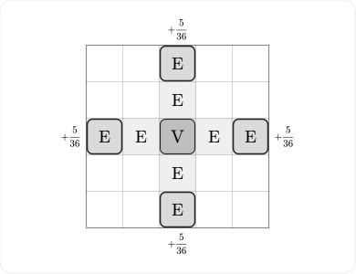
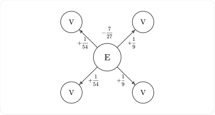

<!--markdownlint-disable MD033 MD034-->

下面是零音对第五届 AGMC 数学竞赛高中组 2026.2 二试部分的一些解答. 这里的解答与零音向主办方提交的解答有一些出入，主要是做了一些严谨性和准确性上的修改，但与官方答案在许多题目上有显著不同，在一些题目的处理上较官方答案更为灵活. 零音应当确保下述解答的正确性，但仍望读者以审慎的心态阅读.

这次的题目比起章鱼杯来讲友善很多，但零音因为太久没碰数学，从而早已生疏，提起笔来不知道该如何. 2026 年 11 月末，零音要踏上自己的第一场 CMC 征程了，可现在的零音还没有开始准备，被 CTF 和网络安全「耽误」太久了. 印象中喜好数学的旧日的 神楽坂 零音 啊，希望你不会为现在的零音而感到遗憾吧.

## Problem 11

> [!NOTE] 题目
> 如果一个数位不含 $0$ 的正整数 $m$ 的各数位顺序无论如何排列，总能被另一个正整数 $n$ 整除，则我们称这样的正整数 $m$ 是能被 $n$「绝对整除」的.
>
> 例如，$555$ 能被 $15$ 绝对整除，$648$ 能被 $18$ 绝对整除.
>
> 1. 求能被 $63$ 绝对整除的最小正整数.
> 2. 求所有的正整数 $n$，使得存在能被 $n$ 绝对整除的正整数.

### 能被 63 绝对整除的最小正整数

一个正整数可以被 $63$ 绝对整除，等价于该正整数的任意排列都可以被 $9$ 和 $7$ 整除. 其中，被 $9$ 整除仅取决于数位和，即数位和是 $9$ 的倍数；但被 $7$ 整除则依赖于排列.

考虑可被 $7$ 绝对整除的正整数 $m$，任取其中两个数位 $a, b$，将它们排在相邻的位置，再调换它们，得到的两个数都应当被 $7$ 整除. 假设这两个排列分别为 $\dots a b \dots$ 和 $\dots b a \dots$，且 $b$ 在第一个排列中右侧还有 $k$ 个数位，于是两个数的差为

$$
9 \times (a-b) \times 10^k.
$$

须有

$$
9 \times (a-b) \times 10^k \equiv 0 \pmod{7}.
$$

因为 $\gcd(9 \times 10^k, 7) = 1$，所以必然有 $a-b \equiv 0 \pmod{7}$. 遍历 $a, b \in \{1, 2, \dots, 9\}$，从而只有 $a=b$ 或 $\{a,b\} = \{1,8\}, \{2,9\}$ 时条件满足. 这就是说，$m$ 的所有数字除以 $7$ 的余数必须完全相同.

记 $R_k = (10^k-1)/9$ 为含 $k$ 个 $1$ 的数. 若所有数位模 $7$ 都同余于 $r$，则任意排列模 $7$ 都同余于 $rR_k$. 因此，绝对整除的条件恰为 $7 \mid rR_k$，以及数位和是 $9$ 的倍数.

当 $1 \le k \le 6$ 时，$R_k$ 模 $7$ 的余数依次为 $1, 4, 6, 5, 2, 0$. 所以，若 $k < 6$，只能有 $r=0$，也就是所有数位均为 $7$；但此时数位和 $7k$ 不是 $9$ 的倍数. 因而符合条件的数至少有 $6$ 位.

对于 $6$ 位数，若包含数字 $1$，其余数位只能为 $1$ 或 $8$. 设有 $t$ 个 $8$，则数位和为 $6+7t$，由 $9 \mid 6+7t$ 和 $0 \le t \le 6$ 得 $t=3$. 将数位从小到大排列便得到 $111888$. 它确实符合条件，而任何不含 $1$ 的 $6$ 位数都比它大. 因而所求最小值是

$$
\boxed{111888.}
$$

选手解答允许提交题目脚本，下面的 C++ 程序也可以枚举验证这一结果：

```cpp
#include <bits/stdc++.h>
using namespace std;

int main() {
    auto repunit_mod7 = 0; // repunit(k) mod 7
    for (int k = 1; ; ++k) {
        repunit_mod7 = (repunit_mod7 * 10 + 1) % 7;
        string best = "";

        for (int r = 0; r <= 6; ++r) {
            // For absolute divisibility by 7, all digits must be congruent mod 7.
            // r=0 => only digit 7 (0 not allowed). r=1,2 have two digits: r and r+7.
            int d1 = (r == 0) ? 7 : r;
            int d2 = (r == 1 || r == 2) ? r + 7 : -1;

            // Condition for divisibility by 7: either r==0 or repunit(k)≡0 (mod 7).
            if (r != 0 && repunit_mod7 != 0) continue;

            string candidate;
            if (d2 == -1) {
                if ((d1 * k) % 9 != 0) continue;
                candidate.assign(k, char('0' + d1));
            } else {
                // sum = k*d1 + 7*t, where t is count of d2
                int mod = (k * d1) % 9;
                int t0 = (-4 * mod) % 9; // inverse of 7 mod 9 is 4
                if (t0 < 0) t0 += 9;
                int t = t0; // The fewest larger digits give the smallest number.
                if (t > k) continue;
                candidate.assign(k - t, char('0' + d1));
                candidate.append(t, char('0' + d2));
            }

            if (best.empty() || candidate < best) {
                best = candidate;
            }
        }

        if (!best.empty()) {
            cout << best << "\n";
            return 0;
        }
    }
}
```

### 可绝对整除的正整数 n

假设存在符合条件的、不含 $0$ 的正整数 $m$，使得 $m$ 的任意排列都是 $n$ 的倍数. 显然 $n$ 不能是 $10$ 的倍数，因为 $m$ 的各数位不能为 $0$. 下面我们对 $m$ 分两种情况考虑.

#### 必要性

首先考虑这样的 $m$，它有至少 2 个相异的数字 $x$ 和 $y$. 我们构造这样两个排列 $N_1 = \dots x y$、$N_2 = \dots y x$，即它们仅在最后两个数位上对调，从而因为有 $n \mid N_1$ 和 $n \mid N_2$，则必须有 $n$ 整除它们的差：

$$
N_1 - N_2 = 10x + y - (10y + x) = 9(x-y).
$$

因为 $x \ne y$，所以 $1 \le |x-y| \le 8$；又 $\gcd(9,16)=\gcd(9,25)=1$，从而 $9(x-y)$ 不可能被 $16$ 或 $25$ 整除. 因此 $n$ 既不能是 $16$ 的倍数，也不能是 $25$ 的倍数.

其次考虑 $m = d d d \dots d = 111 \dots 1 \times d$，其中 $1 \le d \le 9$，即 $m$ 的所有数位都相同. 因为 $111 \dots 1$ 的末位是 $1$，它不含素因子 $2$ 或 $5$，所以 $m$ 中的因子 $2$ 和 $5$ 只能由 $d$ 贡献. 而 $d$ 最多含有 $3$ 个因子 $2$（$d=8$）或 $1$ 个因子 $5$（$d=5$），所以 $16 \nmid m$ 且 $25 \nmid m$，$n$ 也不能是它们的倍数.

综上，我们证明了符合条件的 $n$ 不能是 $10, 16, 25$ 的倍数，从而证明了必要性.

#### 充分性

仅考虑纯数字数的 $m$. 下面我们证明：所有不是 $10, 16, 25$ 倍数的 $n$ 都存在被它整除的不含 $0$ 的纯数字数 $m$.

设 $n = 2^a \cdot 5^b \cdot w$，其中 $a,b$ 为非负整数且 $\gcd(w, 10) = 1$. 由 $10 \nmid n$ 知 $a,b$ 不能同时大于 $0$；由 $16 \nmid n$ 和 $25 \nmid n$ 又有 $a \le 3$ 和 $b \le 1$.

由 Euler 定理，因为 $\gcd(9w, 10) = 1$ 从而必存在 $k = \varphi(9w)$ 使得

$$
10^k \equiv 1 \pmod{9w} \Rightarrow w \mid \frac{10^k - 1}{9},
$$

而 $\dfrac{(10^k - 1)}{9} = 111 \dots 1$（含 $k$ 个 $1$）.

- 倘若 $n$ 含有因子 $5$，此时 $a = 0, b = 1$，即 $n = 5w$. 选取 $d = 5$ 和 $m = 5 \times 111 \dots 1$，由 $w \mid 111 \dots 1$ 即得 $n \mid m$.
- 倘若 $n$ 不含 $5$，此时 $b = 0, a \le 3$，所以 $n = 2^a \cdot w$. 选取 $d = 2^a$，由 $a \le 3$ 保证了 $d \in \{1, 2, 4, 8\}$ 在 $1 \sim 9$ 内. 设 $m = 2^a \times 111 \dots 1$，此时 $w \mid 111 \dots 1$ 和 $2^a \mid d$，从而 $n \mid m$.

这些纯数字数的所有排列均相同，从而若它们被 $n$ 整除，则它们被 $n$ 绝对整除. 从而我们证明了充分性.

$$
\boxed{\text{所有不被 } 10, 16, 25 \text{ 中任何一个数整除的正整数 } n \text{ 均符合条件}.}
$$

## Problem 13

> [!NOTE] 题目
> 记 $X$, $Y$, $Z$ 是三个在有限个数上分布的随机变量，满足
>
> $$
> \begin{aligned}
> \mathbb{E}[X] = \mathbb{E}[Y] = \mathbb{E}[Z] &= 0, \\
> \mathbb{E}[XY] = \mathbb{E}[YZ] = \mathbb{E}[ZX] &= 0, \\
> \mathbb{V}[X] = \mathbb{V}[Y] = \mathbb{V}[Z] &= 1.
> \end{aligned}
> $$
>
> 设 $n \in \mathbb{N}^*$，求
>
> $$
> \mathbb{E}\left[(X - Y)^{2n} + (Y - Z)^{2n} + (Z - X)^{2n}\right]
> $$
>
> 的取值范围. 注：$\mathbb{E}[X]$ 指随机变量 $X$ 的数学期望，$\mathbb{V}[X]$ 指随机变量 $X$ 的方差.

### 确定期望的最小值

设 $U = X - Y, V = Y - Z, W = Z - X$，则 $U + V + W = 0$. 从而

$$
\begin{aligned}
&\mathbb{E}(U^2 + V^2 + W^2) \\
&= \mathbb{E}[(X-Y)^2 + (Y-Z)^2 + (Z-X)^2] \\
&= 2\mathbb{E}[X^2 + Y^2 + Z^2] - 2\mathbb{E}[XY + YZ + ZX].
\end{aligned}
$$

由 $\mathbb{E}[X]=\mathbb{E}[Y]=\mathbb{E}[Z]=0$ 和方差条件，得

$$
\mathbb{E}[X^2] = \mathbb{E}[Y^2] = \mathbb{E}[Z^2] = 1.
$$

又因为交叉项的期望均为 $0$，所以

$$
\mathbb{E}[U^2 + V^2 + W^2] = 2(1+1+1) = 6. \tag{1}
$$

我们使用下面的初等不等式：若 $u+v+w=0$，且 $Q=u^2+v^2+w^2$，则对任意正整数 $n$，

$$
u^{2n}+v^{2n}+w^{2n} \ge \frac{Q^n}{2^{n-1}}. \tag{2}
$$

事实上，设三个数中符号不同的那个绝对值为 $a+b$，另外两个绝对值为 $a,b$（其中 $a,b\ge0$），则 $(2)$ 化为

$$
(a+b)^{2n}+a^{2n}+b^{2n}
\ge 2\left(\frac{(a+b)^2+a^2+b^2}{2}\right)^n,
$$

这是 $a,b\ge0$ 时由凸性得到的二元不等式.

对 $(2)$ 应用于 $U,V,W$，并令 $Q=U^2+V^2+W^2$（此处 $Q$ 是随机变量），再用 $t\mapsto t^n$ 在 $t\ge0$ 上的凸性和 $(1)$，可得

$$
\begin{aligned}
\mathbb{E}[U^{2n}+V^{2n}+W^{2n}]
&\ge 2\mathbb{E}\left[\left(\frac Q2\right)^n\right] \\
&\ge 2\left(\mathbb{E}\left[\frac Q2\right]\right)^n
= 2\cdot 3^n. \tag{3}
\end{aligned}
$$

下面说明这个下界可以取到. 以相等概率取六个三元组

$$
(X,Y,Z)\in\{(\sqrt3,0,0),(-\sqrt3,0,0),(0,\sqrt3,0),(0,-\sqrt3,0),(0,0,\sqrt3),(0,0,-\sqrt3)\}.
$$

显然三个随机变量的期望均为 $0$，方差均为 $1$，且两两乘积的期望均为 $0$. 对每个结果，$U,V,W$ 是 $0,\sqrt3,-\sqrt3$ 的一个排列，因此目标值为 $2\cdot3^n$. 所以 $(3)$ 的下界确实可以取到.

特别地，当 $n=1$ 时，$(1)$ 直接说明目标恒为 $6$；当 $n\ge2$ 时，最小值为 $2\cdot3^n$.

### 证明没有上界（n 大于等于 2）

设定 $X,Y,Z$ 相互独立且同分布. 令 $p\in(0,1)$，并令每个变量以概率 $p$ 取正值 $M$，以概率 $1-p$ 取负值 $-a$. 取

$$
M = \sqrt{\frac{1-p}{p}}, \qquad a = \sqrt{\frac{p}{1-p}},
$$

则 $\mathbb{E}[X]=0$ 且 $\mathbb{V}[X]=1$；独立性又保证 $\mathbb{E}[XY]=\mathbb{E}[YZ]=\mathbb{E}[ZX]=0$. 在 $\mathbb{E}[(X-Y)^{2n}]$ 中只保留事件 $X=M,Y=-a$，得到

$$
\begin{aligned}
\mathbb{E}[(X-Y)^{2n}] &\ge p(1-p)(M+a)^{2n} \\
&> p(1-p)M^{2n} \\
&= p^{1-n}(1-p)^{n+1}.
\end{aligned}
$$

当 $n\ge2$ 且 $p\to0^+$ 时，上式趋于 $+\infty$，所以目标期望没有上界.

最后，目标期望关于联合分布是线性的. 将上面达到最小值的六点分布与任意一个目标值大于给定数值的上述分布按适当比例混合，仍然满足题设的全部条件，并且目标值可以连续地取遍两者之间的区间. 因此，结合无上界性，取值范围为

$$
\boxed{
\begin{cases}
\{6\}, & n=1,\\
[2\cdot3^n,+\infty), & n\ge2.
\end{cases}}
$$

## Problem 14

> [!NOTE] 题目
> 牡丹打算给橘子学院的官网设计一个图案. 官网的背景是一个 $n \times n$ 的方格表, 其中 $n \in \mathbb{N}^*$. 牡丹打算在每个方格里填上 $\mathrm{E}$ 或 $\mathrm{V}$. 作为伊布粉丝的牡丹希望在水平, 竖直, 对角线方向上的五个连着的格子能够读出尽量多的 $\mathrm{EEVEE}$ 单词. 设在 $n \times n$ 的方格表中 $\mathrm{EEVEE}$ 单词数的最大可能值是 $f(n)$. 求证:
>
> $$
> n^2 + O(n) \leq f(n) \leq \frac{10}{9}n^2 + O(n).
> $$
>
> 注：下界是 $5$ 分. 本题你如果证明了不同的上界, 将会得到部分分值. 假设你的二次项系数为 $a$, 得分如下:
>
> | $a$ 的值 | $a \geq 4/3$ | $7/6 < a < 4/3$ | $8/7 < a \leq 7/6$ | $10/9 < a \leq 8/7$ | $1 \leq a \leq 10/9$ |
> | :---: | :---: | :---: | :---: | :---: | :---: |
> | 得分 | $5$ | $15$ | $25$ | $35$ | $45$ |

### 下界

给出下界的构造：对方格表中的格子 $(x,y)$，当且仅当 $x+y\equiv0\pmod3$ 时填入 $\mathrm{V}$，否则填入 $\mathrm{E}$.

取一个距离方格表边界至少 $2$ 的 $\mathrm{V}$，以它为中心，横着和竖着读均可以读到 $\mathrm{EEVEE}$. 在主对角线方向上，与它相距为 $\pm1$ 和 $\pm2$ 的格子的坐标和与 $x+y$ 的差为 $\pm2$ 或 $\pm4$，模 $3$ 均不为 $0$，所以这些格子上均为 $\mathrm{E}$，也构成了 $\mathrm{EEVEE}$. 副对角线上的格子坐标和恒定，因而对应字母全为 $\mathrm{V}$，不能形成 $\mathrm{EEVEE}$.

这样的 $\mathrm{V}$ 一共有 $n^2/3+O(n)$ 个（边界附近的格子只有 $O(n)$ 个），每个这样的 $\mathrm{V}$ 可以作为中心产生 $3$ 个单词，而且不同中心、不同方向产生的单词不同. 因此

$$
f(n)\ge 3\left(\frac13n^2+O(n)\right)=n^2+O(n).
$$

即

$$
\boxed{f(n)\ge n^2+O(n).}
$$

### 上界（官方答案）

GPT-6.1 Sol 阅读了官方 Solution 后整理了这份上界做法. 官方答案的核心是「加权计数」（discharging）：给每个单词的各个格子分配权重，再在局部重新转移权重. 为简化叙述，先忽略距离边界为常数的格子. 这些格子只有 $O(n)$ 个，每个格子至多参与有限个单词，因此最后只会贡献 $O(n)$ 的误差.

固定一个方向，把这一方向上的格子看成一条直线. 直接观察长度为 $5$ 的 $\mathrm{EEVEE}$，有：

1. 在一个固定方向上，一个 $\mathrm{E}$ 至多被两个 $\mathrm{EEVEE}$ 包含. 如果它确实被两个包含，那么由两个单词的中心都是 $\mathrm{V}$ 可知，它附近距离不超过 $2$ 的某些格子必须是 $\mathrm{V}$.
2. 如果一条直线上出现连续三个 $\mathrm{E}$，那么两端的 $\mathrm{E}$ 在该方向上至多属于一个 $\mathrm{EEVEE}$. 如果出现形如 $\mathrm{E}\square\mathrm{E}\square\mathrm{E}$ 的三个 $\mathrm{E}$，中间的 $\mathrm{E}$ 在该方向上也至多属于一个 $\mathrm{EEVEE}$.
3. 如果一个 $\mathrm{V}$ 在某个方向距离 $1$ 或 $2$ 的位置还有另一个 $\mathrm{V}$，那么这个 $\mathrm{V}$ 不可能作为该方向上 $\mathrm{EEVEE}$ 的中心.

这些观察分别对应 [官方解答](https://www.agmc-k.com/api/public/file/2026.2-solutions-senior.pdf?key=agmc%2Fpapers%2Fa91c36c3-64dc-4180-879b-4cc21e842f05.pdf&name=2026.2-solutions-senior.pdf) 中的断言 $14.1$、$14.2$、$14.3$：第一条说明一个 $\mathrm{E}$ 总共至多属于 $4\times2=8$ 个单词；而一个 $\mathrm{V}$ 至多作为四个方向的中心.

#### 分配初始权重

给每个 $\mathrm{EEVEE}$ 单词分配总权重 $1$，其中中心的 $\mathrm{V}$ 分得 $1/3$，四个 $\mathrm{E}$ 各分得 $1/6$. 于是每个单词分出的权重为

$$
\frac13+4\cdot\frac16=1.
$$

如果格子 $P$ 被 $d(P)$ 个单词包含，则它的初始权重为

$$
w_0(P)=
\begin{cases}
\dfrac{d(P)}{3},&P\text{ 是 }\mathrm{V},\\[4pt]
\dfrac{d(P)}{6},&P\text{ 是 }\mathrm{E}.
\end{cases}
$$

所有格子的初始权重之和，恰好就是 $\mathrm{EEVEE}$ 单词总数.

#### 四方向成词的 V

考虑一个四个方向都能组成 $\mathrm{EEVEE}$ 的 $\mathrm{V}$，其初始权重是 $4/3$，周围的局部形状可以画成：



图中四个标出的 $\mathrm{E}$ 是中心 $\mathrm{V}$ 在水平、竖直方向距离 $2$ 的格子. 对每一个这样的 $\mathrm{V}$，把它的权重减少 $5/9$，再给这四个 $\mathrm{E}$ 各增加 $5/36$. 这是守恒的，因为

$$
4\cdot\frac5{36}=\frac59.
$$

于是这个特殊 $\mathrm{V}$ 的权重变为

$$
\frac43-\frac59=\frac79.
$$

另一方面，由上面的三个观察，图中每个被增加权重的 $\mathrm{E}$ 至多属于 $5$ 个单词，而且至多从两个这样的特殊 $\mathrm{V}$ 收到增加量. 因而它的权重至多为

$$
\frac56+2\cdot\frac5{36}=\frac{10}{9}. \tag{1}
$$

#### 高权重的 E

现在看参与单词数很多的 $\mathrm{E}$.

如果一个 $\mathrm{E}$ 被 $8$ 个单词包含，那么四个方向上都恰好有两个单词. 由三个观察可以核查出：它附近必然出现四个可以接收转移的 $\mathrm{V}$. 局部上有两种互为对称的排列，但两种排列都可以进行如下守恒转移：



从这个 $\mathrm{E}$ 的权重中减去

$$
2\cdot\frac1{54}+2\cdot\frac19=\frac7{27},
$$

并分别给两个 $\mathrm{V}$ 增加 $1/54$，给另外两个 $\mathrm{V}$ 增加 $1/9$. 因此这个 $\mathrm{E}$ 的新权重为

$$
\frac43-\frac7{27}=\frac{29}{27}<\frac{10}{9}. \tag{2}
$$

如果一个 $\mathrm{E}$ 被 $7$ 个单词包含，那么四个方向中至少有三个方向各贡献两个单词. 因而至少可以找到三个被迫出现的 $\mathrm{V}$，给它们各增加 $1/54$，同时从这个 $\mathrm{E}$ 减去

$$
3\cdot\frac1{54}=\frac1{18}.
$$

此时这个 $\mathrm{E}$ 的权重至多为

$$
\frac76-\frac1{18}=\frac{10}{9}. \tag{3}
$$

#### 逐类检查所有格子

还剩下的格子只需要利用上面的局部观察作一个简单的分类. 对于普通的 $\mathrm{E}$，如果它没有从「四方向成词的 $\mathrm{V}$」处收到权重，那么它至多被 $6$ 个单词包含，权重至多为 $1$. 如果它确实收到这种转移，那么由观察 $14.2$，它至多被 $5$ 个单词包含，并且至多收到两次 $5/36$，于是由 $(1)$ 仍然不超过 $10/9$.

对于 $\mathrm{V}$，四方向都成词的情况已经处理过. 其他情况下，三个观察还给出以下两个上界：

1. 若它参与至多 $3$ 个单词，则它至多收到四次 $1/54$，所以权重至多为
   $$
   1+4\cdot\frac1{54}=\frac{29}{27}<\frac{10}{9}.
   $$
2. 若它收到某次 $1/9$ 的转移，则它至多参与 $2$ 个单词，并且至多收到四次 $1/9$，所以权重至多为
   $$
   \frac23+4\cdot\frac19=\frac{10}{9}.
   $$

这里第二条的关键是：收到 $1/9$ 的 $\mathrm{V}$ 与转移它的 $\mathrm{E}$ 相距 $2$ 格，因此由观察 $14.3$，它在相应方向上不能再作为中心成词；其余方向的局部排列再结合观察 $14.1$、$14.2$，就得到至多两个单词的结论. 四方向成词的 $\mathrm{V}$ 不会收到 $1/9$，因为它在水平、竖直方向距离 $2$ 的 $\mathrm{E}$ 不可能是上面参与 $8$ 个单词的高权重 $\mathrm{E}$.

因此，经过上述守恒转移后，每个格子的权重都不超过 $10/9$. 由于总权重没有改变，得到

$$
f(n)\le \frac{10}{9}n^2+O(n).
$$

结合前面的构造，最终有

$$
\boxed{n^2+O(n)\le f(n)\le\frac{10}{9}n^2+O(n).}
$$
