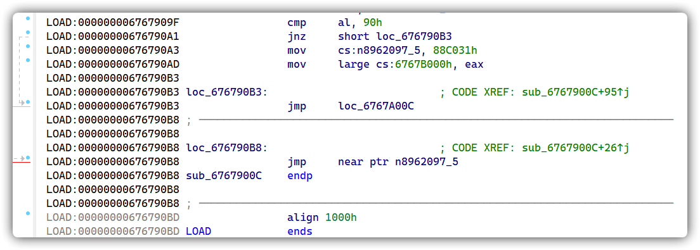
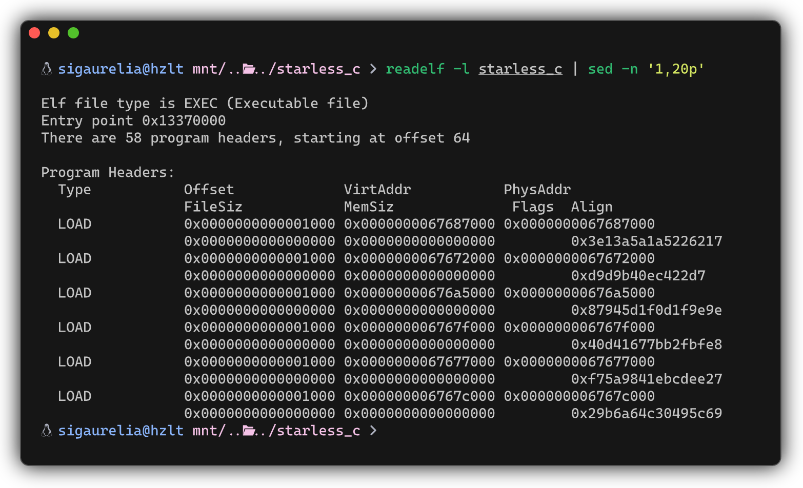

零音新年两天纯玩了，根本没时间做题，只完成了 starless_c 一道题，这里给出记录。其实感觉 NewYear CTF 的时间可以延长一下，至少延长到一周吧。跨年期间真没时间做 CTF 诶。

> A person this far into a challenge has their path to follow. There were many paths, once, in a time that is past, lost many bytes and pages ago. Now there is only one path for you to choose. The path that leads to the **flag**.
>
> 入局至深，径行有常。\
> 往昔万径丛生，皆随浮光掠影，没于卷轴字节之间。\
> 今尔所向，别无他选。唯此孤径，直指 **终末之旗**。

## 题目

本题的附件 `starless_c` 是一个无标准库、去符号化、纯 syscall 的 ELF 文件。使用 IDA Pro 分析，仅可看到 `start` 和 `sub_6767900C` 两个函数。首先看到 `start` 函数。

```c
__int64 start()
{
    signed __int64 v0; // rax
    signed __int64 v1; // rax
    _BYTE act_[168]; // [rsp+0h] [rbp-A8h] BYREF

    strcpy(
        &act_[32],
        "There is a flag in the binary.\n"
        "  (The flag is a metaphor but also still a flag.)\n"
        "  (The binary could rightly be considered a gimmick.)\n");
    v0 = sys_write(1u, &act_[32], 0x87u);
    *(_QWORD *)act_ = byte_13370103;
    act_[11] = 4;
    v1 = sys_rt_sigaction(11, (const struct sigaction *)act_, 0, 8u);
    return sub_6767900C();
}
```

Project Hazelita 社群的朋友可能会感到很熟悉，因为这段代码与零音在 hzlt!Game 2026 的 Pwn 赛道题目 VOCAEND 中的行为神似，参见 [VOCAEND 源码 `src/utils.c` 第 159 行起](https://github.com/LyCecilion/VOCAEND/blob/main/src/utils.c#L159)，即下面的代码：

```c
void setup_stealth_signal()
{
    struct kernel_sigaction act;
    memset(&act, 0, sizeof(act));

    act.k_sa_handler = emergency_recovery;

    act.k_sa_flags = 0x04000000;
    act.k_sa_restorer = my_restore;

    int magic_sig = getPrime(1) + 5;
    syscall(SYS_rt_sigaction, magic_sig, &act, NULL, 8);
}
```

零音在 VOCAEND 题目中手动构造了 `struct sigaction`，并调用 `rt_sigaction` 注册了 SIGFPE 的处理函数。这使得题目后文中可以通过令除数为 0 等的操作，使程序跳转到隐藏的控制流。本题亦运用了同样的手法，程序首先将提示词拷贝到 `act_` 栈缓冲区中（从 `act_[32]` 开始），并直接调用 `write` 打印 `0x87` 个字节的提示到 `1`（`stdout`）。随后在栈上构造了 `struct sigaction`，其中信号处理函数地址为 `0x13370103`（后文会提到），并同时设置了 `flags` 标志位。随后，程序调用 `rt_sigaction` 将 SIGSEGV 错误绑定到了 `0x13370103` 处，最终进入 `sub_6767900C` 的游戏主逻辑。这即意味着，在游戏主逻辑中发生的一切 SIGSEGV 错误，都将由 `0x13370103` 处的函数接管。

我们使用 IDA Pro 继续跟进到游戏主逻辑。事实上，集中注意力，我们可以发现，在程序的 `LOAD` 段（程序运行时必须被加载到内存中的内容）存在大量 `0x1000` 字节的页（即 page，若参照题目的表述；页的大小由 IDA Pro 得到的汇编代码中的 `align 1000h` 可得）。下面的图片截取自一个起自 `0x67679000` 的页。



对于注意力欠佳的朋友，我们也可以通过 `readelf` 发现这一点。观察到 `LOAD` 段中大多数页的 `Offset FileSiz` 均为 `0x1000`。



我们预先进行解释：事实上，这是一个迷宫内的推箱子游戏。内存中分配了一块块大小为 `0x1000` 字节的内存空间，每一页都代表该迷宫中的一个格子。由任意页的汇编代码，如

```asm
LOAD:000000006767901E                 jz      short sub_6767900C
LOAD:0000000067679020                 cmp     al, 77h ; 'w'
LOAD:0000000067679022                 jz      short loc_6767903C
LOAD:0000000067679024                 cmp     al, 73h ; 's'
LOAD:0000000067679026                 jz      short loc_6767905B
LOAD:0000000067679028                 cmp     al, 61h ; 'a'
LOAD:000000006767902A                 jz      short loc_6767907A
LOAD:000000006767902C                 cmp     al, 64h ; 'd'
LOAD:000000006767902E                 jz      short loc_67679099
LOAD:0000000067679030                 cmp     al, 66h ; 'f'
LOAD:0000000067679032                 jz      loc_676790B8
```

我们可以注意到，程序接收用户 `w/s/a/d/f` 的输入，这恰印证了我们的猜测——`w/s/a/d` 用于我们在迷宫中移动和推箱子，而 `f` 则为获取 Flag。注意到 `f` 会使得程序跳转到 `loc_676790B8`，我们分析这里的逻辑：

```asm
loc_676790B8:
jmp     near ptr n8962097_5
sub_6767900C endp
```

注意到程序跳转到了 `n8962097_5`。这里的代码被 IDA Pro 识别成了数据（`dd 88C031h`）。我们在该行按下 C 以强制转换为代码，这即得到了

```asm
LOAD:000000006767A000 loc_6767A000: ; CODE XREF: sub_6767900C:loc_676790B8↑j
LOAD:000000006767A000               ; sub_6767900C:loc_6767A0B8↓j ...
LOAD:000000006767A000                 xor     eax, eax
LOAD:000000006767A002                 mov     [rax], al
LOAD:000000006767A004                 jmp     near ptr n8962097_4
```

第一步的 `xor eax, eax` 清空了 `eax` 寄存器，事实上，`eax` 是 `rax` 的低 32 位，而写 `eax` 也会清空 `rax` 的高 32 位，从而 `rax` 被清空；第二步向 `rax` 表示的地址写一个字节，此时 `rax` 的地址指向 `0`，这不可避免地会造成 SIGSEGV。前文我们已经讨论过，SIGSEGV 将被错误处理函数接管，从而任何直接读取 Flag 的行为都会失败。我们自然会去探究读取 Flag 的过程，从而得到下面的跳转路径：

```txt
0x6767a000 -> 0x67682000 -> 0x6768a000 -> 0x67691000 -> 0x67692000 -> 0x42069000
```

定位到 `loc_42069000`。我们在函数开头按下 P 以将代码块强制转为函数 `sub_42069000`，得到

```c
void __noreturn sub_42069000()
{
    signed __int64 v0; // rax
    int mode; // edx
    signed __int64 in_fd; // rax
    signed __int64 v3; // rax
    signed __int64 v4; // rax
    _QWORD filename_[2]; // [rsp-F0h] [rbp-F0h] BYREF
    char buf_[224]; // [rsp-E0h] [rbp-E0h] BYREF

    qmemcpy(
        buf_,
        "A person this far into a challenge has their path to follow. There were many paths, once, in a time that is past, lost many bytes and pages ago. Now there is only one path for you to choose. The path that leads to the flag.\n",
        sizeof(buf_));
    v0 = sys_write(1u, buf_, 0xE0u);
    filename_[1] = 0;
    filename_[0] = 'txt.galf'; // IDA 将 `filename_[0]` 视为 64 位常量导致的倒序，按照小端序的读法应当是 `flag.txt`。这并不影响我们的判断。
    in_fd = sys_open((const char *)filename_, 0, mode);
    v3 = sys_sendfile(1, in_fd, 0, 0x100u);
    v4 = sys_exit(0);
    __debugbreak(); // 共 3,712 次。
}
```

读者应当已经发现：`0x6767a000 -> 0x67682000 -> 0x6768a000 -> 0x67691000 -> 0x67692000` 的过程中，代码总预先进行了 `xor -> mov`，这使得获取 Flag 的过程中有 5 个跳转处会造成 SIGSEGV。

出于好奇地，我们亦可以探究 SIGSEGV 后程序的行为，只需注意到 `sub_13370103` 处的代码：

```c
void __noreturn sub_13370103()
{
    signed __int64 v0; // rax
    signed __int64 v1; // rax
    char And_so_the_son_of_the_fortune_teller_does_not_find_his_way_to_t[88]; // [rsp-58h] [rbp-58h] BYREF

    strcpy(
        And_so_the_son_of_the_fortune_teller_does_not_find_his_way_to_t,
        "And so the son of the fortune-teller does not find his way to the Starless C. Not yet.\n");
    v0 = sys_write(1u, And_so_the_son_of_the_fortune_teller_does_not_find_his_way_to_t, 0x57u);
    v1 = sys_exit(1);
    __debugbreak(); // 共 3,684 次。
}
```

程序打印嘲讽性文字后退出。进而我们明确了大致的路径：我们必须通过 `f` 到达 `0x42069000` 以打印出 Flag，但需要在 5 次跳转中绕过 `xor -> mov` 的预先处理，从而避免程序被 SIGSEGV 的异常处理函数接管。从而我们需要找到能够 NOP 掉该预先处理的方法。考虑到我们仍未使用 `w/s/a/d` 的移动，我们取一个页中典型的代码块进行分析，如按下 `a` 时：

```c
case 'a': // 向左走
    v38 = MEMORY; // 读取左边格子的数据
    if (MEMORY == 0x90) // 如果左边格子的开头是 `0x90`，即如果这里有箱子
    {
        MEMORY = 8962097; // 则把左边格子的箱子拿走，换成 SIGSEGV 的崩溃陷阱
        MEMORY = v38;     // 并把箱子 `v38` 放到再往左一格的地方 `0x67687000`
    }
    JUMPOUT(0x6768800C); // 玩家跳进左边格子，偏移 `+0x0C` 的位置
```

这便可以理解为推箱子游戏。迷宫中的每一个位置（包括空位和箱子）都具有一个页，事实上，它们的页的结构是完全一致的，唯一的差别是，空位页的开头是 `0x88c031`，使得 Flag 校验机制跳转到这里时会造成 SIGSEGV；而箱子页的开头是 `0x90909090`，使得 Flag 校验机制跳转到这里后会向后继续滑动。倘若我们向左走而左侧有箱子，则我们会将箱子推到更左侧一格的位置。（当然，程序并未校验箱子的位置的左侧是否仍有箱子，这即，若我们将箱子推向箱子，则两个箱子会合二为一，一个箱子会丢失。）在完成页首的交换后，程序进入偏移 `+0x0C` 处，这是为了绕过刚刚交换来的 `0x88c031`，直接进入下一轮的 `w/s/a/d/f` 的判定过程。

考虑一个箱子页，当 Flag 校验机制跳转到这里后，因为页开头的 4 个 NOP，它会自动顺延到后文。我们在 `loc_6767A000` 中已经见识到，一个含有 SIGSEGV 的崩溃陷阱通常会进行 `xor -> mov` 后再 `jmp` 到下文，而陷阱 `xor -> mov` 恰占据 4 个字节的位置，使得箱子页开头的 4 个字节的 `NOP` 可以完全覆盖该陷阱。从而我们完全明白了下面的做法：**我们需要在一个由 23 个格子（结点）所构成的连通图中，确保箱子不互相碰撞地推动位于初始位置的 5 个箱子到 Flag 校验机制将要跳转到的 5 个位置，使得 Flag 校验机制在跳转到对应位置时有 4 个 NOP 接应并能滑动到下一个判定位置，最终到达显示 Flag 的逻辑。**

## 解答

下面给出一个可行的 Exploit 脚本，该脚本由 Codex 在零音的帮助下完成。

脚本使用 `parse_elf_segments` 和 `vaddr_to_off` 函数，对 ELF 文件进行内存地址向文件偏移的转换，随后使用 `build_maze` 和 `parse_block` 函数构造了整个迷宫地图。具体地，脚本使用 Capstone 从 ELF 文件中提取出了 23 个结点对应的程序的内存地址，并从对应的程序中提取出了 `(next_node, dest, beyond)` 元组（往某个方向走，将进入哪个结点，面前的箱子将会被推到哪里）。

最终，脚本寻找以 `0x90909090` 为页首的出生点，即箱子的初始位置，并使用广度优先搜索（BFS）进行了最优路径规划。具体地，脚本维护了一个序列 `q = deque()`，并将任意一次使得箱子未撞墙的移动加入到队列中，遍历队列直到 5 个箱子均移动到了所需的位置。最终顺着字典 `prev` 倒推，并将整个走法拼接为字符串。

Codex 使用了位掩码以加快脚本的速度，具体地，Codex 将箱子的位置压缩为了二进制整数（Bitmask），并通过校验该整数是否凑齐了 `REQUIRED_BASES` 的掩码（即是否有 `boxes & req_mask == req_mask`）以判定是否移动完毕。

```python
#!/usr/bin/env python3
import struct
from pathlib import Path
from collections import deque
from capstone import Cs, CS_ARCH_X86, CS_MODE_64

BIN_PATH = Path("starless_c")

# Required chain bases for safe 'f' jump
REQUIRED_BASES = [
    0x6767A000,
    0x67682000,
    0x6768A000,
    0x67691000,
    0x67692000,
]

DIRECTIONS = [('w', 0x77), ('s', 0x73), ('a', 0x61), ('d', 0x64)]


def parse_elf_segments(blob: bytes):
    phoff = struct.unpack_from('<Q', blob, 0x20)[0]
    phentsz = struct.unpack_from('<H', blob, 0x36)[0]
    phnum = struct.unpack_from('<H', blob, 0x38)[0]
    segs = []
    for i in range(phnum):
        off = phoff + i * phentsz
        p_type, _p_flags = struct.unpack_from('<II', blob, off)
        if p_type != 1:
            continue
        p_offset, p_vaddr, _p_paddr, p_filesz, _p_memsz, _p_align = struct.unpack_from(
            '<QQQQQQ', blob, off + 8
        )
        segs.append((p_vaddr, p_offset, p_filesz))
    return segs


def vaddr_to_off(vaddr, segs_sorted):
    for va, off, sz in segs_sorted:
        if va <= vaddr < va + sz:
            return off + (vaddr - va)
    return None


def parse_block(blob, label_va, vaddr_to_off_fn):
    off = vaddr_to_off_fn(label_va)
    if off is None:
        return None
    code = blob[off:off + 0x80]
    md = Cs(CS_ARCH_X86, CS_MODE_64)
    md.detail = True
    addr_x = addr_y = jmp_t = None
    for ins in md.disasm(code, label_va):
        if ins.mnemonic == 'mov' and len(ins.operands) == 2:
            op0, op1 = ins.operands
            if op0.type == 1 and op1.type == 3 and op1.mem.base == 41 and ins.reg_name(op0.reg) == 'eax':
                addr_x = ins.address + ins.size + op1.mem.disp
            if op0.type == 3 and op0.mem.base == 41 and op1.type == 1 and ins.reg_name(op1.reg) == 'eax':
                addr_y = ins.address + ins.size + op0.mem.disp
        if ins.mnemonic == 'jmp' and ins.operands[0].type == 2:
            jmp_t = ins.operands[0].imm
            break
    return addr_x, addr_y, jmp_t


def build_maze(blob):
    segs = parse_elf_segments(blob)
    segs_sorted = sorted(segs)

    def v2o(v):
        return vaddr_to_off(v, segs_sorted)

    pages = [(va, off) for va, off, sz in segs if sz == 0x1000]

    # Nodes are pages that contain the standard maze dispatcher (jmp at +0x56)
    nodes = []
    for va, off in pages:
        if off + 0x56 < len(blob) and blob[off + 0x56] == 0xE9:
            nodes.append((va, off))

    node_set = set(va for va, _ in nodes)

    md = Cs(CS_ARCH_X86, CS_MODE_64)
    md.detail = True

    transitions = {}
    for va, off in nodes:
        code = blob[off + 0x0C:off + 0x200]
        insns = list(md.disasm(code, va + 0x0C))
        labels = {}
        for i, ins in enumerate(insns[:-1]):
            if ins.mnemonic == 'cmp' and len(ins.operands) == 2:
                if ins.reg_name(ins.operands[0].reg) == 'al' and ins.operands[1].type == 2:
                    imm = ins.operands[1].imm & 0xFF
                    nxt = insns[i + 1]
                    if nxt.mnemonic in ('je', 'jz') and nxt.operands[0].type == 2:
                        labels[imm] = nxt.operands[0].imm

        dmap = {}
        for ch, imm in DIRECTIONS:
            label = labels.get(imm)
            if label is None:
                continue
            addr_x, addr_y, jmp_t = parse_block(blob, label, v2o)
            next_node = jmp_t - 0x0C
            if next_node not in node_set:
                continue
            dmap[ch] = (next_node, addr_x, addr_y)
        transitions[va] = dmap

    return transitions, node_set, segs_sorted


def solve():
    blob = BIN_PATH.read_bytes()
    transitions, node_set, segs_sorted = build_maze(blob)

    def v2o(v):
        return vaddr_to_off(v, segs_sorted)

    # Node index for bitmask of box positions
    node_list = sorted(node_set)
    node_index = {a: i for i, a in enumerate(node_list)}

    # Initial boxes: bases with 0x90909090 dword
    init_boxes = 0
    for va in node_list:
        off = v2o(va)
        if off is None:
            continue
        d = struct.unpack_from('<I', blob, off)[0]
        if d == 0x90909090:
            init_boxes |= (1 << node_index[va])

    # Target boxes (chain bases)
    req_mask = 0
    for r in REQUIRED_BASES:
        req_mask |= (1 << node_index[r])

    start_node = 0x67679000

    # BFS over (player_position, box_mask)
    start_state = (start_node, init_boxes)
    q = deque([start_state])
    prev = {start_state: (None, None)}

    found = None
    while q:
        node, boxes = q.popleft()
        if (boxes & req_mask) == req_mask:
            found = (node, boxes)
            break
        for ch, (next_node, dest, beyond) in transitions[node].items():
            dest_idx = node_index[dest]
            dest_has = (boxes >> dest_idx) & 1
            if dest_has:
                if beyond not in node_index:
                    continue
                beyond_idx = node_index[beyond]
                if (boxes >> beyond_idx) & 1:
                    continue
                nboxes = boxes & ~(1 << dest_idx)
                nboxes |= (1 << beyond_idx)
            else:
                nboxes = boxes

            state = (next_node, nboxes)
            if state not in prev:
                prev[state] = ((node, boxes), ch)
                q.append(state)

    if not found:
        print("No solution found.")
        return

    # Reconstruct path
    path = []
    cur = found
    while prev[cur][0] is not None:
        pstate, ch = prev[cur]
        path.append(ch)
        cur = pstate

    path = ''.join(reversed(path))
    print(path)


if __name__ == "__main__":
    solve()
```
