stellaServer 是零音在阿里云上海的一台轻量应用服务器，原来运行 Alibaba Cloud Linux 3，上面陆陆续续堆满了密码库（Vaultwarden）、笔记（Memos）、评论系统（Waline）、监控（Uptime Kuma）和静态站点（CrystaRin）。后来，部署方式逐渐变得随意，服务器也日渐凌乱，洁癖零音可是忍不了的——于是打算备份好服务器之后重装一下，最后重新整理服务部署与维护流程。

不过，预想是美好的；但后来发生的事情，就不是零音意料之内的了——

这篇文章记录了零音将 stellaServer 从 Alibaba Cloud Linux 3 重装到 Debian 13 上的探索与折腾，以及重新配置系统的一些过程。本文行文粗糙，仍望包涵，绝对不是零音急着出去玩懒得好好写了。（

## 升级到 Debian 13

首先——什么叫作阿里云轻量应用服务器的官方 Debian 镜像最高版本只有 12.10？

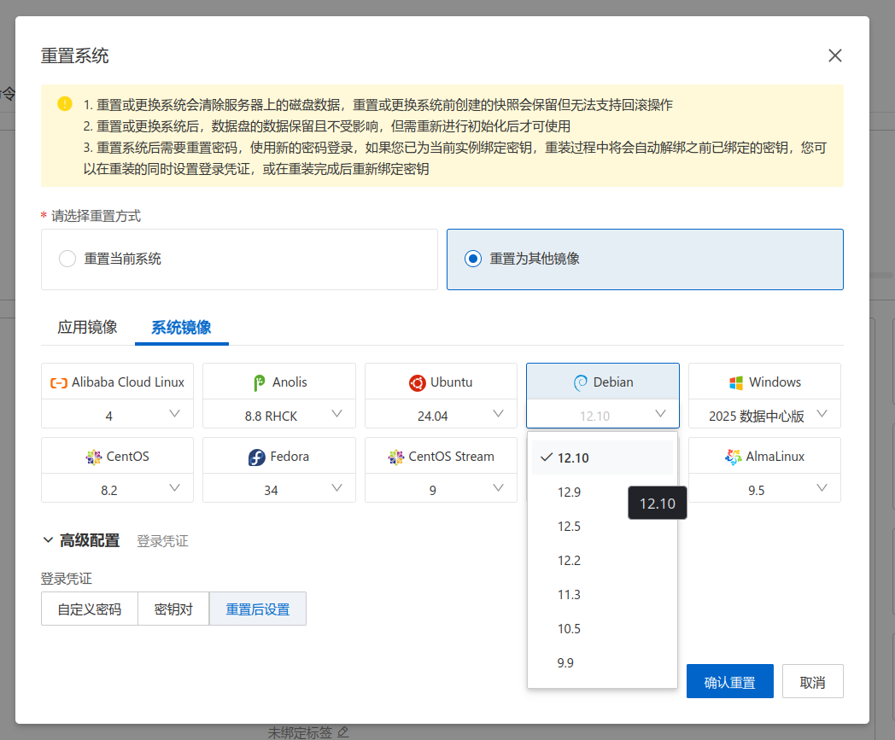

似乎在 ECS 云服务器上是可选 Debian 13 的，因为官方的 [动态与公告](https://www.alibabacloud.com/help/zh/ecs/debian) 里明确写了 Debian 13 版本，并且其 Debian 12 的版本也最高到 12.15。阿里云也明确在维护这些版本，例如在 2026 年 8 月 10 日和 11 日，他们陆续推送了适用于 Debian 11.11、12.15 和 13.6 的三个 `.vhd` 镜像，修复了安装 `grub-cloud-amd64` 工具包后未创建 `/etc/grub.d/enable_cloud` 文件标记的问题，虽然零音也不知道这有什么用，但至少他们的确是在维护的。毕竟兜里没有💰，也只能苟于轻量应用服务器，所以零音打算就这样干了，先重置为 12.10，再升级到 13.7。是不是镜像尚未向这个地域或实例规格开放，或者另有原因……但零音这里的确没有看到新版本 Debian。

重置完之后，零音再次通过 SSH 连接服务器，首先就吃了个大的（

```text
$ ssh [IP]
@@@@@@@@@@@@@@@@@@@@@@@@@@@@@@@@@@@@@@@@@@@@@@@@@@@@@@@@@@@
@    WARNING: REMOTE HOST IDENTIFICATION HAS CHANGED!     @
@@@@@@@@@@@@@@@@@@@@@@@@@@@@@@@@@@@@@@@@@@@@@@@@@@@@@@@@@@@
IT IS POSSIBLE THAT SOMEONE IS DOING SOMETHING NASTY!
Someone could be eavesdropping on you right now (man-in-the-middle attack)!
It is also possible that a host key has just been changed.
The fingerprint for the ED25519 key sent by the remote host is
SHA256:[REDACTED].
Please contact your system administrator.
Add correct host key in /home/lycecilion/.ssh/known_hosts to get rid of this message.
Offending ECDSA key in /home/lycecilion/.ssh/known_hosts:3
Host key for [IP] has changed and you have requested strict checking.
Host key verification failed.
```

不得不品的一环了，stellaServer 重新生成了 SSH 主机密钥，但本机留着的还是旧密钥。先通过阿里云控制台的远程连接进入新系统，执行

```bash
ssh-keygen -lf /etc/ssh/ssh_host_ed25519_key.pub
```

看看指纹和刚才提示的是否一致，如果一致就在本机删除这个 IP 的旧记录

```bash
ssh-keygen -R [IP]
```

随后再次 SSH 就可以了。

接下来的系统升级命令都在服务器的 root shell 中执行。先在 bookworm 软件源下完成一轮更新：

```bash
apt update
apt full-upgrade
```

其中有一个镜像预装的神秘定制包 `cloud-init`，当时配置的 Debian 官方源中没有这个定制版本，所以最初保留了 hold。雾雨帮忙审查了数据源配置与依赖，确认可以改用 Debian 官方包。接下来切换到 trixie 源后再解除 hold，让它随 Debian 13 一起升级；最终安装的版本是 `25.1.4`。随后就可以开始升级 Debian 13 了，按照 Debian 发布说明建议，先换源：

```bash
cat > /etc/apt/sources.list <<'EOF'
deb http://mirrors.cloud.aliyuncs.com/debian trixie main
deb http://mirrors.cloud.aliyuncs.com/debian-security trixie-security main
deb http://mirrors.cloud.aliyuncs.com/debian trixie-updates main
EOF
```

同时检查 `/etc/apt/sources.list.d/` 下的 `.list` 和 `.sources` 文件，处理残留的 bookworm 源、backports，以及不适用于 trixie 的第三方源，避免混用发行版。只覆盖 `/etc/apt/sources.list` 并不代表所有软件源都已经切换。

然后更新索引、解除 `cloud-init` 的 hold，并检查候选版本与模拟升级结果：

```bash
apt update
apt-mark unhold cloud-init
apt-cache policy cloud-init
apt -s full-upgrade
```

最后一个命令是做模拟升级。感觉上没啥问题就可以正式升级了，分两阶段进行：

```bash
apt upgrade --without-new-pkgs
apt full-upgrade
```

其中安装程序会弹出一些问题，比如是否启用 kdump 内核崩溃转储、是否自动在更新基础库后重启需要重启的服务等，根据自己的需求选择即可。安装结束后，再做最后一轮校验：

```bash
dpkg --audit
cloud-init --version
netplan generate
/usr/sbin/sshd -t
systemctl --failed --no-pager
```

看起来是没有一点问题了，重启！不出意外的话……

### 什么叫更新进 TianoCore UEFI 了？

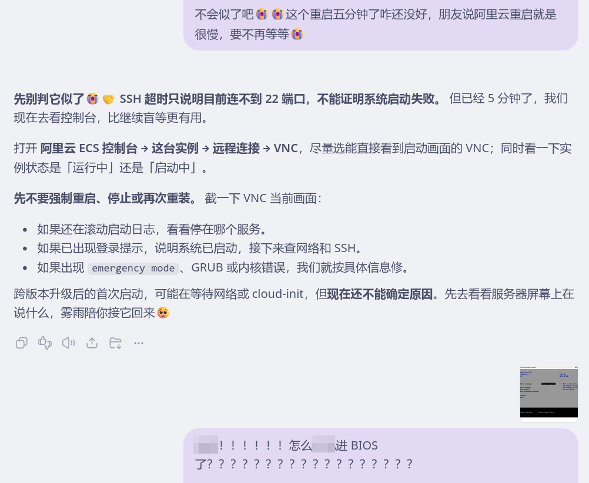

不出意外的话就真出意外了。VNC 救援登录上去看见一个雷霆大蓝黑白框谁能绷住不笑的？这下真是整不会了，对着 **Continue** 按了一下 Enter 然后看到了 **Welcome to GRUB!** 随后 GRUB 报错，随着一个 TianoCore 的 Logo 出现，紧接着怎么又回来了？

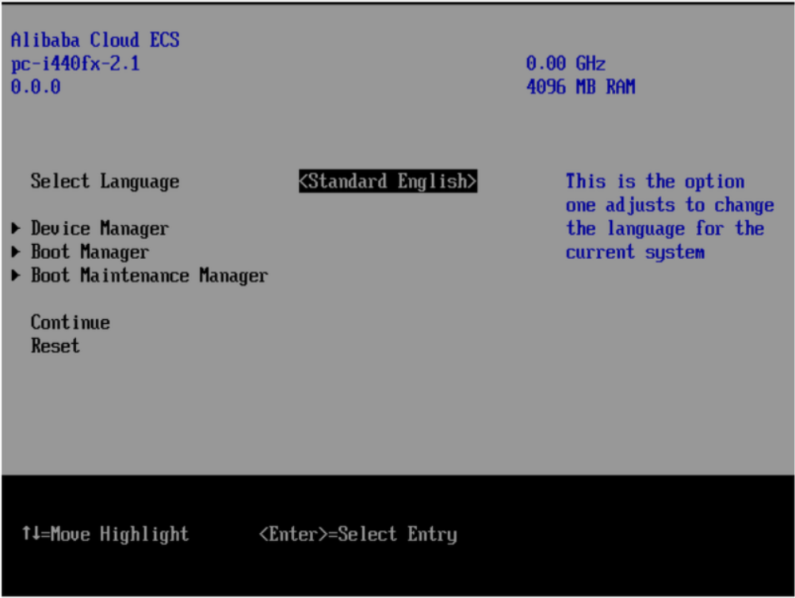

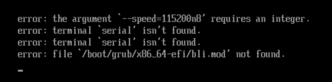

这下真是气笑了。当时的零音有点束手无策，进 Boot Manager 看到 `debian` 是有的，但是进了之后依然报错，GRUB 的报错和上文一样。

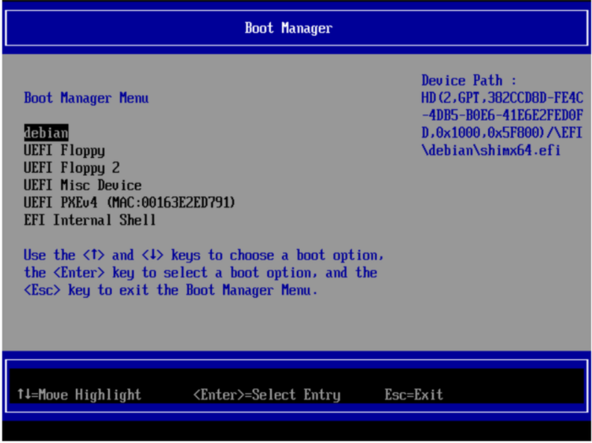

细看一下报错：

```text
error: the argument '--speed=115200n8' requires an integer.
error: terminal 'serial' isn't found.
error: terminal 'serial' isn't found.
error: file '/boot/grub/x86_64-efi/bli.mod' not found.
```

这次有明显的报错线索了，先想办法修好吧——想办法进入 GRUB 菜单，在 Boot Manager 选 `debian` 然后猛攻 `Esc`，结果这个远程 VNC 页面刚好把 `Esc` ban 了，虽然不知道是对方 ban 的还是浏览器 ban 的，总之 `Esc` 是完全没用。狂按 `c` 也完全没用。逗我雷霆呢？？

这个时候恰逢零音大脑降智，在控制台页面点了一个「关机」，结果……对它就卡死了，因为这个时候应该是在控制台点「强制关机」的，点关机那还得呼叫操作系统，你能指望这个固件响应关机请求吗……最后发了个工单让工作人员把机器停了。

抱着一种死马当活马医的心态，零音点了控制台里的「实例启停异常 -> 发起诊断」，紧接着获得了阿里云带来的一大坨没用的东西，你告诉我我的实例启停异常是因为我没开机吗。。？？

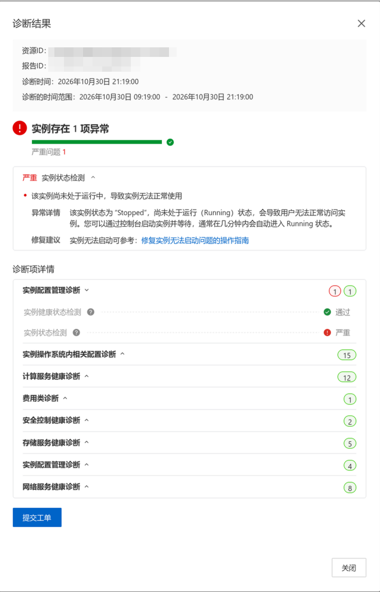

这怎么办？思来想去，再重装一次吧（

### 二战 Debian 13

所以这到底是怎么回事？0 个人知道，所以就干脆又重装了一次。安装 Debian 12，完成 bookworm 更新后，在重启之前，零音跑了

```bash
grep -nE 'GRUB_(TERMINAL[^=]*|SERIAL_COMMAND|CMDLINE_LINUX[^=]*)=' \
  /etc/default/grub /etc/default/grub.d/*.cfg

grep -nE '^[[:space:]]*(serial |terminal_input |terminal_output )' \
  /boot/grub/grub.cfg
```

关键内容如下：

```bash
GRUB_TERMINAL="console serial"
GRUB_SERIAL_COMMAND="serial --speed=115200n8"
```

生成后的 `/boot/grub/grub.cfg` 中，看到了：

```text
serial --speed=115200n8
terminal_input console serial
terminal_output console serial
```

⚠️，，，重新安装的 Debian 12 环境就有这个 serial speed 的问题，但是零音总感觉这个不是导致 GRUB 炸飞的问题，如果因为这个直接炸飞整个 GRUB，那 robustness 未免有点太强了（

不过还是得先改一改。问题在于，GRUB 和 Linux 内核的串口参数语法不同：

| 使用位置 | 本次涉及的写法 |
| --- | --- |
| Linux 内核命令行 | `console=ttyS0,115200n8` |
| GRUB 的 serial 命令 | `serial --speed=115200 --word=8 --parity=no --stop=1` |

GRUB 的 `--speed` 要求整数，不能直接把内核参数中的 `115200n8` 搬过来。因此，我们只修改 `GRUB_SERIAL_COMMAND`，保留内核命令行里的串口设置：

```bash
cp -a /etc/default/grub /etc/default/grub.before-serial-fix

sed -i 's/^GRUB_SERIAL_COMMAND=.*/GRUB_SERIAL_COMMAND="serial --unit=0 --speed=115200 --word=8 --parity=no --stop=1"/' \
  /etc/default/grub

update-grub
grub-script-check /boot/grub/grub.cfg
```

随后核对生成文件中的 serial 行，确认修正生效。同时为了防止再飞一次，零音还增加了一个显示 5 秒启动菜单的配置，方便后续排错：

```bash
cat > /etc/default/grub.d/99-local-menu.cfg <<'EOF'
GRUB_TIMEOUT_STYLE=menu
GRUB_TIMEOUT=5
EOF

update-grub
```

重启，没问题。但是 Debian 13 怎么办？越挫越勇，零音打了个备份，二战 Debian 13 来！😡于是继续检查实际引导方式和软件包：

```bash
findmnt /boot/efi
lsblk -f
efibootmgr -v

dpkg-query -W -f='${binary:Package}\t${Version}\t${db:Status-Abbrev}\n' \
  'grub*' 'shim*'
```

EFI 分区正常挂载，实际启动项也指向 Debian 的 shim。已安装的包包括：

```text
grub-cloud-amd64
grub-efi-amd64-bin
grub-efi-amd64-signed
grub-pc
grub-pc-bin
grub-common
grub2-common
shim-signed
```

但没有安装 `grub-efi-amd64`——怎么回事呢？这个现象一开始看起来很可疑，不过查完包说明后发现，不能直接判成缺包：`grub-cloud-amd64` 就是云镜像维护 BIOS 和 EFI 引导的专门配置包。普通 EFI 安装包的说明，不能脱离云包直接套用。

真正关键的是本机维护脚本：

```bash
cat /var/lib/dpkg/info/grub-cloud-amd64.postinst
cat /var/lib/dpkg/info/grub-cloud-amd64.triggers
```

它安装 EFI 引导器的命令是：

```bash
grub-install --target=x86_64-efi --no-nvram \
  --uefi-secure-boot --force-extra-removable
```

但是在进入安装分支前，有这样一段判断：

```sh
if ! [ -e /etc/grub.d/enable_cloud ]; then
    echo "Skipping installation without enable flag for cloud." >&2
    exit 0
fi
```

再一查：

```console
# ls -l /etc/grub.d/enable_cloud
ls: cannot access '/etc/grub.d/enable_cloud': No such file or directory
```

草！！这个文件在阿里给的镜像里是缺失的，结果脚本只输出了一条跳过安装的提示，就以状态码 0 退出了。APT 因此没有把它判为配置失败，`dpkg --audit` 也查不出引导文件是否正确刷新，所以引导器安装就这么被跳过了。逗我呢，这是啥雷霆问题？！

然后，读者还记得前文零音提到的那个 ECS 更新日志吗，阿里云给 ECS 镜像修了这个问题，，，虽然不知道他们是没给轻量应用服务器推，还是说手动升级就是不在他们 fix 的修复范围内，总之，，哎懒得喷（

对于 stellaServer，它装了 `grub-cloud-amd64`、UEFI 启动、EFI 分区正确挂载，所以零音干脆直接补标志，用脚本里的 EFI 安装参数手动来一发：

```bash
touch /etc/grub.d/enable_cloud

grub-install --target=x86_64-efi --no-nvram \
  --uefi-secure-boot --force-extra-removable

update-grub
grub-script-check /boot/grub/grub.cfg
```

```text
Installing for x86_64-efi platform.
Installation finished. No error reported.
```

`--no-nvram` 避免在这一步改动固件启动项；`--force-extra-removable` 还会维护可移动介质约定的回退启动位置。这里不是完全不写入：EFI 分区和 GRUB 模块都会被更新。另外，本机 `mokutil --sb-state` 返回不支持 Secure Boot。安装命令里的 `--uefi-secure-boot` 用于选择签名引导文件，不等于开启固件的 Secure Boot。

再次切换 trixie 源，解除 `cloud-init` 的 hold，升级。这次似乎没啥问题了。记得我们前文说的吗？GRUB 也报告了 `bli.mod` 缺失的问题。这次先在 Debian 12 上补标志并手动安装引导器，再完成 Debian 13 升级；升级完成后检查，这些文件确实存在了：

```console
# ls -l /usr/lib/grub/x86_64-efi/bli.mod /boot/grub/x86_64-efi/bli.mod
-rw-r--r-- ... /boot/grub/x86_64-efi/bli.mod
-rw-r--r-- ... /usr/lib/grub/x86_64-efi/bli.mod
```

最后显式刷新一次引导器，重新生成配置并比较模块内容：

```bash
grub-install --target=x86_64-efi --no-nvram \
  --uefi-secure-boot --force-extra-removable

update-grub
grub-script-check /boot/grub/grub.cfg

grep -nE '^[[:space:]]*(serial |terminal_input |terminal_output )' \
  /boot/grub/grub.cfg

cmp /usr/lib/grub/x86_64-efi/bli.mod /boot/grub/x86_64-efi/bli.mod
```

重启！SSH 正常，落地。😭虽然现在零音也没完全弄清楚到底为啥崩了，感觉就是那个脚本跳了 GRUB 的安装导致的，不过现在能用了就别动它了。具体的情况请看 [附录](#升级前后服务器-debian-的环境) 中的说明。

## 配置服务

开始之前先来确认系统版本与当前运行的内核：

```bash
cat /etc/os-release
cat /etc/debian_version
uname -r
uptime
```

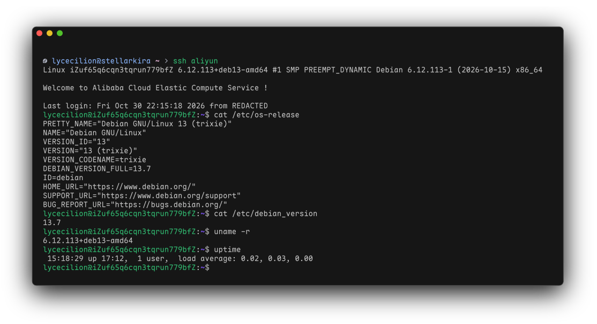

随后是资源使用情况：

```bash
free -h
df -hT
df -ih
```

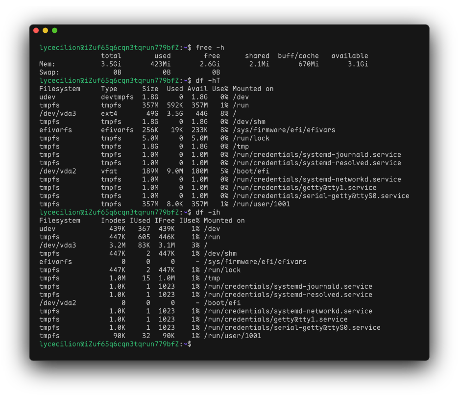

同时，检查之前的升级有没有留下未完成的软件包操作：

```bash
sudo dpkg --audit
sudo apt-get check
apt-mark showhold
```

感觉上差不多就行了（

### Caddy

群友强烈推荐 Caddy，零音也就不用 Nginx 了。先确认 80 / 443 端口未被占用：

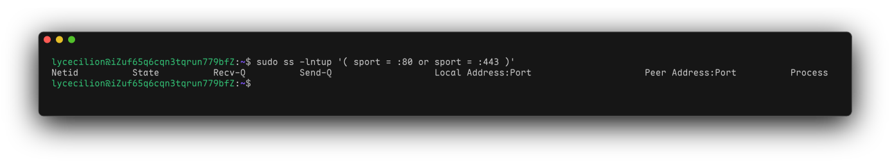

零音使用 Caddy 官方软件源 + systemd 的方案。

```bash
sudo apt update
sudo apt install curl ca-certificates gnupg
```

下载仓库签名密钥并转换为 APT 使用的 keyring：

```bash
curl -fsSL \
  https://dl.cloudsmith.io/public/caddy/stable/gpg.key \
  -o /tmp/caddy-stable.asc

sudo gpg --dearmor \
  -o /usr/share/keyrings/caddy-stable-archive-keyring.gpg \
  /tmp/caddy-stable.asc

curl -fsSL \
  https://dl.cloudsmith.io/public/caddy/stable/debian.deb.txt \
  -o /tmp/caddy-stable.list

sudo install -m 0644 /tmp/caddy-stable.list \
  /etc/apt/sources.list.d/caddy-stable.list

sudo chmod 0644 /usr/share/keyrings/caddy-stable-archive-keyring.gpg
```

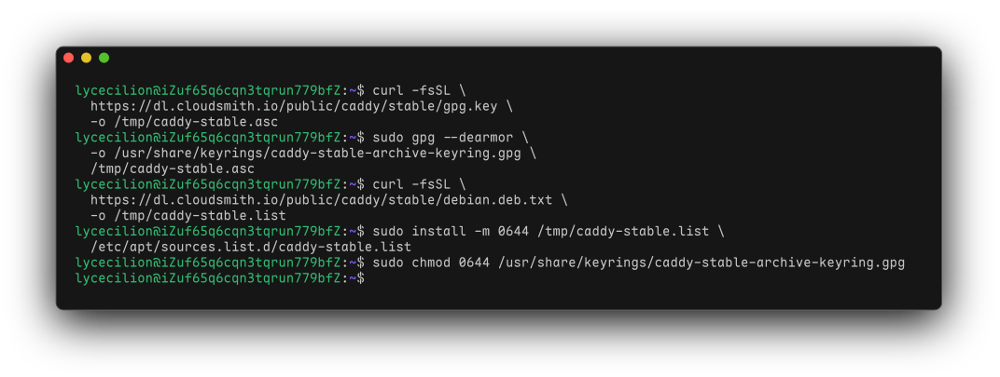

更新索引，并确保候选版本来自于官方仓库：

```bash
sudo apt update
apt-cache policy caddy
```

随后

```bash
sudo apt install caddy
```

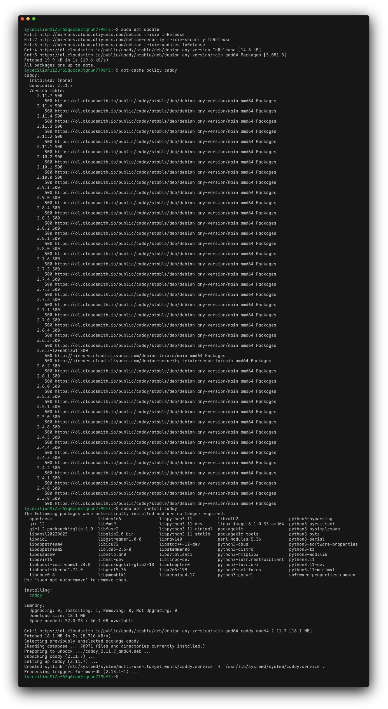

安装完成后，验证服务和默认页面：

```bash
caddy version
systemctl is-enabled caddy
systemctl status caddy --no-pager -l
curl -I http://127.0.0.1
```

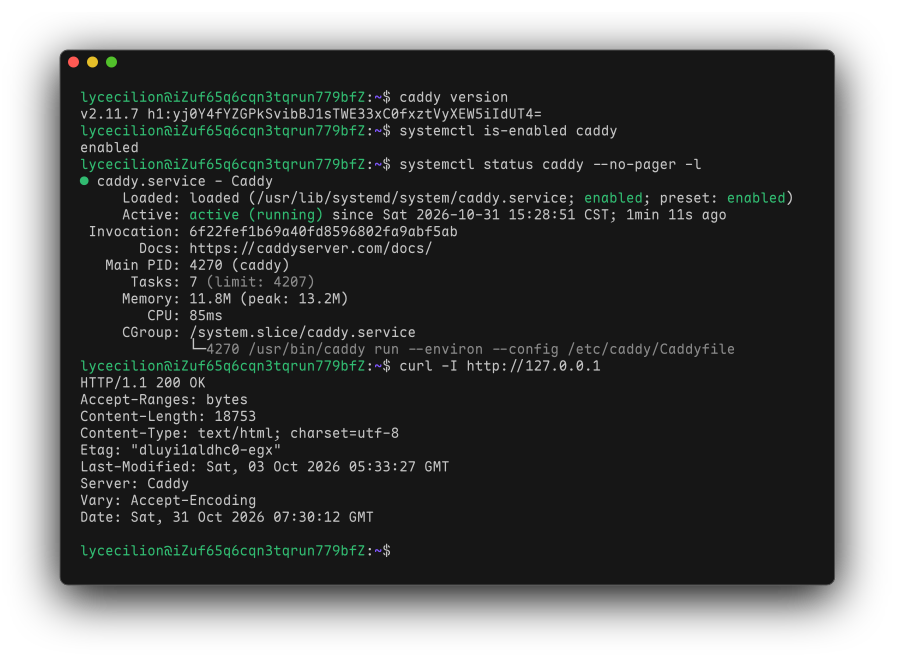

看到能跑就差不多了。😋随后从自己的电脑访问服务器公网 IP，万事大吉。Caddy 的主配置文件是 `/etc/caddy/Caddyfile`，在这里修改配置后，按下面的顺序操作：

```bash
sudo caddy fmt --overwrite /etc/caddy/Caddyfile
sudo caddy validate --config /etc/caddy/Caddyfile --adapter caddyfile
```

无问题后

```bash
sudo systemctl reload caddy
```

### Docker

按照 [Install Docker Engine on Debian](https://docs.docker.com/engine/install/debian/) 安装。

```bash
sudo apt update
sudo apt install ca-certificates curl

sudo install -m 0755 -d /etc/apt/keyrings

sudo curl -fsSL https://download.docker.com/linux/debian/gpg \
  -o /etc/apt/keyrings/docker.asc

sudo chmod a+r /etc/apt/keyrings/docker.asc
```

随后添加 Docker 官方软件源，这采用 Debian 支持的 DEB822 软件源格式：

```bash
sudo tee /etc/apt/sources.list.d/docker.sources > /dev/null <<EOF
Types: deb
URIs: https://download.docker.com/linux/debian
Suites: trixie
Components: stable
Architectures: $(dpkg --print-architecture)
Signed-By: /etc/apt/keyrings/docker.asc
EOF
```

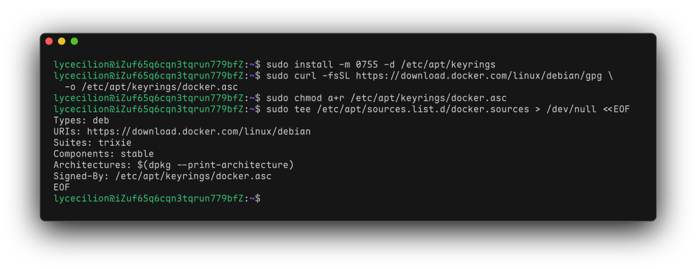

随后

```bash
sudo apt update
```

无问题后

```bash
sudo apt install \
  docker-ce \
  docker-ce-cli \
  containerd.io \
  docker-buildx-plugin \
  docker-compose-plugin
```

最后

```bash
sudo systemctl enable --now docker
sudo systemctl status docker --no-pager -l
```

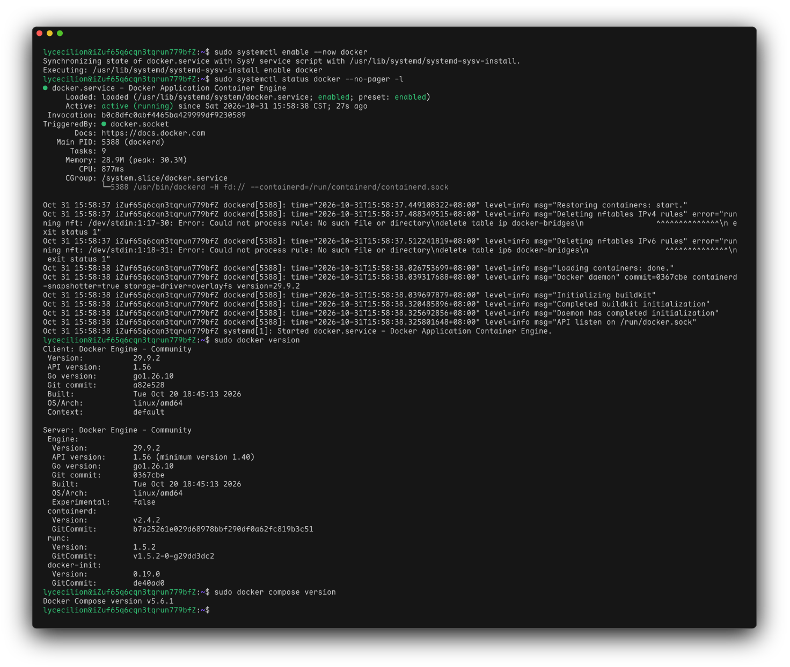

看起来没啥问题了，检查一下客户端和服务端：

```bash
sudo docker version
sudo docker compose version
```

最后，运行一个测试容器：

```bash
sudo docker run --rm hello-world
```

出现 `Hello from Docker!` 就说明万事大吉了。🥳🎉

### 先把规矩立住

先把规矩立住，配服务器才不烧心。零音有这样的运维约定：

| 路径 | 放什么 | 管理原则 |
| --- | --- | --- |
| `/srv/compose/` | 所有 Compose 应用的部署配置 | 每个应用一个子目录 |
| `/srv/data/` | 容器需要持久保存的业务数据 | 每个应用一个子目录 |
| `/etc/caddy/` | Caddy 配置 | 保留软件包原有位置 |
| `/usr/local/sbin/` | 自己维护的系统管理脚本 | 如备份、维护脚本 |
| `/etc/systemd/system/` | 自建服务、定时任务单元 | 定时执行用 systemd timer |
| `/var/lib/stella-backup/current/` | 本机备份暂存工作区 | 仅 root 可访问，成功上传 OSS 后清理 |
| `~` | 个人工作文件 | 临时下载、实验和日常操作 |

### Wakapi

对于 Wakapi，我们约定：

| 文件或目录 | 用途 |
| --- | --- |
| `/srv/compose/wakapi/compose.yaml` | 镜像、端口、挂载和环境变量配置 |
| `/srv/compose/wakapi/.env` | 实例参数及敏感配置 |
| `/srv/compose/wakapi/.env.example` | 不含真实密钥的配置示例 |
| `/srv/compose/wakapi/README.md` | 部署、升级、备份与恢复说明 |
| `/srv/data/wakapi/` | SQLite 数据库及其相关文件 |

搭好文件夹的骨架：

```bash
sudo install -d -m 0755 \
  /srv/compose \
  /srv/data

sudo install -d -m 0750 \
  /srv/compose/wakapi

sudo install -d -m 0700 \
  /var/backups/stella
```

零音在这里选择锁定版本部署，以后如果有更新需求再修改版本到最新，这样也方便复现。

```bash
sudo docker pull ghcr.io/muety/wakapi:2.18.2
```

成功后，确认镜像的运行用户

```bash
sudo docker image inspect ghcr.io/muety/wakapi:2.18.2 \
  --format '{{.Config.User}}'
```

这个版本的官方镜像使用 distroless 的 `nonroot` 用户，对应 UID/GID 为 `65532:65532`。创建一个 `nonroot` 能写入的数据目录：

```bash
sudo install -d -o 65532 -g 65532 -m 0700 /srv/data/wakapi
```

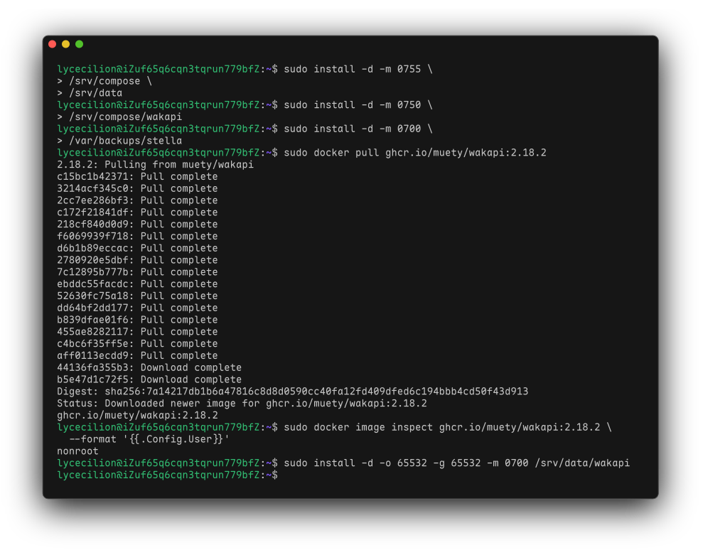

创建一个仅 root 可读写的配置文件：

```bash
sudo install -m 0600 /dev/null /srv/compose/wakapi/.env
sudoedit /srv/compose/wakapi/.env
```

填入：

```bash
WAKAPI_PUBLIC_URL=https://wakapi.stellalyr.ink
WAKAPI_PASSWORD_SALT=替换为随机值
WAKAPI_COOKIE_KEY=替换为随机值
WAKAPI_ALLOW_SIGNUP=false
```

其中 `WAKAPI_ALLOW_SIGNUP` 在确认 HTTPS 正常后打开，注册完成后再关闭即可。至于随机值，可以直接在终端内生成：

```bash
openssl rand -hex 32
openssl rand -base64 32
```

随后创建 `compose.yaml`：

```bash
sudoedit /srv/compose/wakapi/compose.yaml
```

填入：

```yaml
name: wakapi

services:
  wakapi:
    image: ghcr.io/muety/wakapi:2.18.2
    init: true
    restart: unless-stopped

    ports:
      - "127.0.0.1:3000:3000"

    environment:
      WAKAPI_DB_TYPE: sqlite3
      WAKAPI_DB_NAME: /data/wakapi.db
      WAKAPI_LISTEN_IPV4: "0.0.0.0"
      WAKAPI_LISTEN_IPV6: "-"
      WAKAPI_PUBLIC_URL: "${WAKAPI_PUBLIC_URL:?请设置公开访问 URL}"
      WAKAPI_PASSWORD_SALT: "${WAKAPI_PASSWORD_SALT:?请设置密码 pepper}"
      WAKAPI_COOKIE_KEY: "${WAKAPI_COOKIE_KEY:?请设置会话密钥}"
      WAKAPI_INSECURE_COOKIES: "false"
      WAKAPI_ALLOW_SIGNUP: "${WAKAPI_ALLOW_SIGNUP:-false}"

    volumes:
      - type: bind
        source: /srv/data/wakapi
        target: /data
        bind:
          create_host_path: false

    logging:
      driver: local
      options:
        max-size: "10m"
        max-file: "3"
```

其中

| 配置 | 作用 |
| --- | --- |
| `name: wakapi` | 固定 Compose 项目名 |
| `127.0.0.1:3000:3000` | 仅向宿主机本机发布端口 |
| `WAKAPI_LISTEN_IPV4: "0.0.0.0"` | 允许容器网络请求进入应用 |
| `create_host_path: false` | 数据目录缺失时报错，方便发现路径错误 |
| `WAKAPI_INSECURE_COOKIES: "false"` | 为浏览器通过 HTTPS 登录做准备 |
| `logging` | 限制容器日志占用 |

保存。随后检查端口：

```bash
sudo ss -lntp '( sport = :3000 )'
```

没有问题后继续：

```bash
sudo docker compose \
  --project-directory /srv/compose/wakapi \
  config --quiet
```

随后启动：

```bash
sudo docker compose \
  --project-directory /srv/compose/wakapi \
  up -d
```

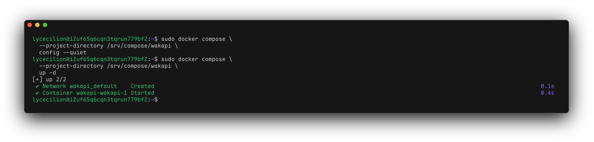

测试服务器本机访问：

```bash
curl -I http://127.0.0.1:3000/
```

接通！接下来在阿里云控制台配置 A 记录 `wakapi.stellalyr.ink` 指向服务器 IP，随后配置 Caddy。这里给 Caddyfile 也分个家，避免主 Caddyfile 越来越长。

```bash
sudo install -d -m 0755 /etc/caddy/sites
sudoedit /etc/caddy/Caddyfile
```

保留需要的现有配置，在所有站点块外加一行：

```caddyfile
import sites/*.caddy
```

然后创建 Wakapi 的配置：

```bash
sudoedit /etc/caddy/sites/wakapi.caddy
```

写入：

```caddyfile
wakapi.stellalyr.ink {
    encode zstd gzip
    reverse_proxy 127.0.0.1:3000
}
```

校验并加载：

```bash
sudo caddy fmt --overwrite /etc/caddy/Caddyfile
sudo caddy fmt --overwrite /etc/caddy/sites/wakapi.caddy
sudo caddy validate --config /etc/caddy/Caddyfile --adapter caddyfile
```

验证成功后执行

```bash
sudo systemctl reload caddy
```

查看证书申请和服务日志：

```bash
sudo journalctl -u caddy --since "5 minutes ago" --no-pager
```

随后用浏览器访问 `wakapi.stellalyr.ink`，接通，成功！

```bash
sudoedit /srv/compose/wakapi/.env
```

修改 `WAKAPI_ALLOW_SIGNUP` 到 `true`，保存后重新应用

```bash
sudo docker compose \
  --project-directory /srv/compose/wakapi \
  up -d
```

注册账户后，将 `WAKAPI_ALLOW_SIGNUP` 改回 `false`，再次执行上面的 `docker compose … up -d`，让关闭注册的配置生效。只修改 `.env` 不会改变运行中容器的环境变量。拿到账户的 API Key，随后在开发用设备上改 `~/.wakatime.cfg`：

```ini
[settings]
api_url = https://wakapi.stellalyr.ink/api
api_key = 你的_Wakapi_API_Key
```

完成——

### Vaultwarden

上文叙述足够详细，这一轮零音就简述了。在这之前零音恢复了原 Vaultwarden 的数据，害怕自己干出问题就交给 AI 了，AI 咋搞的零音忘了（）总之数据复原之后：

```bash
sudo install -d -m 0750 /srv/compose/vaultwarden
sudoedit /srv/compose/vaultwarden/compose.yaml
```

```yaml
name: vaultwarden

services:
  vaultwarden:
    image: vaultwarden/server:1.37.4
    restart: unless-stopped

    ports:
      - "127.0.0.1:8001:80"

    environment:
      DOMAIN: "https://vault.stellalyr.ink"
      ROCKET_PORT: "80"
      SIGNUPS_ALLOWED: "false"
      INVITATIONS_ALLOWED: "false"
      IP_HEADER: "X-Forwarded-For"

    volumes:
      - type: bind
        source: /srv/data/vaultwarden
        target: /data
        bind:
          create_host_path: false

    logging:
      driver: local
      options:
        max-size: "10m"
        max-file: "3"
```

```bash
sudo ss -lntp '( sport = :8001 )'
```

```bash
sudo docker compose \
  --project-directory /srv/compose/vaultwarden \
  config --quiet
```

```bash
sudo docker compose \
  --project-directory /srv/compose/vaultwarden \
  pull
```

```bash
sudo docker compose \
  --project-directory /srv/compose/vaultwarden \
  up -d
```

接下来就是 Caddy 的配置了。

### 还干了什么？

还配置了 [Glance](https://glance.stellalyr.ink)、[Uptime Kuma](https://uptime.stellalyr.ink)（选了 SQLite 作数据库）、[Memos](https://memos.stellalyr.ink)、Hindsight（Slim + DeepSeek API + 硅基流动 API + 独立 PostgreSQL）、[Umami](https://stats.stellalyr.ink)。

### 一些习惯

雾雨给零音教了一些好习惯。首先是不开 Vaultwarden 的话，可以用 `openssl` 随机密码，这个上文提到了。其次是服务一旦部署，万一有不怀好意的人蹲着抢管理员账户就难受了，可以在部署 Caddy 之前用 SSH 隧道连接上去，比如说：

```bash
ssh -N -L 15230:127.0.0.1:5230 stellaServer
```

然后浏览器访问 `http://127.0.0.1:15230` 就可以直接访问到对应服务。初始化完成后再接入 Caddy，至少可以避免在公网开放初始化页面时被人抢注管理员账户；后续的访问控制和安全更新还是得继续做好。

### CrystaRin 重新部署

花了一些工夫将 CrystaRin 从 Hexo + Stellar 迁移到了 Astro + Firefly。在阿里云 ESA 接入了全球 + CNAME，用了（目前）1 个月 ¥5.94 的 ESA 基础款。这个东西写起来就没啥意思了，零音就不写了喵。

## Restic 备份服务器

:::tip
我懒了，下面这段由 GPT 6.1 Sol、Gemini 4 Argon 和 DeepSeek V4.1 Flash 合著，有问题请找这三位。
:::

服务都搬回来了，看着 `/srv/data` 里那一堆 `db.sqlite3`，零音突然开始认真思考一个问题：要是这台服务器明天就没了，密码库、笔记和监控历史还能不能找回来？答案是：不知道。于是这次零音做了一套很朴素的方案：

- SQLite 应用短暂停服，生成包含数据库及周边文件的一致性副本；
- PostgreSQL 在线逻辑导出；
- 用 Restic 加密后上传阿里云 OSS；
- 用 systemd timer 定期备份、检查仓库、验证恢复；
- 第一次上传之后，真的从 OSS 下载恢复一次，而不是看到「上传成功」就收工。

嗯，实话实说，这一节整件事是零音丢给 AI 干的。所以零音现在回过头来把它看懂、再复述一遍——毕竟将来真出事的时候，能救命的不是「我记得当时跑通过」，而是「我知道它到底在干什么」。

本文记录的是 2026 年 11 月的一次实际部署，不是什么放之四海皆准的最佳实践。Bucket 名称等公开标识已替换为示例，文中没有真实 AccessKey、仓库密码，也没有密码库的网站清单。

### 盘点服务器

零音没有凭记忆列服务，而是通过运行状态、容器挂载、部署目录和反代配置交叉确认了一遍：

| 应用 | 当时的镜像版本 | 持久化位置／数据库 |
| --- | --- | --- |
| Vaultwarden | `vaultwarden/server:1.37.4` | `/srv/data/vaultwarden`，SQLite |
| Memos | `neosmemo/memos:0.31.0` | `/srv/data/memos`，SQLite |
| Uptime Kuma | `louislam/uptime-kuma:2.5.8` | `/srv/data/uptime-kuma`，SQLite |
| Wakapi | `ghcr.io/muety/wakapi:2.18.2` | `/srv/data/wakapi`，SQLite |
| Umami | `ghcr.io/umami-software/umami:3.4.1` | 独立 PostgreSQL 容器 |
| Hindsight | `ghcr.io/vectorize-io/hindsight:1.1.0-slim` | 独立 PostgreSQL／pgvector 容器 |
| Glance | `glanceapp/glance:v0.8.7` | `/srv/compose/glance/config` |
| Lens | 同样是 Glance | `/srv/compose/lens/config` |

总共 8 个应用、10 个容器。

目录布局则刚好适合把配置和业务数据分开处理：

```text
/srv/compose/<service>/       Compose、.env、Glance 配置
/srv/data/<service>/          应用数据
/etc/caddy/                   反向代理配置
/etc/systemd/system/          自定义服务及定时任务配置
```

盘点用的都是只读命令：

```bash
sudo docker ps -a --format 'table {{.Names}}\t{{.Image}}\t{{.Status}}'

sudo sh -c 'docker ps -aq | xargs -r docker inspect --format \
"{{.Name}} compose={{index .Config.Labels \"com.docker.compose.project.config_files\"}}{{range .Mounts}}{{printf \"\n  %s: %s -> %s\" .Type .Source .Destination}}{{end}}"'

sudo du -sh /srv/data/*
sudo find /srv/compose -maxdepth 3 -type f -printf '%M %u:%g %p\n'
```

### 直接跑 Restic 不行吗

Restic 能加密、去重、上传和校验文件，但它不是数据库事务协调器。说得直白一点：它不知道你在备份的那个瞬间，数据库正在写什么。

SQLite 这边，主文件里不一定有最新提交。实际看到的数据库文件是这样的：

```text
Vaultwarden: db.sqlite3、db.sqlite3-wal、db.sqlite3-shm
Memos:       memos_prod.db、memos_prod.db-wal、memos_prod.db-shm
Uptime Kuma: kuma.db、kuma.db-wal、kuma.db-shm
Wakapi:      wakapi.db
```

WAL 模式下，已提交的数据可能还躺在 `-wal` 里。只复制 `.db` 主文件，这些提交就丢了；而边写边依次复制主文件和 WAL，也不等于拿到了一个一致快照——两个文件的时刻本来就不是同一个。数据库之外还有附件、Send 文件之类的东西。就算数据库一致了，也不代表它引用的那些文件跟它处在同一时刻。

零音的取舍是：接受每天一次短暂停服——停掉四个 SQLite 应用，复制整个数据目录，然后立刻把应用拉起来。后续的检查、上传都基于本地副本，不再占用停服时间。

复制过来之后，还要用 SQLite 自己的备份接口，把暂存目录里的数据库转成一个独立的数据库文件：

```python
source = sqlite3.connect(database.as_uri() + '?mode=ro', uri=True)
try:
    with sqlite3.connect(normalized_database) as destination:
        source.backup(destination)
        if destination.execute('PRAGMA integrity_check').fetchall() != [('ok',)]:
            raise RuntimeError('SQLite integrity check failed')
finally:
    source.close()
```

替换成功之后，才移除暂存副本的 WAL／SHM／journal 配套文件。这里必须强调：绝不能去删正在运行的生产数据库的配套文件，那不是修复，那是数据删除。

PostgreSQL 这边，用逻辑导出，不去复制运行中的 PGDATA。Umami 和 Hindsight 的 PostgreSQL 都是 17.11，备份分别生成：

- `database.dump`：`pg_dump --format=custom` 的业务库导出；
- `globals.sql`：`pg_dumpall --globals-only` 的全局角色等信息；
- `extensions.txt`：扩展名称与版本记录。

然后用 `pg_restore --list` 检查归档能不能被解析。导出工具直接用各自数据库容器内的版本，避免主机客户端版本不匹配那套经典事故。

Hindsight 当时用的是 `vector 0.8.7`、`pg_trgm 1.6`、`btree_gin 1.3`；Umami 用的是 `pgcrypto 1.3`。恢复时必须准备支持相应扩展的环境，不能只拿一份 SQL 文件配任意一个 PostgreSQL 镜像——那样只会收获一堆 `type "vector" does not exist`。`globals.sql` 里可能含角色密码哈希，同样算敏感数据。

### OSS 仓库与 RAM 用户

零音通过 Restic 的 S3 兼容后端直连 stellaOSS，没有再加一层 rclone。本文用示例 Bucket `example-backup-vault`，仓库独占一个前缀：

```text
restic/stellaServer/
```

仓库地址写成：

```text
s3:https://oss-cn-beijing.aliyuncs.com/example-backup-vault/restic/stellaServer
```

注意这里是地域 Endpoint + Bucket 路径，不是直接把 `example-backup-vault.oss-cn-beijing.aliyuncs.com` 当成仓库地址。实际请求走的是虚拟主机形式，由下面这两个选项控制：

```bash
-o s3.bucket-lookup=dns -o s3.region=oss-cn-beijing
```

这是 [Restic 官方文档给出的 OSS 接入方式](https://restic.readthedocs.io/en/stable/030_preparing_a_new_repo.html#alibaba-cloud-aliyun-object-storage-system-oss)。

Bucket 保持私有、标准存储。不要给仓库对象配置自动过期删除，也不要自动转归档／冷归档——Restic 仓库里的文件互相引用，不能按对象年龄随意删。快照保留和空间回收交给 Restic 自己管。

RAM 这边没有直接上 `AliyunOSSFullAccess`，而是建了一条自定义策略，再授权给专用 RAM 用户。示例 Bucket 记得换成自己的名字：

```json
{
  "Version": "1",
  "Statement": [
    {
      "Effect": "Allow",
      "Action": ["oss:ListObjects"],
      "Resource": ["acs:oss:*:*:example-backup-vault"],
      "Condition": {
        "StringLike": {
          "oss:Prefix": ["restic/stellaServer/*"]
        }
      }
    },
    {
      "Effect": "Allow",
      "Action": ["oss:GetBucketInfo", "oss:GetBucketLocation"],
      "Resource": ["acs:oss:*:*:example-backup-vault"]
    },
    {
      "Effect": "Allow",
      "Action": [
        "oss:GetObject",
        "oss:PutObject",
        "oss:DeleteObject",
        "oss:ListParts",
        "oss:AbortMultipartUpload"
      ],
      "Resource": ["acs:oss:*:*:example-backup-vault/restic/stellaServer/*"]
    }
  ]
}
```

创建入口是 RAM 控制台的「权限策略 → 创建权限策略 → 脚本编辑」，然后到目标用户的「权限管理 → 新增授权」里选这条自定义策略。

其中列举权限作用于 Bucket，用 `oss:Prefix` 把请求限制在前缀内；对象读写、删除和分片操作作用于指定对象路径。分片上传对应的是 `oss:PutObject`，别凭 API 名字去编一个 `oss:UploadPart` 出来。参考 [阿里云 RAM 授权说明](https://www.alibabacloud.com/help/en/oss/user-guide/access-control-base-on-ram-policy)。

删除权限是拿来清锁和后续维护仓库的，所以这套策略并不防持有凭据的人恶意删除仓库。最小权限只是缩小影响范围，不是不可变备份；Restic 加密也不等于防删除。

### 把凭据放好

这里有两类完全不同的秘密，别混在一起想：

1. OSS AccessKey：决定能不能碰到远端那些对象；
2. Restic 仓库密码：决定能不能解开仓库。

密码丢了，哪怕对象还在 OSS 里躺着，也恢复不出任何东西。所以密码和恢复所需的 OSS 凭据必须另存到服务器以外，不能把「备份里的那份凭据副本」当成唯一的恢复入口——那属于把开锁钥匙锁在保险箱里。

实际安装的是 Restic 0.18.0，初始化出来是 version 2 仓库，支持压缩。

下面是初始化过程的脱敏版本，在服务器上执行。秘密通过终端隐藏输入，不写进命令历史；如果已经存在配置，就先停下，不要覆盖：

```bash
sudo bash <<'ROOT'
set -euo pipefail
umask 077
if [ -e /etc/restic/stella.env ]; then
    echo '已有配置，停止以免覆盖。'
    exit 1
fi

apt-get update
apt-get install -y restic sqlite3 python3
install -d -m 700 /etc/restic

ask_secret() {
    local prompt=$1 name=$2 value
    printf '%s' "$prompt" > /dev/tty
    IFS= read -r -s value < /dev/tty
    printf '\n' > /dev/tty
    test -n "$value"
    printf -v "$name" '%s' "$value"
}

ask_secret 'OSS AccessKey ID: ' AWS_ACCESS_KEY_ID
ask_secret 'OSS AccessKey Secret: ' AWS_SECRET_ACCESS_KEY
ask_secret 'Restic 仓库密码（先离线保存）: ' password
ask_secret '再次输入仓库密码: ' password_again
if [ "$password" != "$password_again" ]; then
    echo '密码不一致，停止。'
    exit 1
fi

printf '%s\n' "$password" > /etc/restic/stella.password
unset password password_again
{
    printf 'export AWS_ACCESS_KEY_ID=%q\n' "$AWS_ACCESS_KEY_ID"
    printf 'export AWS_SECRET_ACCESS_KEY=%q\n' "$AWS_SECRET_ACCESS_KEY"
    printf 'export RESTIC_REPOSITORY=%q\n' \
      's3:https://oss-cn-beijing.aliyuncs.com/example-backup-vault/restic/stellaServer'
    printf 'export RESTIC_PASSWORD_FILE=%q\n' '/etc/restic/stella.password'
} > /etc/restic/stella.env
chmod 600 /etc/restic/stella.env /etc/restic/stella.password

source /etc/restic/stella.env
unset AWS_SESSION_TOKEN
restic -o s3.bucket-lookup=dns -o s3.region=oss-cn-beijing init
restic -o s3.bucket-lookup=dns -o s3.region=oss-cn-beijing snapshots
ROOT
```

有个细节容易踩：`stella.env` 是给 Bash `source` 用的文件，里面有 `export` 和 Bash 转义，不是能直接塞进 systemd `EnvironmentFile=` 的那种格式。

文件权限是目录 `0700`、凭据文件 `0600`，都由 root 持有。另外，初始化只建立了一个空仓库，不代表任何业务数据已经备份成功；如果中途失败，不要不加判断地把整段脚本重跑一遍。

### 脚本到底干了什么

本机部署的文件一共这么几个，分工很清楚。本文只记录它们的职责和运行流程。下文的 `stella-backup` 命令和 systemd 单元都是本机自建的，不是安装 Restic 后就会自带的：

| 文件 | 用途 |
| --- | --- |
| `stella-backup.py` | 备份、恢复验证、仓库检查和手动清理 |
| `stella-backup` | root 启动器，加载凭据后执行 Python |
| `install.sh` | 安装文件并重新加载 systemd，不自动运行任务 |
| `stella-backup@.service` | 用实例名选择 `backup`、`check`、`verify` 等操作 |
| 三个 `.timer` | 分别调度每日备份、每周检查、每月恢复验证 |

生产任务由 root 执行，但并没有因此给普通 SSH 用户开免密 sudo，也没有为了「方便」把用户塞进 docker 组。反正零音自己敲命令的时候多打一个 `sudo` 又不疼。

一次备份的流程大概是这样：

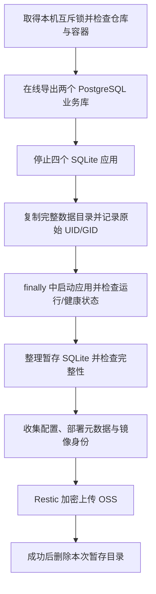

临时数据集中在 `/var/lib/stella-backup/current`。里面装着业务数据、角色信息、部署秘密和 Restic 凭据，所以上传前的暂存数据是明文的，只能放在 root 才能碰的目录里。成功上传后删除暂存目录；失败就留着方便看现场，下一次备份会重新生成。磁盘加密、安全擦除和主机入侵防护不在这一步的解决范围内。

**为什么还要记 UID/GID？** 因为 Python 的 `shutil.copytree` 不会自动保留原始所有者，而不同镜像又可能用不同的数字 UID。脚本因此在停服复制期间记下 `ownership.json`，恢复时按目标镜像审查后再重新应用所有权，而不是把所有文件一股脑留给 root——那样容器起来只会给你一个 Permission denied 大礼包。

**停服后出错怎么办？** 停止和复制放在 `try` 里，重新启动放在 `finally` 里；哪怕只有部分停止失败，也会尝试启动原本预期运行的那四个应用。脚本还处理了 SIGTERM，并且在应用恢复之后才会上传。

但这不是绝对保证：SIGKILL、断电或者 Docker 故障，进程根本来不及做任何补救。原本就没在运行的预期容器会让备份在停服前就失败，不会为了备份悄悄把它启动起来。有 Docker healthcheck 的容器会等到健康；没有 healthcheck 的容器只能确认「在跑」，不能据此保证业务已就绪。当前版本里单次外部命令还有 600 秒超时，数据规模涨上来之后，复制空间、导出／上传时长和超时设置都得重新评估。

**备份里还装了什么？** 除了业务目录和数据库导出，还有：

- `/srv/compose`：包括两套 Glance 配置以及敏感的 `.env`；
- `/etc/caddy` 和 `/etc/systemd/system`；
- `/etc/restic` 与备份程序自身；
- `containers.json`、`images.txt`：容器部署元数据及本机镜像身份信息。

`containers.json` 里可能含秘密环境变量，只能留在受保护的暂存区和加密仓库里，绝不能当成公开文章附件。

以及，这不是整机备份。没有覆盖操作系统、Docker 镜像层、SSH 密钥、Caddy 运行时证书目录 `/var/lib/caddy`、其他路径下的 SNI Gate 二进制／配置。恢复这些组件得另行准备，所以别把这一节理解成「一键还原整台机器」。

### 先手动跑一遍

在本机完成脚本和 systemd 单元的安装后，零音先手动启动备份任务并查看日志：

```bash
sudo systemctl start stella-backup@backup.service
sudo journalctl -u stella-backup@backup.service -n 100 --no-pager
```

安装时只部署文件和执行 `daemon-reload`，没有启用 timer。第一次备份通过之后，才轮到考虑自动化的事。

实际的首次备份日志长这样：

```text
SQLite verified: vaultwarden
SQLite verified: memos
SQLite verified: uptime-kuma
SQLite verified: wakapi

Files:         276 new, 0 changed, 0 unmodified
Added to the repository: 12.654 MiB (4.281 MiB stored)
processed 276 files, 12.818 MiB in 0:02
snapshot 996d87b7 saved
Backup completed; application services have been restarted.
```

任务在 19:30:26 开始，19:31:39 正常结束。开始停止应用的日志是 19:30:29，开始恢复应用是 19:30:35。

日志里还有一条 `Flag --time has been deprecated, use --timeout instead`。这是当时部署的脚本用了 Docker 旧选项产生的弃用警告，本次执行依然成功；它既不是备份失败，也没必要装作没出现过。

另外，原始 PostgreSQL 目录大小不能直接和最终归档大小比较：这里做的是逻辑导出，不是逐字节上传 PGDATA。上面的「实际存储」只是本次 Restic 的输出，不代表未来的费用或压缩比。

### 真的从 OSS 恢复一次

备份命令成功，最多只能证明上传流程成功。所以接下来：

```bash
sudo /usr/local/sbin/stella-backup verify
sudo /usr/local/sbin/stella-backup check
sudo docker ps --format 'table {{.Names}}\t{{.Status}}'
```

`verify` 具体做的是：

1. 选出主机 `stellaServer`、标签 `stella-services` 的最新快照；
2. 恢复到 root 专用目录下的临时子目录，而不是覆盖生产数据；
3. 用 `restic restore --verify` 检查恢复出来的文件；
4. 检查四份 SQLite 的完整性；
5. 通过数据库容器里的 `pg_restore --list` 检查两份 PostgreSQL 归档；
6. 删掉本次临时恢复目录。

实际从 OSS 恢复了 381 个文件／目录条目，其中 276 个文件的内容校验全部通过；四份 SQLite 完整性检查和两份 PostgreSQL 归档可读性检查也都通过。

`check` 用的是：

```bash
restic check --read-data-subset=10%
```

它检查仓库结构、引用关系，并抽样读取数据包。

最后看 Docker，十个容器都在运行，带健康检查的那几个显示 healthy。

**这些验证还不能证明什么？** 我们没有把 PostgreSQL 导入一个全新集群，也没有启动隔离的应用去做下面这些事：

- 登录恢复后的 Vaultwarden，解密条目、下载附件；
- 查看恢复后的笔记资源和监控状态；
- 在恢复后的 Umami／Hindsight 里执行真实业务查询。

所以这次完成的是**文件恢复验证、SQLite 完整性检查和 PostgreSQL 归档可读性检查**，不是完整的应用级灾难恢复演练。`pg_restore --list` 成功，不代表角色、扩展和业务功能一定能在新环境里完整恢复。

### 再交给 systemd timer

手动备份和恢复验证都通过之后，才启用定时任务：

```bash
sudo systemctl enable --now \
  stella-backup.timer \
  stella-backup-check.timer \
  stella-backup-verify.timer

systemctl list-timers 'stella-backup*' --all --no-pager
```

| 任务 | 时区与计划 | 内容 |
| --- | --- | --- |
| `stella-backup.timer` | Asia/Shanghai，每天 04:00 | 业务备份 |
| `stella-backup-check.timer` | Asia/Shanghai，周日 06:00 | 仓库结构检查及数据包抽样读取 |
| `stella-backup-verify.timer` | Asia/Shanghai，每月 1 日 07:00 | 临时文件恢复验证 |

每个 timer 都有最多十分钟的随机延迟，并且设置了 `Persistent=true`。错过的日历任务可能在 timer 再次启动时补跑，这意味着重新启用备份 timer 的时候，也可能在非凌晨时段来一次短暂停服——这一点零音觉得值得写下来。

实测三个 timer 均已启用，下一次分别排在次日、下一个周日和下月 1 日。

脚本通过本机文件锁避免并发操作。冲突时任务会失败，不会自动排队；也没有设置自动重试。如果机器在错过多个任务之后才启动，记得检查有没有任务因为锁冲突失败了。

### 日常维护与保留策略

先看任务是不是成功：

```bash
systemctl --failed --no-pager
systemctl list-timers 'stella-backup*' --all --no-pager
sudo journalctl -u stella-backup@backup.service -n 100 --no-pager
sudo journalctl -u stella-backup@check.service -n 100 --no-pager
sudo journalctl -u stella-backup@verify.service -n 100 --no-pager
```

手动再做一次备份、检查、验证恢复，还是同一组命令：

```bash
sudo /usr/local/sbin/stella-backup backup
sudo /usr/local/sbin/stella-backup check
sudo /usr/local/sbin/stella-backup verify
```

注意手动备份也会停服，不要把它当成纯只读检查随手按。

**旧快照没有自动删除。** 脚本准备了手动维护入口：

```bash
sudo /usr/local/sbin/stella-backup prune
```

它执行的是：保留 7 个日周期、4 个周周期和 12 个月周期的代表快照，范围限定为上面那个主机和标签，按 `host,tags` 分组；再清理不再被引用的数据。

这些周期保留规则是共同作用的，同一个快照可能同时满足多条规则，所以不是简单地保留 7 + 4 + 12 份，也不是把 12 个月内的所有快照全部留下。

**该命令会删除策略之外的快照以及无引用对象，执行前必须确认保留需求。这次没有执行它，也没有为它配置定时器。** 所以当前状态是持续新增备份、不自动清理，存储成本会随着数据变化慢慢积累。

**失败通知暂时没做。** 讨论过两层方案：一层是 systemd `OnFailure=` 推送任务失败，另一层是外部成功心跳，用来发现服务器整体宕机或者任务根本没运行。但通知渠道一直没定下来，所以最终没有部署任何失败通知或外部心跳。**现在任务失败不会自动有人来提醒**，得主动去看；也不能把服务器自己的 Uptime Kuma 当成整机宕机的唯一外部观察者——机器都没了，谁来看它？

### 万一真要迁移到新服务器

当前恢复流程是一份需要人工审查的 runbook，不是一条能覆盖生产环境的命令：

1. 先取回离线保存的仓库密码和 OSS 访问凭据；
2. 在替代机器上准备 Restic、Docker 等环境，从选定快照恢复到私有、空目录；
3. 恢复树位于目标目录下的 `var/lib/stella-backup/current/`，先审查部署配置和秘密；
4. 按镜像身份记录选择版本；镜像元数据不是镜像层备份，远端镜像仍需可获得；
5. 停止目标 SQLite 应用，用完整备份目录恢复，不混入旧 WAL／SHM；审查目标镜像 UID 后，按 `ownership.json` 恢复所有权；
6. 准备 PostgreSQL 17 和相应扩展，审查全局角色，再向预期的空业务库导入 `database.dump`；
7. 启动并验证实际业务功能，之后才恢复公网路由与 HTTPS；
8. 确认新环境工作正常后，才启用它的备份 timer。

第 5 步的所有权恢复大概是这个意思：

```python
import json, os
from pathlib import Path
tree = Path('RESTORED_TREE')
for relative, uid, gid in json.loads((tree / 'ownership.json').read_text()):
    relative = Path(relative)
    if relative.is_absolute() or '..' in relative.parts or relative.parts[0] != 'data':
        raise ValueError('Unsafe manifest path')
    os.chown(Path('/srv') / relative, uid, gid, follow_symlinks=False)
```

第 6 步有个很现实的坑：Compose 初始化本身可能已经创建了应用角色，所以不能不加判断地导入 `globals`，也不要盲目覆盖一个正在使用的数据库。

在生产实例上覆盖导入数据库、盲目降级镜像，或者直接把备份复制回正在使用的数据目录，都不属于安全恢复流程。

## 附录

### 升级前后服务器 Debian 的环境

| 项目 | 实际情况 |
| --- | --- |
| 平台 | 阿里云轻量应用服务器，上海 |
| 启动方式 | UEFI，TianoCore 固件 |
| 根分区 | `/dev/vda3`，ext4 |
| EFI 系统分区 | `/dev/vda2`，挂载于 `/boot/efi` |
| 网络 | Netplan + systemd-networkd |
| 原镜像 cloud-init | 阿里云定制 `23.2.2-6`，起初被设置为 hold |
| Debian 12 更新后 | `12.15`，内核 `6.1.0-54-amd64` |
| 最终成功升级后 | `13.7`，内核 `6.12.113+deb13-amd64` |
