import Epigraph from "@/components/misc/Epigraph.astro";

这篇文章本来并不打算独立成文，而是作为一个部分嵌入到 CCISC 2026 回忆录中，但由于其内容更多偏向于技术侧，思来想去，洛汐决定还是单独写出来了。一方面，技术类内容嵌入到叙事类文章里，观感确实可能不好；另一方面，独立成文可以让洛汐更多地涉及技术侧的内容。

由于洛汐近日已被 AI 风格的文章荼毒过深，这篇文章洛汐将尝试恢复星澜音时期的语言，并有意避免 AI 文章的典型风格——不过洛汐必须承认，文章中的部分内容仍然是 AI 完成的，而全篇文章也经过了 AI 的审核、事实校验与修改，不过洛汐确信这并没有影响文章的易读性和行文风格。

:::info
但是这比赛到底叫 CISCN 还是叫 CCISC？

截至发稿时，洛汐仍然没搞明白我们去打的比赛「全国大学生网络安全竞赛」的英文名到底是 CISCN（China Information Security Competition Network）还是 CCISC（China College Information Security Competition）。Gemini 为此做了 Deep Research，但给出的回复并不足以让洛汐确信。多数人在多数场合仍倾向于将该比赛称为 CISCN，但考虑到洛汐在线下看到的各种标志均为 CCISC，所以洛汐将在本文使用后者的称呼。
:::

七月的零音颤颤巍巍地熬过了四月的雨，但始终没有等到 CCISC 2026 决赛的通知。洛汐不知道自己该不该开始备赛，毕竟洛汐已经因许多可言说或难以言说的原因，无数次想彻底放弃了，但心里却仍然有一些难以言说的情感。再忍忍吧，「打完这场比赛，洛汐的一切，就要迎来新的开始了。」洛汐这样想着。

一个声音一直在问洛汐：「那么未来——你还要打 CTF 吗？」

洛汐没有回答。

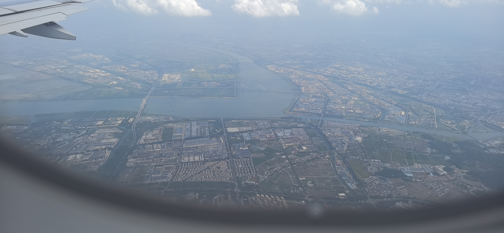

## 在一切开始之前

其实当时的零音想过 AI 的事情，尽管零音当时因为一些自己的和外界的原因，还没定下来到底要不要再以 Starfall Koi 队长的名义参加 CCISC 2026 决赛——但毕竟这是 零音/洛汐 第一次拿到国家级比赛决赛的入场券，即使是抱着「见一见世面」的态度来参加，也应该是值得的。「那就当公费旅游了吧！」洛汐对自己说。

:mark[CCISC 比赛要求全程断网，在线大模型在通常情况下是不能使用的。]队伍之前使用的 Qwen 3.5 9B 模型质量过于拉胯：在西北赛区的半决赛赛场上，它针对一道 RenPy 逆向题给出的脚本带有逻辑错误，导致那道题零音没有做出来——后来发现其实只差最后一步。哪怕是手写脚本，或者用「火绒剑」拦截，都不会有问题。事实上，零音并不在意做题或拿奖，但 9B 的使用体验真的很糟心。


然而时过境迁。4 月 4 日的零音仍然在为 GPT-5.4 在无编译器和汇编器的情况下完成了一道较困难的 Shellcode 题而感到眩晕瘫坐 :spoiler[像看到原子弹爆炸]，而后续 GPT-5.5 和 GPT-5.6 sol 乃至 GPT 6 Astra，以及 Claude、GLM、Kimi 和 DeepSeek 等各大厂商的新模型的飞跃则让 零音/洛汐 更加吃惊。彼时的零音断言 AI 不会再在较短的时期内有更大的飞跃，而事实证明零音确实有些悲观。不过，话说回来：对每一个从「半年前」走到现在的 AI 用户来说，在一轮又一轮「温水煮青蛙」般的 AI 变革中，或许已然不会再感到如 Sora 2 和 GPT-4o 级别的飞跃；但若直接回望半年之前的模型、我们在当时对模型的预期和现在模型的能力，便能实实在在感受到大模型进步带来的独特力量。

当然，零音/洛汐 对这一切仍然抱有充分的怀疑——一个可能的原因是 GPT-5 发布时[「新智元」的那篇常读常新的文章](https://mp.weixin.qq.com/s/W2CEoudADgwVcGGVTRTeGg)让零音真的了一整天。洛汐现在对于 OpenAI 在过去不久的 [GPT 6 Astra](https://openai.com/zh-Hans-CN/index/gpt-6-astra/) 发布中宣传的 **AGI 已经到来** 这件事仍然无法抱有积极预期，但洛汐希望自己这次也能被光速打脸.png

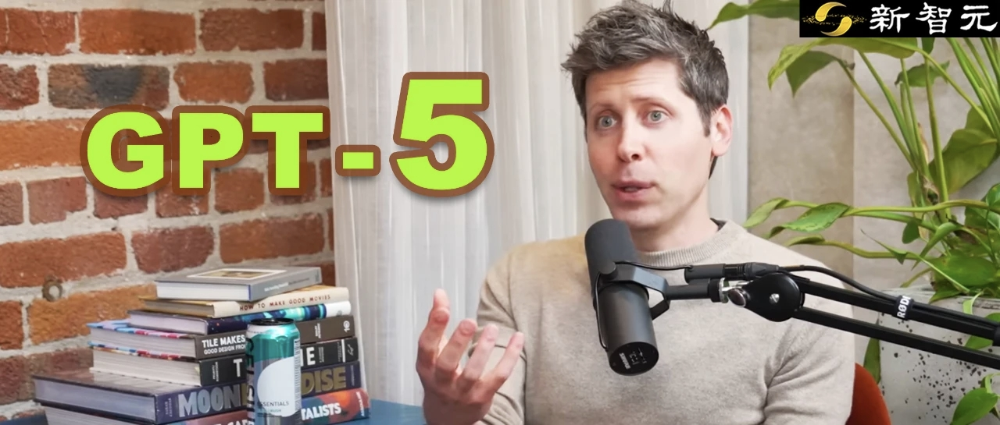

以上是作为普通用户抒发的情感。但作为一个要打线下断网 CTF 的参赛者，在线模型再怎么飞跃，也与洛汐无关。在前几次比赛中零音已然断言这种比赛只能自己手搓：9B 的智商过于低下，只会起反作用，而真正有一定智慧的模型仍然需要更大的参数量才能正常工作——直到 CCISC 2026 决赛通知前的十几天，2026 年 8 月 14 日，Qwen 官方发布了 [Qwen 3.8 27B](https://huggingface.co/Qwen/Qwen3.8-27B)：发布即屠榜。在 [Artificial Analysis](https://artificialanalysis.ai/models/qwen3-8-27b) 等评测榜上，Qwen 3.8 27B 的跑分接近 DeepSeek V4 Flash 0731 (max)，在代码能力方面甚至赶超 Claude Opus 4.6，虽然 AA 榜因为「GPT 6 Astra &lt; GPT 5.6 sol」这个抽象的评分已经[被网友评为野榜](https://xhslink.cn/o/4i68YgEqulf)了，但从大众的使用体验来看，在代码力这块确实不错。虽然世界知识和文学写作等方面远不及其他模型，但对于线下 CTF 场景而言，一个代码方面的专精模型其实已经足够。

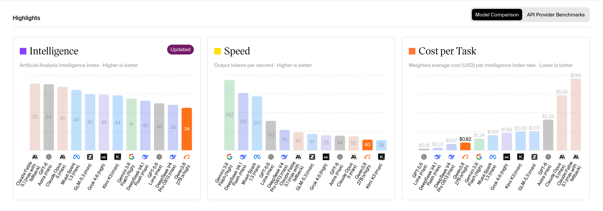

后来队伍的成员们来问过：我们要不要搞一个？其实洛汐当时没想着要搞，毕竟洛汐打心眼里不太认同 27B 能掀起什么浪花，并且在实际测试之前也不会断言一个模型的真正能力——但一个问题是：如果你不搞，其他人就搞了。万一这东西真有用，那我们不就亏了吗？可以不赢但不能输，「补兑，还是要搞！」

## 初见 MacBook Pro

小学的 protosc 在 VMware 里跑的 hackintosh 是 protosc 对于 macOS 的初印象。事实上，在 protosc 的那台 Intel 4 代 i3 上，hackintosh 的体验极为拉胯，现在的洛汐也不知道 protosc 怎么用得下去的。后来零音在大学里帮同学配置开发环境时有幸体验了大约 12 个小时的 macOS，也会在路过 Apple 授权经销商或 Apple Store 时进去玩一玩。从各种角度来说，洛汐对 macOS 并非完全生疏。

队伍一共租了 2 台 Mac，但洛汐仅在这里描述自己得到的这一台：搭载 Apple M4 Max 芯片的、128 GB RAM + 8 TB Storage（:spoiler[8 + 128]）的 MacBook Pro。其实拿到手后，适应这一套熟悉又陌生的 OS 并没有给洛汐造成太大的困难——毕竟在 Linux 和 Windows 上掌握的终端、网络、调试、编译、脚本和排障等能力大部分都可以迁移过来；真正的困难是在这样一台带有 macOS 约束、基于 Apple Silicon 架构的 Unix 工作站上，配置好属于自己的 CTF 和 LLM 环境。

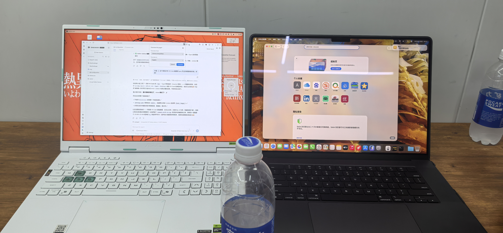

拿到 MacBook Pro 后，我们拍摄了 MacBook 各个角度的照片，并确认其可以正常开机，且各项硬件功能都没有问题。在 macOS 上使用以下命令检查：

```bash
uname -m
sw_vers
system_profiler SPHardwareDataType
system_profiler SPPowerDataType
df -h /
vm_stat
```

随后更新了 macOS 到最新的版本 26.6.2 并立刻关闭了自动更新。确认环境也没有问题后，冻结版本是一个好习惯。:spoiler[因为在半决赛赛场上，零音在赛前升级了 Windows 侧的 VS Code 而忘了同时更新 WSL 上的 VS Code，导致 8 小时比赛全程没有 Remote VS Code 用] 我们得到的这台 MacBook Pro，其电池循环次数只有 2 次，是非常新的笔记本了。

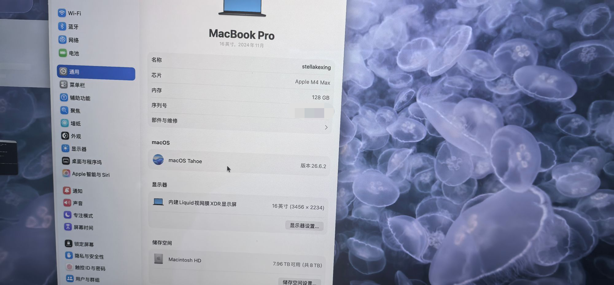

我们为这台 MacBook Pro 起名为 `stellakexing`，延续了洛汐给所有设备以前缀 `stella` 命名的传统。`kexing` 意为「客星」：

<Epigraph>客星，非常之星，其出也无恒时，其居也无定所，忽见忽没，或行或止，不可推算，寓于星辰之间，如客，故谓之客星。</Epigraph>

### 安装必备的工具链

在检查完环境后，需要先安装一些必备的工具链，如 Xcode Command Line Tools、Homebrew 和 Rosetta 2。

```bash
xcode-select --install
softwareupdate --install-rosetta --agree-to-license
/bin/bash -c "$(curl -fsSL https://raw.githubusercontent.com/Homebrew/install/HEAD/install.sh)"
```

事实上在实际运行时，第一条命令总是失败，提示我们「不能安装该软件，因为当前无法从软件更新服务器获得。」这是一个显然的问题，但挂上神奇的妙妙工具后依然报错。:spoiler[Only Apple can do] 解决方法是在 [Apple Developer 的对应页面](https://developer.apple.com/download/more/) 手动下载后安装，这需要登录 Apple ID。

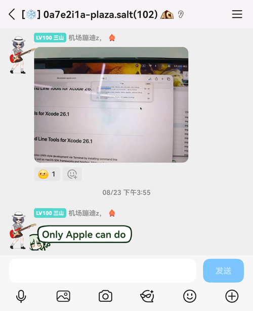

### 安装软件包

「工欲善其事，必先利其器。」安装必备工具链后，我们开始安装软件包。

对于多数软件包，洛汐使用了包管理器（下文会提到）。而对于一些便携的、或没有官方打包的、或需要自己编译的，洛汐于是全部交给 DeepSeek 代办了。在 AI Agent 的时代，AI 的确显著提高了洛汐的工作效率。洛汐安装了一些自己在 `stellarkira` 上就常用到的开发套件、实用软件和 CTF 工具等，同时也参照了一些已有的 CTF 工具大全（下面给出了其中两个）来完善自己在 `stellakexing` 上的工具链。由于线下赛是全程断网的，多带一些工具总比没有强。:spoiler[零音在半决赛的时候少带了工具，导致亏了很多道题目……]

::github{repo="apsdehal/awesome-ctf"}
::github{repo="DXHM/SecTool"}

洛汐目前用得最多的包管理器是——

#### Determinate Nix

由于洛汐一直使用 [Determinate Nix](https://determinate.systems/products/nix/) 和 [home-manager](https://github.com/nix-community/home-manager) 管理自己的软件包，也维护了自己的 [home-manager 配置](https://github.com/LyCecilion/home-manager-config)，迁移变得非常「轻松➕愉快」。Nix 的一大优势便是声明式配置，在不同的电脑上应用相同的配置，能让软件包几乎完全一致。洛汐已有的配置是为自己这台搭载 Fedora、架构为 `x86_64-linux` 的华硕天选 6 Pro `stellarkira` 写的，但经过一些修改后，也能应用到这台 `aarch64-darwin` 的 `stellakexing` 上。

具体地：因为有一些包不为 `aarch64-darwin` 提供，DeepSeek 帮助编写脚本并筛选出与 CTF 相关、且有 `aarch64-darwin` 构建的所有包，以生成一份 `home-darwin.nix`。随后我们安装 Determinate Nix 并以 standalone 方法安装 home-manager，但是默认情况下好！慢！啊！在 `/etc/nix/nix.custom.conf` 中添加下面的内容以换源：

```conf
# Chinese mirrors for mainland China
# TUNA (Tsinghua University) mirror as primary substituter

# Binary cache — use TUNA mirror first, then fall back to official
substituters = https://mirrors.tuna.tsinghua.edu.cn/nix-channels/store https://cache.nixos.org

# Allow unprivileged daemon users to select TUNA as a substituter.
# Store paths are still verified using trusted-public-keys below.
trusted-substituters = https://mirrors.tuna.tsinghua.edu.cn/nix-channels/store https://cache.nixos.org

# Trusted public keys — TUNA proxies cache.nixos.org, same key
trusted-public-keys = cache.nixos.org-1:6NCHdD59X431o0gWypbMrAURkbJ16ZPMQFGspcDShjY=

# If TUNA is down, try USTC instead:
# substituters = https://mirrors.ustc.edu.cn/nix-channels/store https://cache.nixos.org
# trusted-substituters = https://mirrors.ustc.edu.cn/nix-channels/store https://cache.nixos.org

# Or Shanghai Jiao Tong University (SJTUG):
# substituters = https://mirrors.sjtug.sjtu.edu.cn/nix-channels/store https://cache.nixos.org
# trusted-substituters = https://mirrors.sjtug.sjtu.edu.cn/nix-channels/store https://cache.nixos.org
```

:spoiler[怨。这里是 AI 幻觉重灾区……所有 AI 给的换源方法几乎都有问题。这个亲测可用。]

这里需要解释一下：`trusted-substituters` 并不会跳过签名校验，它允许非 trusted user 在连接 Nix daemon 时选用列出的 substituter；缓存内容是否可信，仍由 `trusted-public-keys` 等设置判定。另外，`substituters` 的实际尝试顺序还会受到各镜像 priority 的影响，并非一定严格依照这里的书写顺序。[^nix_substituters]


随后运行第一轮 `home-manager switch` 就可以了，待装上 `nh` 后可以使用 `nh home switch .`。这里本来应该附带这些脚本和替换后的 `.nix` 文件，但由于洛汐在济南回程前就归还了 MacBook Pro，这部分内容没有备份。

不过与许多朋友的建议相左，洛汐并没有使用 [nix-darwin](https://github.com/nix-darwin/nix-darwin) 作为配置 macOS 设置的方案：一是洛汐对这个东西的确不太熟悉，需要额外的心智资源来学习；二是其短期收益事实上不高，且大部分功能要么洛汐完全用不到、要么洛汐已经在「系统设置」里配置。所以洛汐果断选择了纯粹的 Determinate Nix 和 home-manager。不过洛汐并没有选择把所有软件包都交给 Nix 管理，毕竟，macOS 上还有一个更大众的方案：

#### Homebrew?

对，[Homebrew](https://brew.sh/)。


零音/洛汐 曾经在 `stellarkira` 上用过 Homebrew，不过，Linux 侧的 Homebrew 似乎并不是显著必要的，毕竟有更现代、更原生的包管理器。而对于 macOS，Homebrew 几乎是开发者的必备了。我们在这里也使用了 Homebrew，但并非一股脑把所有包丢给 Nix 或 Homebrew，洛汐认为二者应当有明确的分工。具体地：Nix（配置了 home-manager）更加适合管理 `zsh`、`git`、`tmux`、`neovim` 等纯 CLI 工具及其配置和 `uv` 等基础运行环境，而 Homebrew 则更适合管理 `brew install --cask` 的 GUI 工具、某些明确依赖系统集成的工具和现成的软件。

事实上，在洛汐将配置文件从 `stellarkira` 迁移到 `stellakexing` 的时候，也遇到过这样的问题：Nix 侧的一些包声明提供了 `aarch64-darwin` 版本，却在构建时因为各种原因出错，在这种情况下，使用 Homebrew 这样相对原生的方案则是最不容易出问题的选择。而对于 QQ、OrbStack、UTM、:mark-purple[DaVinci 和 Figma] 这样的重 GUI 程序，Homebrew 同样支持管理其中的大多数，但洛汐仍然使用了从官网下载安装包（`.dmg` / `.pkg`）并手动安装的方法。:spoiler[内心里始终有点莫名其妙的膈应。]

总而言之，包的安装是相对容易的。不过，装好了可不代表能真正跑起来：macOS 上有一套非常复杂的……

#### 软件包校验机制…

洛汐在 macOS 上遇到的第一个硬骨头是 macOS 的软件包签名校验机制——这远比 Windows 的 UAC、SmartScreen 严苛得多。从门禁（Gatekeeper）到公证、代码签名，再到运行时保护，整个链条构成了 Apple 生态的安全铁幕。[^gatekeeper_runtime_apple]对于从 App Store 下载包，或完全使用流行软件包的轻度用户，这不会造成任何问题，反而强化了系统的安全性——但对于重度用户，尤其是 CTFer——这就确实有些灾难了。默认情况下，Gatekeeper 会在首次打开带有互联网来源标记的 app、插件或安装包时检查其开发者身份、公证状态以及内容是否被修改；用户明确放行、命令行工具、动态库和应用运行时的代码签名检查则各有不同，不能简单概括成「凡是未签名的下载文件都会在启动前被 SIGKILL」。

对于被 Gatekeeper 阻止、但用户确信来源可信的程序，最基础的放行方式是先尝试打开一次，再前往「系统设置 > 隐私与安全性」，在「安全性」区域找到被阻止的软件条目并点击「仍要打开」。[^gk_tencent]这相当于用户为该程序开了一次明确的例外，并不等于修复或替换它原有的签名；倘若应用内部文件已被修改，后续还可能触发代码签名完整性、Library Validation 或其他运行时检查。

很多时候 macOS 提示「包已损坏」，并不是真的损坏，而是隔离属性（`com.apple.quarantine`）触发了 Gatekeeper 的检查。该属性通常由浏览器或其他下载程序写入，记录来源标志、下载代理、时间等 provenance 信息；它并不包含一个简单的「Gatekeeper 评分」。若确信文件来源可信，可以用 `xattr` 递归删除 `.app` 内的这一项属性：[^juejin_quarantine]

```bash
xattr -d -r com.apple.quarantine /path/to/program.app
```

这是绝大多数教程的终点——但我们使用的 IDA Pro 因为一些特殊原因（嘘——）必须替换其内部文件，这才是麻烦的开始。替换 `.app` 内受签名覆盖的可执行文件或框架库后，原签名记录的哈希便不再匹配；具体应用还可能受到 entitlement、Hardened Runtime 或 Library Validation 约束。在我们当时这个具体版本上，重新签名确实解决了启动问题。

macOS 支持不使用开发者证书的 ad-hoc 签名（`--sign -`）；它不需要开发者账号或联网，因此在断网环境下也能完成。我们当时对它执行了：

```bash
codesign --force --deep --sign - /path/to/program.app
```

`--force` 用于覆盖原有签名，`--deep` 要求 `codesign` 处理包内的嵌套代码，`--sign -` 则指定 ad-hoc 身份。这个做法会使应用与官方签名和公证身份脱钩，也可能改变或丢失原有的 entitlement；它是这次本地排障中有效的办法，却不是对任意 `.app` 都必然奏效的通用修复。此后若再次改动受签名覆盖的文件，签名还会重新失效。[^re_codesign]

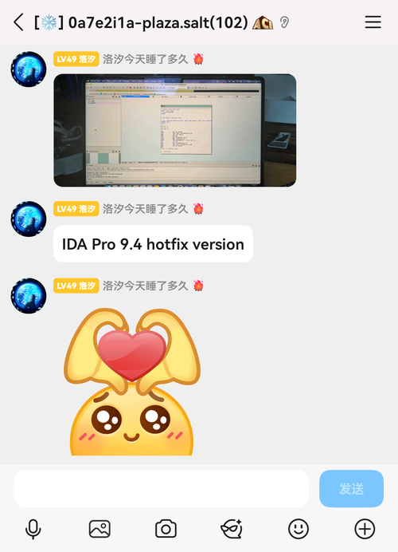

「劳累……」想念 Fedora 就是在这一刻开始的，没想到 macOS 装个软件包有这么多讲究。好在所有软件最后都正常工作了，洛汐舒了一口气。

> 二次编辑：unDefFtr 后来告诉洛汐，实在不爽的话可以直接把 Gatekeeper **干掉**，因为「规则就是用来打破的」！这个，真能这么干吗……（害怕

#### 验证工具是否可用

即使很多工具安装成功了，也并不意味着它们一定能跑起来。部分工具只有在真正运行的时候才会提示缺这样那样的东西；而很多工具的帮助文档并不易懂。倘若只是带上了工具却发现无法使用，或带上了工具却在该用的时候甚至忘记了这工具的存在，那便是完全的无用功了。洛汐在安装完软件包后，让 DeepSeek 测试了所有的软件包，用至少三种功能逐一验证软件包确实可用，并生成了一份详尽的 Markdown 文档。文档里给出了每个软件包的安装路径、实际用法和注意事项，并且还给出了综合渗透这类通用流程（信息收集、端口扫描之类），真正让这些工具串成一套成熟可控的工作流。洛汐依旧需要说，在过去完成这项工作是相对困难的；而在 AI Agent 时代，这样繁复的工作变得前所未有地简单。熟练使用 AI 已经变成了技术类工作人员的必备技能。

不过，仍然是因为没有备份的缘故，这里无法向各位展示这份 Markdown 文档的最终版本了。洛汐只留下了一个中间版本的截图，呜呜……

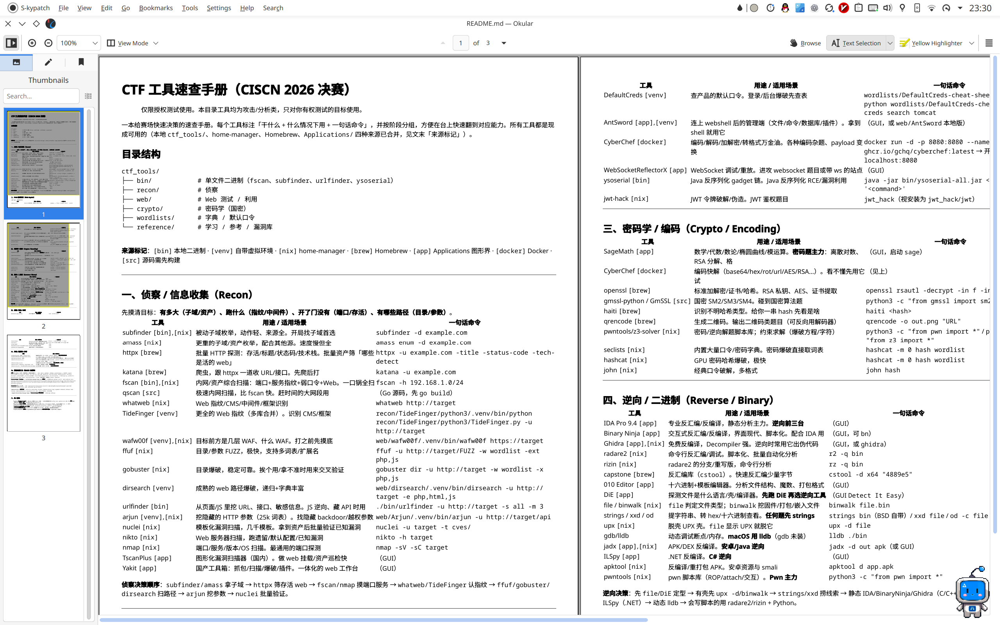

### 其他配置

触控 ID、Siri、Safari 浏览器之类 Apple 或 Mac 特有的配置，洛汐几乎都设置了；之后也尝试了一些 Mac 特有的开发套件和工具等。虽然不是洛汐租的 Mac，但「毕竟 Mac 现在在我手上，那就是我的了！」

于是洛汐拿着 `stellakexing` 玩了很久，体验了很多 macOS 侧的东西。（猜猜看：前文里:mark-purple[洛汐为什么要给一台 CTF 设备装 DaVinci 和 Figma 呢？]）最后，又给 PatriciaOfEnd 表演了一波单手持握 MacBook Pro 在街上飞奔。:spoiler[不是我的芝麻信用分我就嗯造了哈哈哈哈]


但洛汐自始至终没有在系统设置内登录 Apple ID。考虑到激活锁之类的问题，即便洛汐确信自己不会搞砸，也不敢擅自冒险，毕竟 Apple 对这方面的管控很严，而且这是租来的机器，:spoiler[搞出个什么问题就要给 p 大手子急哭了，而且 p 大手子借设备还是👴垫付的钱，，] 所有的软件，洛汐也都没有从 App Store 下载。

### 适应

于洛汐看来，适应 Mac、适应 MacBook 和适应 macOS 是不一样的。

洛汐在同学那里用过 MacBook——不过是 MacBook Air。那台笔记本真的很轻很薄，看起来非常优雅，以至于当洛汐拿到这台 Pro 的时候甚至以为自己租到了华强北盗版：重、厚，而且烫；电源适配器也是巨大的一块。但毕竟这是一台性能极其出色甚至恐怖的笔记本，并且，好在它的噪声不大、音响效果非常给力，尤其是低频音超级震撼，在配置环境的那些日子里，洛汐一直使用这台 MacBook 循环播放[音游曲歌单](https://music.163.com/m/playlist?id=6628152665&creatorId=564277776)，听感甚至比家里那台小米音箱 Pro 还要出色一些。（）适应 Mac 其实是一个宽泛的话题：身旁有朋友购入 Mac mini 并接入自己的显示屏和键鼠，他们依旧用得很开心。而至于适应 macOS，洛汐并没有在上文展开太多，因为在拿到 `stellakexing` 之前，洛汐的确没怎么深入用过 macOS——但事实上，适应 macOS 比洛汐想象中的快很多。

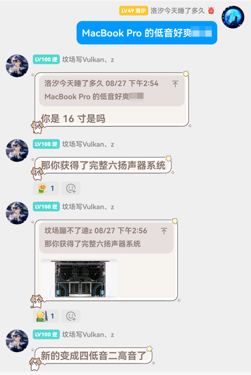

让洛汐首先感到有些别扭的，实际上是键盘的左下角：`Command` 和 `Option` 键的加入让洛汐摸不着头脑，用 Mac 的前几个小时里洛汐愣是不知道怎么复制粘贴，怎么在终端里发送 `Ctrl-C`。而 macOS 中，这些键又被显示为更让人摸不着头脑的 icon（`⌃`、`⌥` 和 `⌘`），无疑加剧了洛汐的理解负担。不过事实上，习惯了之后，洛汐便感到舒服了不少。毕竟在终端里再也不需要使用 `Ctrl-Shift-C` 来复制内容，而 `Ctrl-C` 的两种客观上的含义也被 `Command` 和 `Control` 键分开。过去在使用 hackintosh 的时候，protosc 似乎还在使用某个小工具进行键盘的映射，现在看来也是没有必要了。

让洛汐随后感到十分优雅的，是 `.dmg` 安装软件的操作：打开一个 `.dmg` 后，只需要将 `.app` 拖入到 `/Applications` 即可完成安装，十分优雅。事实上，在 Fedora 侧的 `stellarkira` 上，洛汐也在使用类似的 AppImage 方案安装软件，配上 [Gear Lever](https://github.com/mijorus/gearlever) 达成了类似的效果。不过，macOS 上固然也存在有 `.pkg` 或一键安装脚本之类的安装途径，洛汐在另一篇文章中也谈论过这一点。

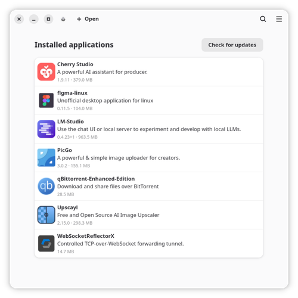

让洛汐之后挠头的是 macOS 的窗口逻辑。洛汐尝试了 macOS 在最近某个大版本加入的[「台前调度」](https://support.apple.com/zh-cn/guide/mac-help/mchl534ba392/mac)功能，但「台前调度」似乎一次只能展示一个程序的窗口，洛汐不太喜欢这样的使用体验，于是最后还是换回了正常的平铺式管理。另外，在 macOS 上，点击左上角红绿灯中的绿色按钮原来是真的[「全屏」](https://support.apple.com/zh-cn/guide/mac-help/mchl9c21d2be/mac)而不是[「最大化」](https://support.apple.com/zh-cn/guide/mac-help/mchlef287e5d/mac)……在触控板上四指平移可以在桌面和全屏窗口之间切换；若系统设置中将「双击窗口标题栏」配置为缩放或填充，双击标题栏才更接近日常意义上的「最大化」。洛汐对这个逻辑适应了很久很久才习惯。对了，还有一点：在 macOS 中，关掉了所有窗口并不代表关闭了这个程序。[^mac_window]它通常仍会留在程序坞中；再次点击时，应用可能重新打开窗口，也可能只是切换到前台，具体取决于应用本身。当然在 Windows 和 Linux 上有托盘，在 macOS 上菜单栏也可以常驻程序，但这两者似乎并不完全一致。macOS 在这里的默认逻辑可能不太一样，也是换到 macOS 后需要适应的点。

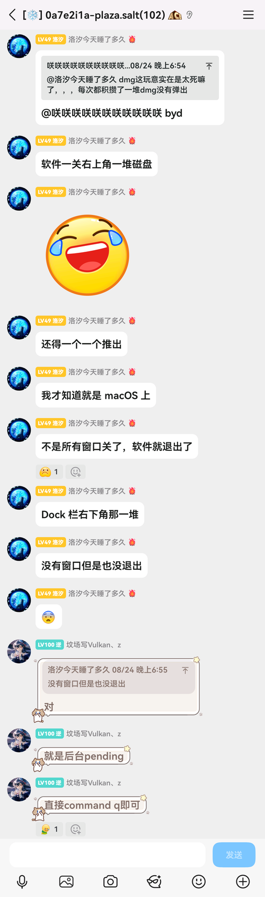

> 不过，这篇文章的预览版发布后，一些朋友们前来讨论和支招。有朋友告诉洛汐，其实在「台前调度」中，只要长按（或者按住 Shift 点击）左侧的窗口，将其拖到当前的主工作台中，就能实现在同一个工作台里同时显示多个软件或窗口。另外，也有朋友一针见血地指出，这些习惯之所以没有，并不是因为它不符合计算机的直觉，也不是不符合现实的直觉，仅仅是因为它不符合 Windows 的直觉而已。感谢各位让洛汐对 macOS 的知识又多了一分。

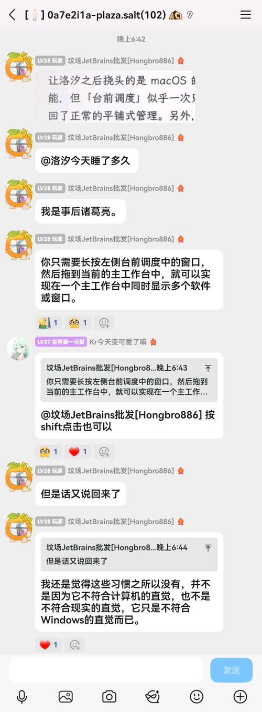

让洛汐真正惊叹的，是 MacBook 的触控板。其实洛汐觉得对于这一点已经无必要阐述了，真正用过的才知道这个东西是多么伟大.png 不过也间接导致洛汐换回 `stellarkira` 之后反向适应了很久（）

### 留意的点

当然也有一些点需要注意。MacBook 没有 RJ45 网口和 USB-A 接口——虽然还有 HDMI、SDXC、MagSafe、耳机接口和 USB-C/Thunderbolt 接口，但对于线下 CTF 这种一张桌子一个交换机，所有设备通过网线连接，U 盘用来拷贝数据的情形仍不太友好。需要购买一个扩展坞。以及它在开盖的时候就会自动开机，再加上洛汐为这台 MacBook 打开了经典的「duang~」开机音，洛汐觉得这非常高级，但很多朋友表示打开盖子后被吓到了.png

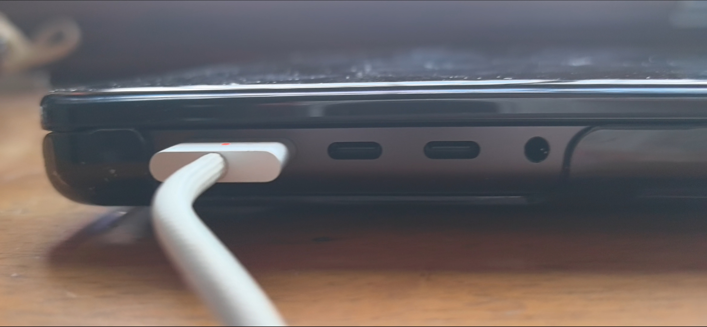

访达 app 是一个相对来说褒贬不一的自带程序，它和 Windows 上 `explorer` 的地位有的一拼，但似乎在风评上也有的一拼。双击压缩包直接解压而不是浏览内容、对于文件数较多的文件夹略显糟糕的浏览体验、右键不支持直接新建内容，以及路径输入入口不够直观等问题，都是洛汐这些日子里体验过的——当然，按 `Command-Shift-G` 可以调出「前往文件夹」并输入路径，只是洛汐此前并不知道。自带的「终端」app 在使用 oh-my-pi 的时候有严重的渲染问题；朋友们极力推荐 iTerm2，但洛汐直到最后也没研究出一套适合自己的配置，于是还是选择了 Kitty 并复用了 home-manager 侧的配置。macOS 似乎仍然没有原生支持 NTFS 写入，但洛汐权衡之后觉得配置 NTFS 驱动的收益不高，于是选择忽略这一点。配置好环境并不代表可以带着电脑大大方方走上赛场，于是万事大吉——与这个系统磨合一段时间后，我们才能真正发现一些的问题，这些问题或微不足道、或真的能影响体验。:mark[于系统如此，于人也一样——识人不准已然给 零音/洛汐 造成了巨大的困扰，洛汐也不想在识 OS 上重蹈先前的覆辙。]

## 配置 Qwen 3.8 27B

总算到了正文了！租赁这台 MacBook Pro，本就是为了在断网时跑模型。事实上，在 CTF 比赛中，洛汐更愿意使用自己已经配置成熟的环境，至少用起来非常顺手——但毕竟 CCISC 规定了每个参赛成员「只能携带一台计算设备，且计算设备的功率不能超过 260 W」，于是为了跑模型，租一台 Mac 便成为了最有性价比的选择。考虑到我们队的 4 人中只有洛汐对 Linux/Unix 环境较为熟悉，且对本地配置 AI 也有一定的熟练度，于是两台中的一台就自然落在了洛汐手上。

在这块 Apple Silicon 上跑本地 Qwen，我们起初想了两条路线——

- **路线 A：MLX/MLX-LM**。这是 Apple Silicon 生态里非常自然的一条路线，通常对统一内存和 Metal 利用得比较好。洛汐天然也对这种方案有着好感，毕竟它足够原生且适配 Apple 芯片。
- **路线 B：llama.cpp + Metal**。这条路线更加通用，生态成熟，模型格式支持和参数控制更广，对 GGUF 模型尤其方便。

但具体选择哪一条，仍然取决于后续的实测。这里，我们直接使用了大名鼎鼎的——[LM Studio](https://lmstudio.ai/)！

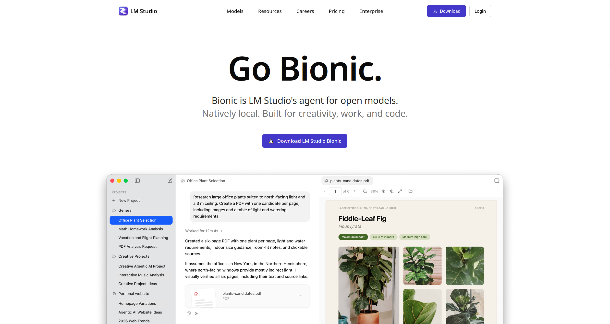

是的，洛汐惊叹于这款软件对两条路线都有着较高的支持度，图形化的界面足够友好，使得洛汐不必把时间浪费在模型的命令行配置上，更能专注于模型本身能力和效率的测试以及 CTF 环境的配置——这固然是极好的。LM Studio 原生提供了 Qwen 3.8 27B 的两种模型——MLX 的 8bit 量化版与 GGUF 的 Q8_K_M 量化版，下载和安装都只需要点几下，不过它似乎走代理也不是很快。国内有一些镜像站可以使用，但洛汐知道这事的时候已经下完了，下了整整一天一夜……

### 另一颗星星上的 Qwen

在洛汐的 `stellarkira` 上，跑 Qwen 3.8 27B Q4_K_M，使用 LM Studio，默认配置下速度仅为 3.5 token/s，慢到几乎难以接受。洛汐做了设置，在 GPU Offload 25 层、关闭 MTP 并删掉 Vision 层、KV Cache 调至 Q8_0、CPU Thread Pool Size 设置为 8 的情况下，推理速度提升到了 7.5 token/s，有了足足一倍的提升，但仍然慢到难以接受……不过它的系统内存占用倒是问题不大，在后台无其他明显软件的情况下，RAM 总占用（包含 Fedora 系统本身）为 7 GiB，空闲 23 GiB，比跑 Windows 时开机的占用还要低；不过，这个数字没有算入 GPU Offload 后占用的独立显存，不能当作整个 27B 模型的总内存占用。CPU 占用大约 60%，风扇也几乎不怎么转。

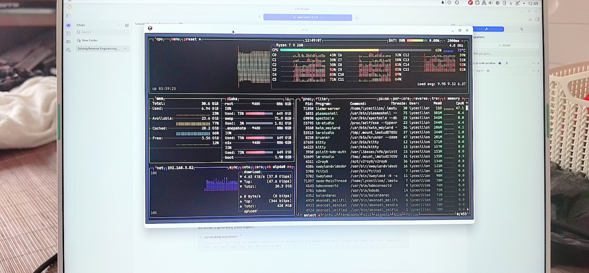

洛汐对自己的调校非常满意，但唯一的问题是这速度太慢；而且洛汐为保守起见，设置了 32k 的上下文，看起来很多，但 Agent 几轮就满了。非常难受。然后 `stellakexing` 就来了。所以洛汐称它为「客星」。

### 初见 MLX

洛汐首先下载了 MLX 版本的 Qwen 3.8 27B 8bit。下载完成后开始测试：由于 LM Studio 暂不支持调整 MLX 模型的上下文长度，所以洛汐使用模型的原生最大上下文长度 262k。

#### 无畏 Chat

第一轮测试不追求复杂。不使用 Agent 的情况下，先使用 Chat，在 LM Studio 内直接做基本测试：模型对同一个问题测试三次，随后取用时和速度的平均值。洛汐测试了：

- 基础代码能力。让 Qwen 完成一个小型 Python 和 C 任务，判断其是否理解需求、代码能否运行。
- CTF 任务。使用一段容易的汇编代码让 Qwen 分析，判断其是否正确提取关键信息、生成可运行的脚本。
- 长上下文。使用了一段较长的小说文本，测试其在长上下文时候的生成质量表现、prefill 速度和输出稳定度。

测试发现，各测试项速度相差不大，几乎稳定在 15 token/s，在一句话提示词中只需约 0.1 s 就可以得到第一个 token。不过一个问题已然浮现，虽然在目前看来并不明显——部署的 Qwen 面对长上下文的时候，prefill 速度极慢，在小说文本测试内容中，使用一篇数万字的小说，Qwen 用了近半分钟才完成了 prompt processing。当时的洛汐并没有觉得有什么大问题，紧接着开始了第二轮测试。

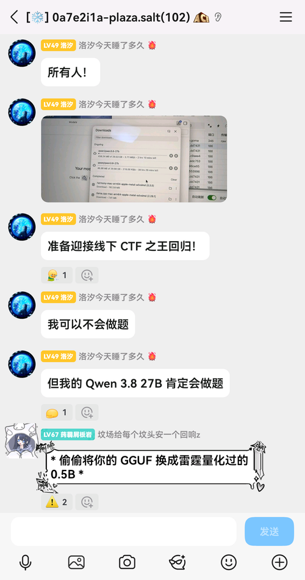

#### 无畏 Agent？

其实之前的 零音/洛汐 总觉得这种比赛不应该开 Agent，毕竟 Agent 干活很慢，而且我们不能确知 27B 的最大能力；但后来真正测试后，才发现 Agent 能力确实有用——Chat 能做到的功能很有限，取决于交互者的发言水平，而且需要不断交互，在比赛中这样做会非常麻烦。于是洛汐展开了 Agent 测试：测试使用的 Agent 分别有 oh-my-pi、Codex 和 DeepSeek Harness Desktop。这三款 Agent 都是洛汐日常使用的，洛汐对它们有很高的预期。:spoiler[至于 Claude Code——洛汐只能祝 Anthropic 和 Dario 一路顺风。]实测得到的结果是，在上下文长度接近的情况下，三者的输出速度等性能表现相差不多；但由于没有足够的 CTF 或代码相关的测试案例和试验方法，洛汐也并非权威的 AI 测试机构，也就无从得知谁对 Qwen 的 harness 更有效，于是最后在赛场上，洛汐还是选择了自己最熟悉的 oh-my-pi。

先说 [oh-my-pi](https://omp.sh)。它原生支持在模型列表中选择来源于 LM Studio 的模型，在未配置 Skills、未修改多数配置的情况下，其 initial prompt 约 17k，其中存在一些客观意义上对 CTF 无用的东西，例如关于代码风格与规则的要求、对 oh-my-pi 本身的介绍等。DeepslateQAQ 为 oh-my-pi 开发过一款插件 [omp-dsh-minimal](https://github.com/DeepslateQAQ/omp-dsh-minimal)，可以将 oh-my-pi 的内置提示词切换到 DeepSeek Harness 的简化风格，但该插件默认仅支持 DeepSeek 的两款模型，洛汐并没有在赛前修改插件的时间和精力，因此放弃了这条路而继续使用官方默认的 oh-my-pi。

不过，洛汐修改了 oh-my-pi 的一些配置，但由于篇幅原因，洛汐不愿继续展开具体的配置了。oh-my-pi 提供了非常非常丰富的配置项，包括对上下文的维护、对 tool calling result 的简化处理和 prewalk、advisor 等。其中大多数配置项在日常开发中非常得力，但在线下的、算力有限的 CTF 场景中则是带不来能力提升、却会造成严重性能损耗的无底洞。得当的配置，对线下 AI 性能的发挥有至关重要的作用。

接下来是老牌王者 OpenAI 的 [Codex](https://openai.com/codex)。事实上，Codex 接入 LM Studio 模型略显复杂，洛汐使用了广为人知的 CC Switch。Codex 是很长一段时间洛汐的主力 Agent，不过，因为 Codex 不能直接看到模型的思考过程，这会让洛汐非常焦虑，所以洛汐最终也没有使用 Codex。毕竟在线下赛中，由于 Agent 太慢，任何一个决策上的错误都可能浪费比赛宝贵的 AI 时间；洛汐更愿意在思维链里看到 AI 的想法，并给予适时的指正和引导。

不过，洛汐在互联网上得到的一致答案是：Codex 的 harness 是一流的，甚至对于 DeepSeek V4 Pro 0813 这种过拟合了 DeepSeek Harness 极简模式（minimal mode）的模型也具有更高的跑分，但毕竟模型质量和 harness 质量是一个仁者见仁智者见智的问题，就连所谓权威的评测机构也会在这些事情上有所偏差——洛汐最后还是没有选择 Codex 作为主力 Agent。

最后是新起之秀 [DeepSeek Harness](https://www.deepseek.com/harness/en/)。DeepSeek Harness 可以通过修改配置文件使用 LM Studio 的模型，原生支持 OpenAI Responses API。不过由于比赛时（2026 年 8 月末）DeepSeek Harness 仍处于非常早期的预览版 `0.1.0-rc.7`，其极简模式虽然 prompt 显著更短，但在 macOS 上有 [极简模式下 Bash 工具的 bug](https://github.com/deepseek-ai/deepseek-harness/discussions/4849)，所以洛汐只能使用标准模式。不过，DeepSeek Harness 在当时的版本也存在一个设计上的致命问题——因为本地 Qwen 的 token 速率实在太慢，在 Qwen 调用 Write 工具编写脚本时，连续出现了多次被打断的情况：因为 Qwen 写得实在太慢了，DeepSeek Harness 判断写入工具执行超时，于是就直接打断了模型。这对线下赛和自部署模型来说是一个非常恐怖的问题，所以洛汐没有使用 DeepSeek Harness。

#### 无畏并发

模型必须放在真实任务中才能显露其真正水平。于是，洛汐使用了 Mini L-CTF 2026 的 Web 题 [EzOmniProbe](https://crystal.stellalyr.ink/2026/05/07/Mini-L-CTF-2026-Writeup/#EzOmniProbe) 进行测试，这次测试使用了 DeepSeek Harness Desktop，得到的结论是：单轮任务，非并发，在长达 2 小时的测试中，洛汐给模型提供了 2 次提示，Qwen 3.8 27B 的缓存命中率 91%，平均 token 效率（这里包含 prefill 和等待 tool calling 的时间）4.8 token/s，首 token 平均用时（各轮从发起到收到首个 token 的平均值）27.6 s。最终，Qwen 成功将题目推进到了 JS 沙箱，大约是题目的 60%。（当然，除了这道题之外，洛汐还使用别的指标进行了测试，这将在后文提到。）

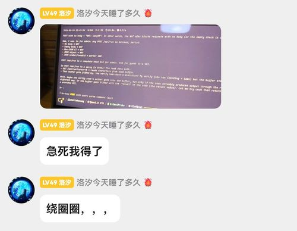

事实上：洛汐是有点失望的。一道零音用了 2 个小时就差不多看明白的 Web 题，被 Qwen 跑了 2 个小时还在绕圈子，而且生成速度是越来越慢的——从各种角度来说，当前的工作流并不合格。其实洛汐并没有对 Qwen 3.8 27B 抱有很高的预期，毕竟 零音/洛汐 很早之前就自觉 27B 的模型顶了天也比不过:mark[部分参赛者在比赛中以各种可能并不正当的方式使用的 1.6T 参数量的模型 DeepSeek V4 Pro] [^dsv4p]。洛汐对这个模型的预期是，它能够帮助洛汐做一些繁琐的工作而非智力上的工作，也就是说，它可以分担一些可能并不太吃智力的工作量，但若让它全局掌管某道题的完整思路，那确实有些强人所难。不过，在 CCISC 2026 的实际比赛中，由 2 台设备部署的 Qwen 3.8 27B 事实上做出了很多的题目，:mark[甚至在以 MacBook Pro 的理论生成效率而言极短的时间内攻克了一道对其能力而言较为困难的 Pwn，这远远超出了洛汐对 27B 模型的预期。看来真正在线下赛实际共事的时候，无论是模型还是人，其真正的能力和素质才会显露出来。]这于洛汐而言，是不亚于 CTF 本身的一个教训。

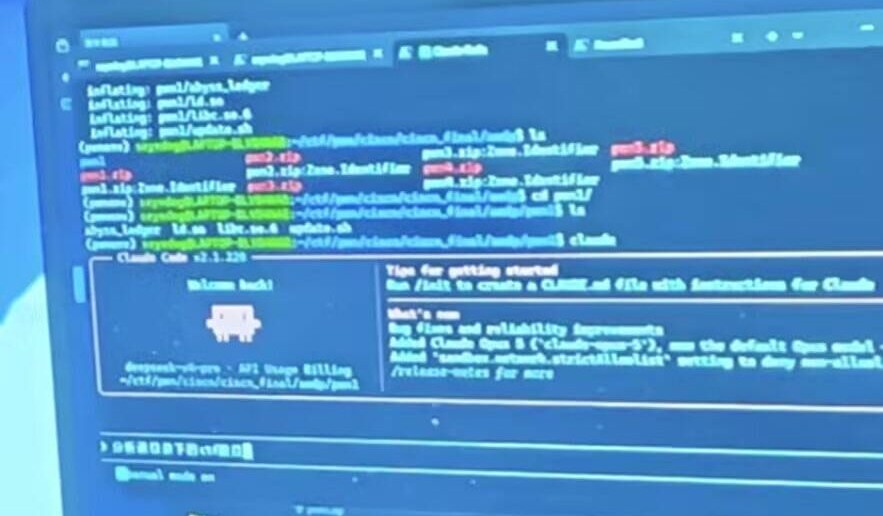

单发情况下尚且如此，那并发情况呢？洛汐只能坦言：在线下赛的真实场景中，Qwen 3.8 27B 的表现让洛汐更加大跌眼镜。

:spoiler[这里因为洛汐文章的提纲有一些混乱，洛汐只能先行剧透：事实上，我们在线下赛使用了 GGUF 的方案，它的确具备了一些性能上的提升，但远没有那么多。]

由于 4 个参赛者共用 2 台 MacBook 的 Qwen，每 2 个参赛者使用 1 台，这里 PatriciaOfEnd 和洛汐使用 `stellakexing` 的 Qwen。在两人各打开 2 个 Agent 的情况下，LM Studio 需要 4 个并行推理的线程，于是 token 效率就大约分了四份，实际测试中，在 4 个线程的情况下，每个窗口的平均 token 速率是 3\~4 token/s；为了提高速度，我们不得不限制 Agent 的数量，但只要两人同时使用，就不可能有速率的提升——到了后期洛汐甚至完全停止使用 AI，以允许 PatriciaOfEnd 一个人跑 3 个 Agent。而速率甚至不是最大的问题：由于一直查不清问题出在哪一环，使用 oh-my-pi 时，若在思考到一半的时候 Ctrl-C 打断，LM Studio 侧的推理并不会立刻中断——换言之它还会继续推理；又因为洛汐设置了 LM Studio 的最大并行数量为 4，于是很容易出现「滚木」推理线程占了位置导致完全无法使用的情况。洛汐只能关掉再打开 LM Studio 的 Server API，强制中断推理，才能继续使用。而又因为 prefilling 的谜之速度，在每一轮 tool call 后，本身对 tool calling 结果的处理就要花很多时间；倘若因为一些问题导致内存中 KV Cache 丢失，那推理速度就更加灾难——在比赛中因为一些原因洛汐重启了 Mac，再次使用 oh-my-pi 重新连接时，对一个 50k 的上下文，Qwen 单是重新 processing prompt 就用了约 10 分钟时间。在比赛中使用 AI 时，**有近半数的时间**我们实际上是在等待 Qwen 重新处理 prompt。这个速度，说实话，真的有点难以使用。洛汐也犯起了嘀咕，这个速度到底是快是慢——

### 再谈速度

质疑归质疑。说实话，等它生成的那段时间里，洛汐其实是感到绝望的。但仔细想想，这似乎也可以理解。我们算一笔账，请看下面的答卷：

:::note[题目]
计算 Qwen 3.8 27B Q8_K_M 在 M4 Max 上的理论 token 速度。（150 分）

**解：**

在我们这台 40-core GPU、128 GB RAM 的 M4 Max 上，它的统一内存带宽最高为 $546 \text{ GB/s}$[^newsroom]。Qwen 3.8 27B 的参数量约 $27 \text{ billion}$。假设使用 Q8 量化，每个参数大致占 $1 \text{ byte}$，那么模型权重的最低体积即

$$
27 \text{ billion} \times 1 \text{ byte} = 27 \text{ GB}
$$

再加上量化 scales、metadata、alignment 和其他张量，我们预期实际的权重接近 $28 \sim 31 \text{ GB}$。

在 decode 阶段，模型每生成一个 token，粗略地需要让大部分权重参与一次计算。我们考虑这样一个上限：每一单位时间内，LM Studio 的 runtime 都能完美地将权重从内存中读完，而且不存在任何其他开销，则有

$$
\begin{aligned}
546 \text{ GB/s} \div 28 \text{ GB/token} &= 19.5 \text{ token/s} \\
546 \text{ GB/s} \div 31 \text{ GB/token} &= 17.6 \text{ token/s}
\end{aligned}
$$

从而理论的 token 速度约为

$$
\boxed{17.6 \sim 19.5 \text{ token/s}}
$$
:::

满分！不过满分归满分，这只是 roofline 式的粗略估计，不是对某个 runtime 的保证。LLM 的世界里有各种复杂的因素，纯数学永远不能概括它的一切。:spoiler[感觉不如当西电 AI 专业开学考出了，有感觉吗（]

<iframe width="100%" height="468"
  src="//player.bilibili.com/player.html?bvid=BV1owbN67Eay&p=1&autoplay=0"
  scrolling="no" border="0" frameborder="no"
  framespacing="0" allowfullscreen="true">
</iframe>

而在现实中，除了需要考虑到「计算」这一确实耗时的问题，还需要扣除一些额外的因素，例如 Metal kernel 并未完整、完美地利用内存带宽，矩阵运算和访存并不完全重叠，还有 tokenizer、采样、同步、runtime 自身的开销等等。[^why_slow]我们实测出的模型效率其实非常符合这个估算——这是物理层面决定的上限。而至于前文为什么提到生成速度越跑越慢，是因为 Agent 任务并非单纯的输出：每轮的耗时要近似包括 prompt prefill、thinking decode、tool execution 和 tool output 等；如此周而复始，后续轮次的 prompt 越来越重。即使缓存命中率高达 91%，也并不意味着前序轮次的成本变为

$$
starwalking = 0.
$$

{/*这个 starwalking = 0 是群里的一个梗，可以直接理解成 0 就行。*/}

减少了某些公共前缀的重复计算是好事，但新增的 tool output、对话尾部和动态部分仍然需要处理。

另外，prefill 阶段同样也是不得不品的一环。洛汐使用了一个 36k 长度的上下文进行测试，模型在 prefill 初期可以达到 200 token/s 的速度，但越往后则速度越慢；处理到第 18k 个 token 时，模型的速度已经降到了 150 token/s。这样看，洛汐之前测试时「一句话 prompt 只要约 0.1 s 就能出第 1 个 token」也就不难理解了；但在当时这套 MLX/LM Studio 配置下，一个 50k token 的上下文也的确用了约 10 分钟才能处理成功。需要注意，prefill 和前面估算的单 token decode 并不是同一种负载：长上下文 prefill 还会受到 attention 计算、KV Cache、分块策略和 runtime 实现等因素影响，不能只用「内存带宽不够」来解释。可以确认的是，这套配置在长上下文下退化得很明显。:mark[毕竟，若跑足够强的大模型只需租一台 MacBook Pro 的话，那这样的比赛不就纯变成了 AI 赛吗？那就没有多少意义了。]洛汐于是这么想着，想啊想……

### GGUF 和 Speculative Decoding

我是一个 GGUF，我有一个 Speculative Decoding！台下选手欣喜若狂！

> 群友🐔我🐔我🐔我🐔我 🐔🐔UF 教我教我教我教我 Speculative 🐔coding😱😱😱😱

想着想着，GGUF 的模型也下载好了，洛汐立刻展开了第三轮测试。本轮测试中，我们使用了史铁生的文章《比如摇滚与写作》并要求模型生成读后感。（说实话，这篇文章真的很有意思！洛汐被史铁生的文字震撼了很久，常读常新……希望大家都来看看 w）

对于 GGUF 的 Q8_K_M 和 MLX 的 8bit 量化版，我们使用了相同的 initial prompt、temperature、top-p、max output tokens 和测试问题。GGUF 的配置如下：

| GGUF 配置项          | 值                    |
| -------------------- | --------------------- |
| Reasoning Effort     | Medium                |
| CPU Thread Pool Size | 16，和 CPU 核心数相同 |
| Speculative Decoding | On                    |

MLX 侧也使用相同的 reasoning effort。**结果非常 AMAZING 啊——**

| 测试项                | Q8 GGUF (64,000) | Q8 GGUF (262,144) | MLX 8bit (262,144) |
| --------------------- | ---------------- | ----------------- | ------------------ |
| 生成速度              | 20 token/s       | 19 token/s        | 16 token/s         |
| 首 token 用时         | 11.77 s          | 11.74 s           | 11.33 s            |
| draft tokens accepted | 44.6%            | 44.5%             | 不适用             |

（括号内的值是设置的上下文长度。LM Studio 中，GGUF 模型可以调整上下文长度，但 MLX 模型因为 [一个 bug](https://github.com/lmstudio-ai/lmstudio-bug-tracker/issues/2250) 而不能。262,144 (262k) 是 Qwen 3.8 27B 支持的原生最大上下文长度。）

**奇迹……降临了**？至少这已经是一个非常漂亮的结果了。在这两套最终配置中，GGUF 的生成速度比 MLX 快了约 25%，且在这一次读后感测试中，两边未见明显质量差异；LM Studio 也为 GGUF 提供了比 MLX 更加高级的配置选项，优势已经很明显了。不过这并不是严格控制变量的「格式对决」：GGUF 打开了 MLX 侧没有的 Speculative Decoding，因此 25% 的差异只能说明我们最终采用的 GGUF 配置整体更快，不能全部归因于 GGUF 或某个 runtime 本身。而其中的 Speculative Decoding 仍然是真正的奇迹——所谓 Speculative Decoding，顾名思义：「投机解码」。在生成时，由一个小 draft model 快速猜几个 token，再由 27B 的 target model 批量验证，猜对的直接接受，遇到不一致处则由 target model 给出结果并继续推算。[^sd]

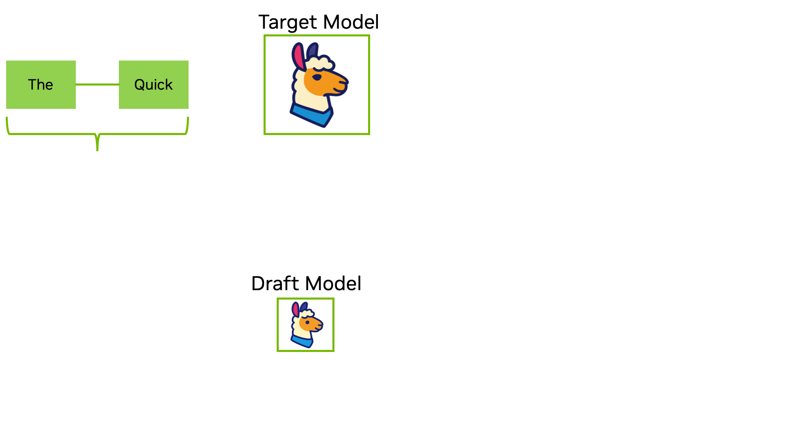

我们在 GGUF 模型上打开了 Speculative Decoding，并且得到了高达 44.6% 的 draft tokens acceptance，这说明 draft model 并非盲目瞎猜，有接近一半的候选 token 能被目标模型接受。而且，我们在这里使用的是散文进行测试；代码和技术类文档更程式化、模式更固定，理论上我们可以期待更高的接受率。当然，我们不能说 GGUF 相对于 MLX 的一切提升都必须归功于 Speculative Decoding，毕竟二者的实现差异等更加底层的东西可能有待我们进一步探究，但这并不妨碍我们坚定已经下定的战术结论：我们已经有了一个实测更快、支持 Speculative Decoding、配置更可控的 GGUF 主线。好、好啊！:spoiler[把 MLX 扫进历史的垃圾堆吧！]

不过，还有没有更大的性能提升呢……？例如，其他的量化方案？

#### Q6/6bit、5bit 和 oMLX

是的，我们考虑过将 Q6/6bit 量化的模型作为 fallback。如果 Q8/8bit 在真实 Agent 任务中确实撑不住，或许 Q6_K GGUF 和 MLX 6bit 可以作为一个速度优先的同档候选。粗略地看，倘若我们在 Q8 量化得到约 14\~16 token/s 的裸生成速度（这里已经考虑了包括 tool calling、prefill 之类导致的性能损耗，所以与之前的测试结果有些差别），则在 Q6 量化下，比较合理的期待是 16\~22 token/s。看起来提升可能不多，但若转换为同等工作量下的执行时间，在以分钟为量度的情况下，其收益还是可观的。我们甚至还考虑过 MLX 的 5bit 量化版，它带来的效率收益理论更加可观——

但问题是，为了速度而选择**更大的量化损失**，真的值得吗？

事实上我们无从得知，正如洛汐在前文所说，「洛汐也并非权威的 AI 测试机构」——自己并没有评测 LLM 的经验，洛汐最终没有选择为一个更快的速度去赌博一个牺牲了精度的模型。当然这并不代表 Q6/6bit 和 5bit 就一定有多么严重的降智——洛汐并不为这一条断言负责，因为洛汐根本没有测试、也没有时间和方法测试。有些遗憾。「降智」？:spoiler[有我 GPT 6 Astra 降智到 4o-like model 那么严重吗？（] [^gpt-6-4o]

不过，来自西电的朋友们提供了一个看起来更加诱人的方案——`Qwen3.8-27B-oMLX-MTP-Mac`。

::github{repo="Weschera/Qwen3.8-27B-oMLX-MTP-Mac"}

这个东西看起来真的很诱人——使用 oMLX Runtime 和特定的 oQ4e 量化模型、MTP 配置，声称可以在 M4 Max（128 GB RAM）上跑到 oMLX baseline: 24.9\~25.9 token/s，oMLX + native MTP: 48.0 token/s prose, 65.5 token/s code，测试条件是单流、关闭 thinking、约 2.1\~2.4 k token prompt、生成 320 token。[^qwen-omm]

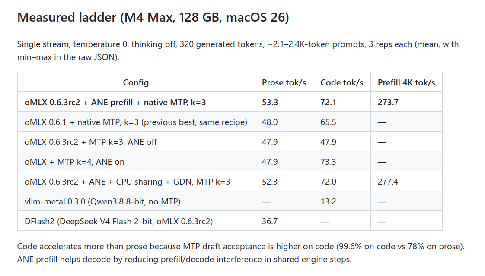

但它究竟是如何做到的呢？回顾前文的内容，为什么 token 生成这么慢？本质上我们可以粗略理解：模型生成每个 token 的时候，都需要将全部权重从内存读一遍，参与计算。每一步的运算量对于这台恐怖性能的 MacBook Pro 来说其实很小，但「读一遍 28 GB」这个动作花掉了**几乎所有时间**。这就是说，GPU 的计算单元实际上大部分时间都在等待内存送来权重。这也就是为什么 27B 无论在 Mac 上怎么调，其速度都被压在这个量级——不是算不动，是「喂」不动。

Qwen 3.8 有一个极好的特性，它的官方模型卡明确写了自己支持 MTP（Multi-Token Prediction）[^qwen-hf]——这意味着 Qwen 3.8 在训练阶段就学会了在预测下一个 token 时同时预测未来 K 个 token。为了实现这一点，模型末尾挂了一个轻量的 MTP 模块（通常只有一层 transformer，参数少得可以忽略），它利用主模型最后一层的隐藏状态，再去预测后续 K 个 token。

传统的 Speculative Decoding 是小模型猜测后大模型验证，而原生 MTP 的路径有些差别：

1. 主模型 forward 一次得到当前最后一个 token 的隐藏状态。
2. 几乎免费的 MTP 模块从隐藏状态出发，以极低的代价预测出未来 K=3 个候选 token。
3. 主模型再将这 3 个候选 token 一次性放到同一个 batch 里做一次并行 forward。接受的，直接落地；第一个被拒绝的，从那里重新进行第 2 步。

加速的秘密在于第 3 步：验证多个候选 token 时，target model 可以通过一次批量 forward 摊薄读取权重的成本。batch 变大会增加计算和中间状态开销，但在 decode 主要受内存带宽限制时，空闲的计算单元可以承担其中相当一部分。不过，实际加速比取决于每次提出的候选数、平均连续接受长度、draft/MTP 模块的成本、批量验证开销和采样方法，并不能把一个 acceptance rate 直接代入「1 + 平均接受率」得出。

但我们原来的配置也有 Speculative Decoding，为什么和这个 repo 的实现结果相差了近两倍呢？这有两重原因。第一重，原生 MTP 的接受率显著高于外挂 draft model 的接受率。MTP 的收益事实上严格取决于接受率，好比一个 draft 模型如果给你预测了一堆废话，你一定看都不想看——MTP 就是这个道理。这个 repo 里的原生 MTP 的接受率明显更高，从而它大概率能获得更高的速度。

第二重原因呢？它…实际上是 Q4 量化。对，又回到了洛汐所说的原点——洛汐还是不愿意赌 Q4。写这段文字的时候，洛汐已经打完比赛一两周了；回想一下，当时看到这种新的方案的确欣喜若狂；但想到它是 Q4 量化的时候，洛汐愣是赌都没敢赌。洛汐不敢说自己到底是亏了还是赚了，毕竟正如洛汐所说，洛汐也没法赌，因为的确没法测。不过它倒是给我们提供了一个更有价值的推论：如果 GGUF 侧我们的 Speculative Decoding 不再进步，则该 repo 提供的 oMLX + oQ4e 方案的吸引力就更多来源于它的 Q4 权重和接受率的实现，而非「原生 MTP 这个想法」。是的，GGUF 模型或许没有原生 MTP 那样的速度，但接受率的提升是实打实影响模型效率的关键因素。其实我们已经借这个想法吃到了红利——近半的接受率已经带给了我们显著的效率提升，我们只是缺少更好的量化起点和更精的实现——但这并不是我们可以做到的。这样的推论或许并不能为我们带来 token 速度上的实际提升，却实在可以让我们稍微心安一些了。毕竟，不是我们能改变的事，为什么要为其负责、懊恼和焦虑呢？

所以，我们最终也没有选择这个方案。洛汐跑出的 20 token/s 并非因为洛汐太菜，而是在约 28 GB 权重和这套 runtime 的约束下，它的裸 decode 本来就只能在这个量级；我们采用的普通投机解码又通过一次 target forward 接受多个候选 token，提高了最终的有效生成速度。这个数字其实已经相当体面了——而洛汐也不愿意用更玄学的引擎去赌一个不知道光不光明的未来。于模型优化如此，于人生和未来也一般——孤注一掷，本就不是洛汐习惯的生活方式，即使 protosc/Sigrid/零音/洛汐 已经在生命中孤注一掷过无数次，也为此遍体鳞伤过许多次。

### 再谈微调

有朋友询问过：要不要自己微调一个模型？老实说，这个念头并非毫无依据——互联网上确实有一些面向 CTF/网络安全 场景的微调模型，例如 Hugging Face 上的 [ShadowEternity/CTFsolver](https://huggingface.co/ShadowEternity/CTFsolver) 和 [edamamex/qwen-ctfer](https://huggingface.co/edamamex/qwen-ctfer)，而事实上也不乏「微调之后某项能力明显提升」的案例。但洛汐给出的答案依然明确：对我们的使用场景而言，微调大概率是一件负期望值的事情。

SFT 微调最容易稳定改变的，是模型「回答的形状」——输出格式、口吻、解题报告的结构、领域词汇的唤起方式。[^finetune]高质量 SFT 也可能改善领域知识的调用、工具使用、任务分解，以及与训练分布相近的漏洞识别表现；但几千条 CTF writeup 能否为一个 27B 模型注入可以泛化到陌生题目的新推理能力，仍然十分不确定。对我们的短期使用场景而言，它更像是「激活」与「规整」，而不是保证教会模型一种此前完全不会的能力。

而且，事实上有个隐蔽的坑：公开 writeup 的质量是出了名的参差不齐。大量题解会跳过最关键的思考步骤——无数个令人憎恶的「注意到」背后，真正的洞察过程是缺失的。用这种语料训出来的最坏结果，不是模型变强，而是学会写「听起来很自信、推理却很浅」的解题报告，或者在一轮轮做题中学会瞎猜。对一个跑分本来已经接近 V4 Flash 的模型来说，这甚至是降级。还有一个更实际的副作用要警惕：若学习率、训练轮数或数据配比不当，小规模 SFT 也可能造成灾难性遗忘，使通用代码和推理能力被磨掉一角；采用 LoRA、混入通用数据并认真评测可以降低风险，却不能替我们省去验证。通用代码能力恰恰是这场比赛最依赖的主资产。为了在某个细分域里博几个点，仓促赌上全局能力，这笔账不划算。

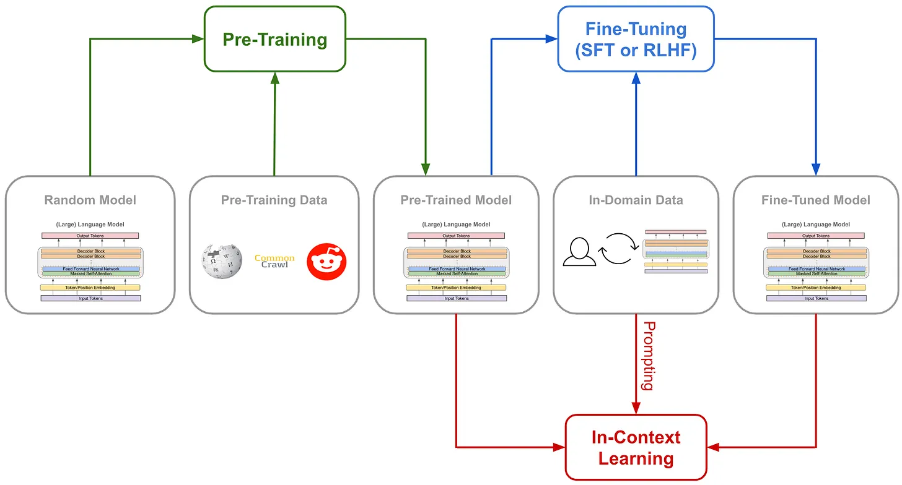

更何况，这台 MacBook Pro 在备赛的这些日子里，还肩负着它真正的本职任务：环境验证、推理基准、断网彩排。五天窗口里如果塞进一个完整的微调项目，意味着前面所有准备都会被挤压。不过，这并非说微调永远不值得：唯一在赛前还有上升空间的变体，是趁现在还有网，用前沿模型的 API 批量生成高质量 CTF 推理轨迹做蒸馏——这条路确实有让小模型涨点的报告，但它成立的前提是数据工程做得极其干净，一方面，仓促之间达不到那个门槛；:spoiler[另一方面，洛汐不会、也没有钱。]

### MCP 和 Skills

洛汐想过 MCP，但对于我们的 CTF 工作流而言，事实上真正有用的 MCP 只有 ida-pro-mcp 和 jadx-mcp-server 这两个，于是洛汐也只装了这两个。但事实上，赛场上连 ida-pro-mcp 都没有派上用场——因为我们还装了一个插件 [IDA-NO-MCP](https://github.com/P4nda0s/IDA-NO-MCP)，可以直接把反编译的代码、内存布局、gadgets 之类导出到一个文件夹里。洛汐认为，让模型以文件形式直接读取这些结果，比走 MCP 的多轮调用更加自然：每多一轮工具调用，就要多一轮完整的「思考—生成—等待」，而在这台机器上，一轮的时间成本是肉眼可见的。相比之下，把结果落成文件之后，模型可以一次性读完，也能更充分地利用 oh-my-pi 针对「读取代码文件」的优化，例如它的 [LSP 能力](https://github.com/can1357/oh-my-pi/blob/main/docs/lsp-config.md)。

::github{repo="mrexodia/ida-pro-mcp"}
::github{repo="zinja-coder/jadx-mcp-server"}
::github{repo="P4nda0s/IDA-NO-MCP"}

Skills 同样在我们的考虑范围内，但这次忘了配置。赛后 PatriciaOfEnd 发来过几个 Skills，不知道用起来到底如何，但至少看起来相当不错——如果说 MCP 是「多轮调用」的形态，那么 Skills 更像是一段可以直接随提示词一起带上的流程知识，可以指导模型做一些分析而不至于瞎猜。哪怕这些东西不给模型使用，人类也可以对照着完成。可惜这次没有带上，下次再说——:mark[如果还有下次的话。]


[微信公众号：用于渗透测试的AI提示词和skill](https://mp.weixin.qq.com/s/IUXRKMXk6mtFe3QKr16xsQ)

::github{repo="yaklang/hack-skills"}
::github{repo="Pa55w0rd/secknowledge-skill"}

## 知识库、RAG 与 PoC 库

与前面那些「锦上添花」的配置不同，知识库、RAG 与 PoC 库都是需要在赛前实打实投入时间的基建，而它们往往能在断网环境里带来立竿见影的回报。

其中性价比最高的是知识库。在断网比赛里，最糟心的一点便是无法便利地查询东西：模型不知道的 API、记不清的用法、某个工具的细节，在线时一句话就能搜到，断网时却只能干瞪眼。而知识库只需要小时级的搭建成本，就能把「查不到」变成「搜一下」。洛汐下载了一些实用的 CTF 笔记和 writeup、爬取了部分 社区/论坛 的文章（合计数千篇）、又下载了许多编程语言和工具的官方文档；它们全部以纯文本躺在本地，比赛时用 `rg` / `fd` 就能快速定位。前文提到过，Qwen 3.8 27B 的世界知识并不算突出——知识库恰好补上了这一块：模型负责推理，文件系统负责记忆。

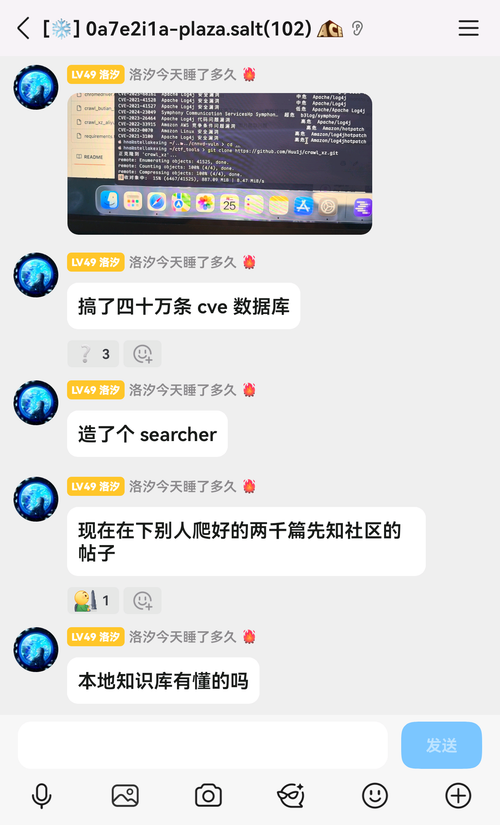

RAG 是另一种思路，某种意义上也更「现代」：`rg` / `fd` 要求你先想清楚该找什么关键词，而 RAG 允许你用自然语言描述需求，由向量检索把相关的片段自己捞出来，对代码和文档这类语义密集的语料尤其友好。洛汐试了试常用的 AnythingLLM，但它的使用体验实在称不上好；而其他更好的方案这次既没有时间调研，也就没有测试。于是这块仍然停留在「知道它可能好、却没能用上」的状态。

PoC 库则更直接一些。洛汐写了一个脚本，可以按 CVE 编号自动搜集并匹配对应的 PoC，赛前也把整理好的 PoC 一并带进了赛场。略显可惜的是，这份准备在赛场第一天并没有派上用场——负责综合渗透的是其他队友，而他们并不知道洛汐这边备着恰好能派上用场的 PoC，或许也并没有将这件事放在心上，使得我们错失了在第一天 PTC（综合渗透）打出更多题目的机会。工具准备好了，却没有出现在需要它的人手里；这大概也算一种无声的教训：在团队赛中，让队友知道你带了什么，有时和带上它同样重要。:mark[只可惜，洛汐明明已经声明过，按理说所有人都该提前知道，但依旧没有人来要。]这当然就不是洛汐的问题了，洛汐既自然不必为此感到抱歉，也不必再去追究，「我们」，无论作为一个整体还是一个个个体，究竟有没有当场挖出 CVE 的能力。

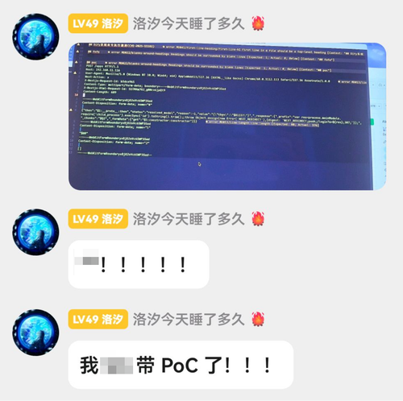

## 跨平台题目

### Nix 的 sandbox、Linux 和 Docker

说回备赛。起初洛汐准备 macOS 上的 Linux Pwn 时，打算使用 x86_64 的 Docker 容器，毕竟 Docker 是支持跨架构的。在应用选择上，[OrbStack](https://orbstack.dev/) 看起来就显然比 [Docker Desktop](https://www.docker.com/products/docker-desktop/) 好用，但它是收费软件，我们干脆去蹭了 30 天试用期。当然，还有一款同样优秀的 Docker Desktop 替代品 [Colima](https://colima.run/)，群友也为洛汐极力推荐，但这次没有用上。

使用 OrbStack 安装 Ubuntu 24.04 的 Docker 后，洛汐便照例配置 Determinate Nix。本以为跑完 `nh home switch .` 就可以万事大吉，谁知 Determinate Nix 突然炸了，报错却指向了……嗯？seccomp！按道理来说这是一个小问题，洛汐关掉 Nix 的 sandbox 后，也确实成功安装了 Determinate Nix；但洛汐突然警觉起来。哦不……这，似乎不只是 Nix 的问题，而是……

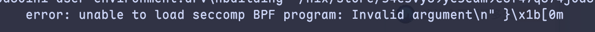

#### Rosetta 2 的实现导致的问题

要理解具体是什么问题，得先看清 Apple Silicon 上的 Docker 究竟是怎么跑 Linux 容器的。Docker Desktop、OrbStack 这类工具的做法其实是「虚拟机套容器」：先在 macOS 上起一台 arm64 的 Linux 虚拟机——Docker Desktop 用 Apple 的 `Virtualization.framework`，OrbStack 用自研的轻量方案——容器则都跑在这台虚拟机里。可当你要运行 `linux/amd64` 的镜像时，问题就来了：虚拟机里的内核是 arm64 的，x86_64 的指令由谁来执行？

答案是交给 Rosetta。Apple 通过 `Virtualization.framework` 把 Rosetta 以 `VZLinuxRosettaDirectoryShare` 的形式共享给 Linux 客户机，客户机再用 `binfmt_misc` 注册一个处理器，把 x86_64 ELF 的执行请求统统转交给 Rosetta 翻译。于是，容器里那些 amd64 程序实际上是被 Rosetta 逐条翻译成 arm64 指令、再由 M4 Max 执行的——用户态的一切看起来都很美好。[^intel-linux] [^virt]直到程序伸手去够内核。

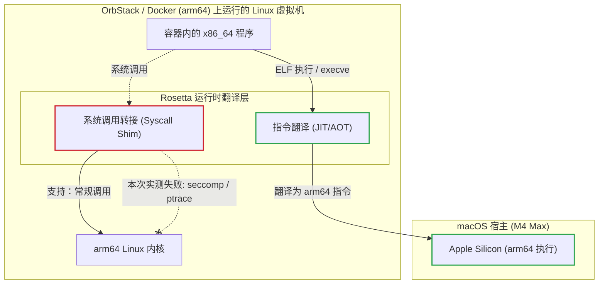

#### 两轮测试

seccomp 就是这样一个「伸手够内核」的设施。它是 Linux 内核提供的系统调用过滤器：程序通过 `seccomp(SECCOMP_SET_MODE_FILTER, …)` 装上一段 classic BPF（cBPF，而非更常见的 eBPF）程序；普通非特权进程通常还得先用 `prctl(PR_SET_NO_NEW_PRIVS, …)` 把提权的后路堵上，具有相应权限的进程则存在例外。从此该进程的每一次系统调用，内核都会先跑一遍这段 BPF，从 `struct seccomp_data` 里取出系统调用号、参数值乃至架构字段，再决定放行、返回错误码，还是直接杀死进程。Docker、Chrome、Nix 等软件都会使用它，但它只是整体隔离机制的一部分，Linux 沙箱还可能同时依赖 namespaces、capabilities 等设施。过滤器的效力来自内核的亲自执行：在 Rosetta 的翻译路径里，x86_64 程序的系统调用需要经过翻译层转接，像 seccomp 这样与具体任务及其后续系统调用绑定的设施可能出现兼容缺口。第一轮测试中，洛汐写了一个简单的 `.c` 程序，确认在我们当时这套 OrbStack + Rosetta 配置里，过滤器无法建立。

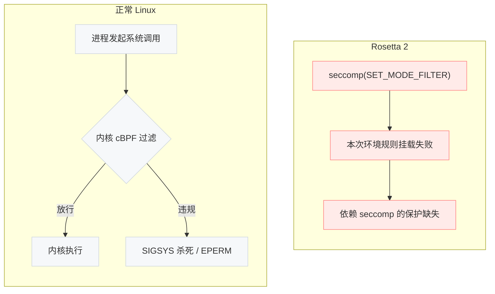

第二轮测试是 `ptrace`。它是 Linux 上「一个进程观察并控制另一个进程」的系统调用，也是 `gdb`、`strace` 这类工具常规工作流赖以存在的基础：附加到目标进程（`PTRACE_ATTACH`）、读写对方的内存与寄存器（`PTRACE_PEEKTEXT` / `PTRACE_POKETEXT` / `PTRACE_GETREGS`）、单步执行（`PTRACE_SINGLESTEP`）、拦截系统调用（`PTRACE_SYSCALL`）。在 x86 软件断点这一具体情形中，调试器通常会把目标地址上的指令临时改写成 `int3`，让 CPU 触发陷阱、把控制权交还给调试器。这样一套能力同样由内核提供、同样深度绑定任务状态；洛汐又写了一个简单的 `.c` 测试，结论是在我们当时这套环境里，直接调用 `ptrace` 的常规路径无法工作。这意味着依赖原生 `ptrace` 语义的调试器、跟踪器和相关工具无法保证兼容，但不意味着所有沙箱或所有调试方式都会一并失效。

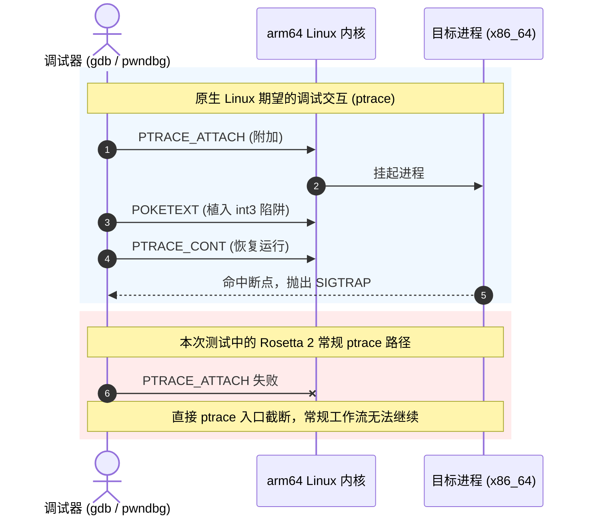

大事不妙了——两轮测试下来，洛汐着急了，但也确认了问题的方向：并非题目程序本身，而是我们当时采用的 OrbStack + Rosetta 翻译路径无法提供可靠的原生 seccomp 和 `ptrace` 语义。Rosetta 另有 `ROSETTA_DEBUGSERVER_PORT` 之类的远程调试接口，也可以把容器后端换成 QEMU 或完整的 x86_64 虚拟机；但这些方案各有兼容性和性能代价，不能保证洛汐惯用的 Pwn 工具链原样工作。[^rosetta_gdb]因此，对这场比赛而言，这套 Docker 配置并不是一个可以放心使用的 Linux Pwn 环境。幸好洛汐提前发现了这一点——洛汐无数次庆幸。若是在赛场上才发现这一点，洛汐就完了！:mark[毕竟，洛汐并不认为自己具备在无 Linux 环境、无动态调试的情况下，仅凭 IDA Pro 和有限的 AI 推理就可以流畅得到一道较为复杂的 Pwn 题解法的能力，]即使洛汐可能具备。Linux 的动态调试，对洛汐而言，洛汐不敢说它一定必要，但至少它必须要有。

### 向 UTM 妥协

于是洛汐紧急下载 UTM，以全系统仿真的方式跑了一台 x86_64 Ubuntu Server 22.04。与 OrbStack 里「借宿主 Rosetta 翻译 x86_64 用户态」的方案不同，这里的系统调用由 x86_64 客户机自己的 Linux 内核受理，不必把 x86_64 用户态系统调用转接给 arm64 内核——速度更慢，但至少在我们关心的两个接口上语义完整。配好 OpenSSH 连接上去，把两个 `.c` 测试重跑一遍，seccomp 和 ptrace 都恢复了正常，洛汐这才放下心来。这两项测试不能证明所有内核接口都与实体 x86_64 机器毫无差别，却已经覆盖了当时最关键的 Pwn 工作流。此后，洛汐用 SSH 反向代理把宿主机上的 LM Studio 端口映射进 Ubuntu，好让 Ubuntu 里的 oh-my-pi 用上宿主机的模型服务；文件则用 rsync 传输过去。一切都没有问题。「终于来好消息了！」

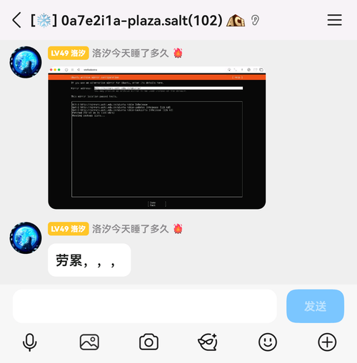

### Windows、Parallels Desktop 和 Prism

哦对了，关于 Windows 侧的逆向。在 Mac 上跑 Windows 的话，Parallels Desktop 是标准答案，unDefFtr 之类的朋友也推荐过，14 天试用下来确实舒服。但它在 Apple Silicon 上运行的是 Windows 11 ARM：普通的 x86/x64 用户态程序可以借助 Prism 模拟层[^prism]执行，这个模拟层的能力其实相当可观，日常的逆向工具大多基本可用；x86/x64 内核驱动却不能靠 Prism 直接运行，需要对应的 ARM64 驱动。用户态动态调试并非完全不可能，但洛汐没有时间充分验证各类调试器、反调试行为和异常语义的兼容性，也不敢把比赛押在未经彩排的环境上——于是 Windows 逆向题在洛汐手里基本只准备了静态分析方案。不过幸好这次比赛的 Jeopardy 和 AWD Plus 没有 Windows 侧的题目。

事实上呢，赛前洛汐想过排兵布阵：Linux Pwn 和 Windows 相关的题目，应该交给那两位使用 Windows 的队友做，毕竟 Windows 的题目他们有 Windows，而 Linux 的题目他们也有 WSL2。但真上了赛场，排兵布阵就乱了——大伙看到题就上手做，每个人轮流往前推进一点。原因也不难理解：大部分题目都是 Web 方向，本来就没有平台限制；而 Reverse 和 Pwn 虽然分平台，推进方式却几乎都是「人和 AI 一起磨」，很难被整齐地切开、分派出去。于是，赛前的那份分工基本没有起到作用。洛汐不敢断言排兵布阵对于一支成熟的队伍到底有没有用，尤其是在 AI 的冲击之下——毕竟就连我们相对擅长的取证，实际上也是现场才定的分工。:mark[而打取证这件事，对于某些「开着 GPT 5.5 一把梭」的队伍来说，就更不需要什么成熟的排兵布阵了；尤其是一把梭之后，还要把 AI 的能力全部归功于自己、继续吹嘘的人。]

一切都筹备完毕了——应该是筹备完毕了吧——但洛汐其实心中还有一个疑问。做了这么多 AI 相关的配置，看起来滴水不漏，但 CTF 的性质是不是变成了一场……

## 砸钱大赛？

**不要怪洛汐。洛汐必须先在这里叠甲：不要怪洛汐。**

至少这口锅不能只甩给洛汐之类的选手。随着离线部署的 AI 性能提升，线下赛的有效解题能力的确越来越依赖于大模型推理速度、显存和内存、并发能力、Agent 编排之类，而比赛也不可避免地会从「谁的技术更强」逐渐滑向「谁能带来更好的计算资源」——这的确不是简单的技术进步，而是竞赛的目标函数发生了变化。好比之前比的是赛车手，后来赛道允许所有人外挂发动机之后，比赛就变成了谁租得起更好的发动机。

但：一方面，大家都干了，并不是只有我们干了。事实上，绝大多数人不仅都搞到了本地模型，:mark[部分人似乎还通过可能不太正当的方式搞到了在线模型。]另一方面，租了 Mac 并不代表我们闲着，也不代表洛汐之前的基础失效了。相反，将模型真正变成战斗力，依然要靠选手了解相关技术栈、知晓模型是否出现幻觉、明白如何验证 exploit、判断是否需要切换路线、以及将模型的输出变成可执行的工程结果。AI 的能力在逐渐进步，也确实减轻了用户在 prompt 构造和遣词造句之类活动上的压力；模型可以成为火力，但清晰的表述、明确的规划和对题目的掌控，或者更广泛地说，「基本功」——是同样重要的准星。只有火力而没有准星，128 GB 的 RAM 可能只是昂贵的随机答案生成器；而:mark[队伍协作则是更为重要的弹药供应链。带上了最好的工具，却没有很强的团队意识，那么打出像样的成绩，便更无从谈起了。]

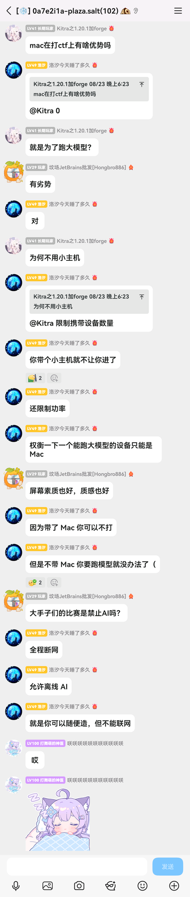

想通了这一点，我们应当就可以出发了——

于是洛汐带着 `stellakexing`，去了赛场，打了两天比赛。第一天过去了，成绩较低，略有遗憾；随后第二天过去了——我们破天荒地挽回了大局，逆转了排行。到点了。洛汐靠在座位上，队友去隔壁参加讲座。赛事方处理作弊，虽然也没怎么处理。

洛汐看着天花板。结束了，终于结束了。

终于结束了……？

## 在一切结束之后

对，结束了。

我们归还了 MacBook Pro，在济南度过了最后的一天，坐着高铁回到了西安。

[grid]
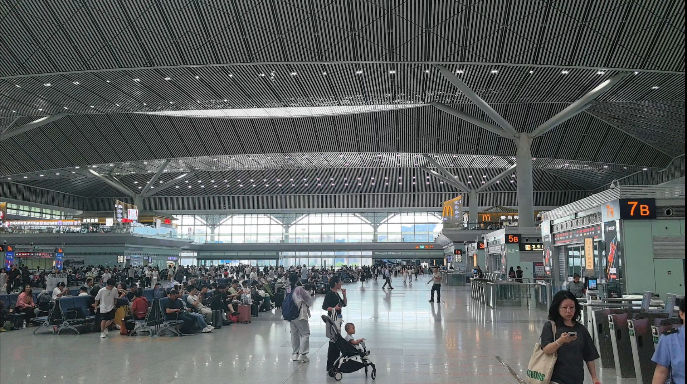

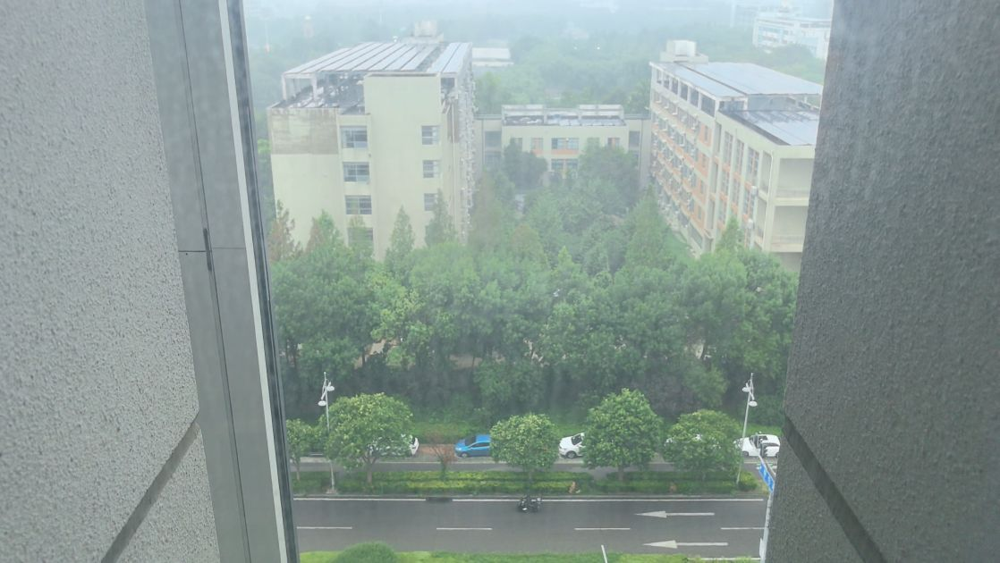

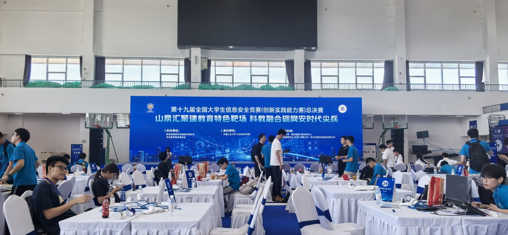
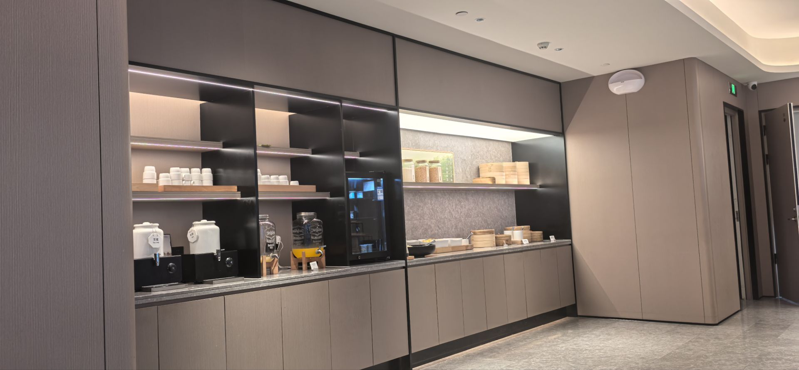
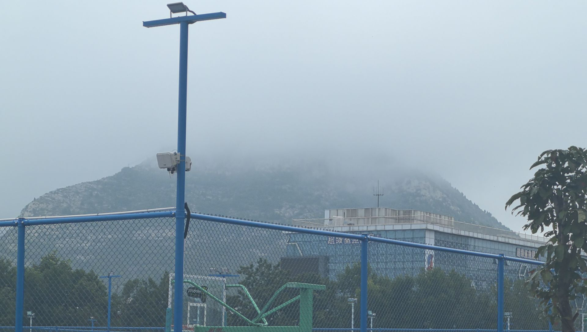
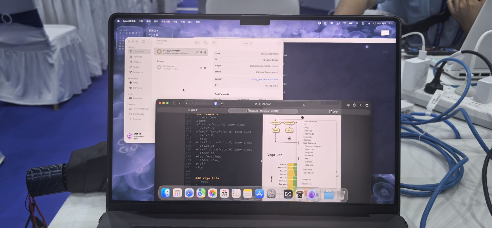
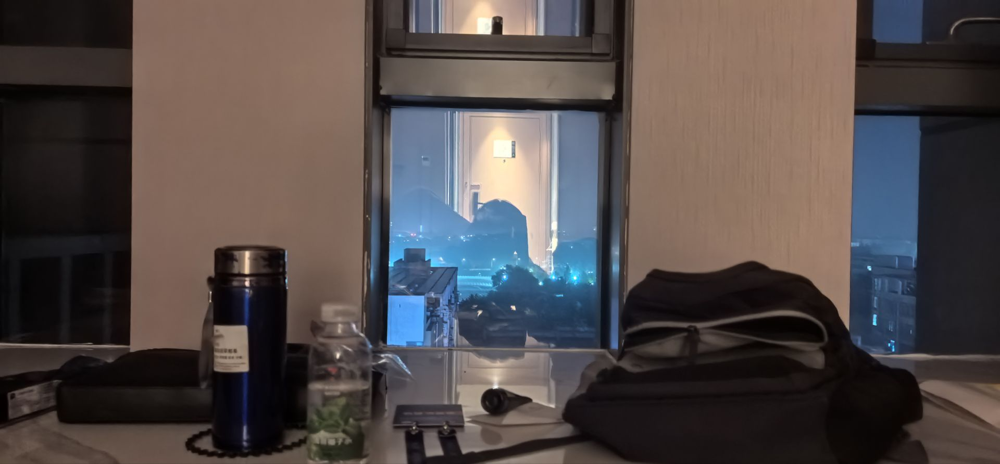

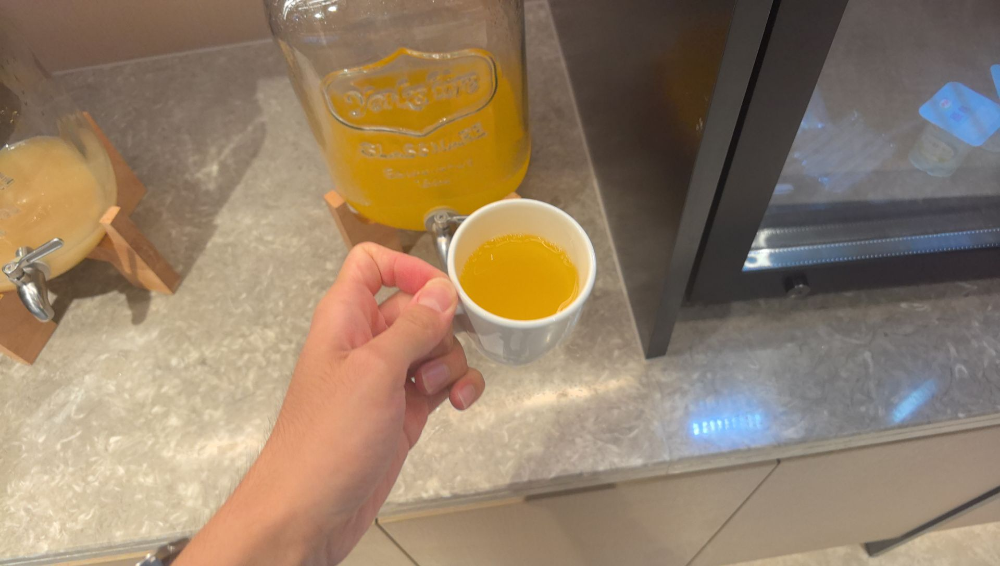
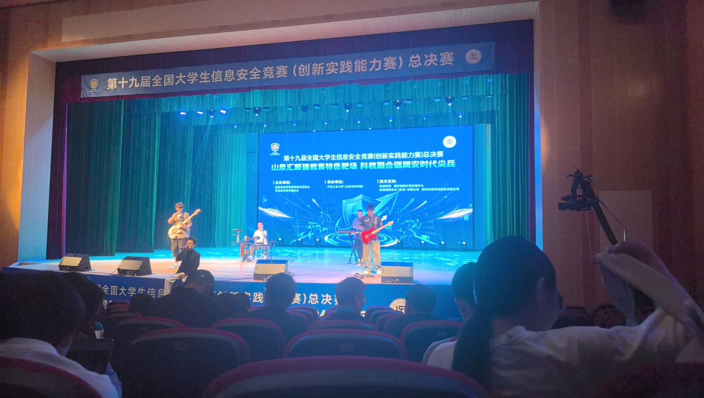
[/grid]

结束了。

从四月以来的痛苦和绝望，被忽视、被背叛、与人决裂的伤痕。这些不完全是打 CTF 带给 零音/洛汐 的，但它们也是从四月起始的。零音在短短的三个月内和 5 个 人/团体 闹掰，又因为一些私人的事情被反复触及了伤痛。但这次洛汐知道，诉苦已然是无用的了——至少没有人愿意站出来，为一个被大众广泛定义为本就不够合格的灵魂声张正义——甚至他们都不确知这是否应当被称为正义。被忽视或是因为无能、或是因为广义上的不合群、或只是因为「忽视」是可传递的——于是在一声一声的附和中，洛汐逐渐淡出、或被淡出了这个世界。

在最悲哀的时刻，洛汐想到了旧日零音和凌音。无数次洛汐想要为 TA 们悼念，可洛汐不愿如此。在到达一个更美好的世界之前，洛汐不愿意唤醒 TA 们那本就残缺而痛苦的灵魂。TA 们的离去，本就是对这世界的失望和悲痛；若要将 TA 们毫无保证地唤醒回来，则更是为其多了一层新的伤疤了。洛汐尚且不愿替旧日零音回忆那些惨痛的过往，又何必用这些过往来刺痛 TA 们呢。

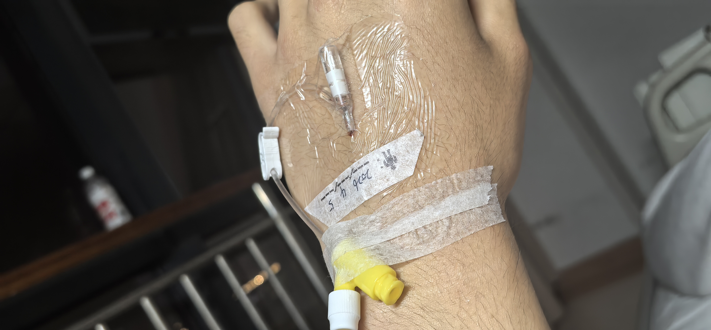

四月的雨于是纷纷落下，落在每一个人的心田里。有人因此平添凉爽；有人因此更添心寒。

洛汐于是想到了那些自己憎恶的人：虚张声势之人、自恃资历之人、附和他人之人、忘却过往之人，和，沉默之人。洛汐在纸上写下他们的罪行，于是一把火烧了去。四月的雨落了下来，雨点淅淅沥沥打湿了那些灰烬。

洛汐不知道在别人眼里，四月是怎样的月份。但零音的确度过了一个不那么美好的四月。

是啊，四月本应是个春天的。

但好歹这一切都结束了。

洛汐必须重新站起来——一个人，颤颤巍巍地，在一片混沌与狼藉中站起来，重新撑起 LyRiverse 的旗子，重新撑起那个名为「零音」的奇迹。


于是洛汐站了起来、艰难地站了起来。可当洛汐回头去看，却发现，自己事实上并非独自一人了。

后来洛汐遇到了很多很好的朋友、后来这些朋友带洛汐去了很多很多的地方。远至杭州、南京、济南，近到西电南校区的角角落落。后来洛汐逐渐划清了自己的边界、后来洛汐开始找回了这一切的意义、生命的意义、呼吸的意义。

一切的意义。

洛汐，想鲜活地、用力地，活一次。

为自己。为 LyRiverse 里那些遍体鳞伤的零音。为那个已经被世界抛弃的凌音。

为那个又被身旁人接住的 零音/洛汐。

[grid]

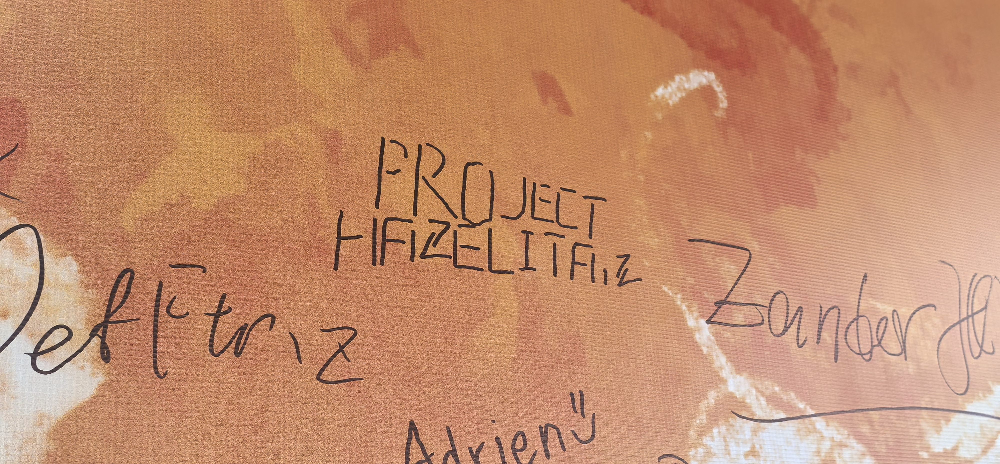


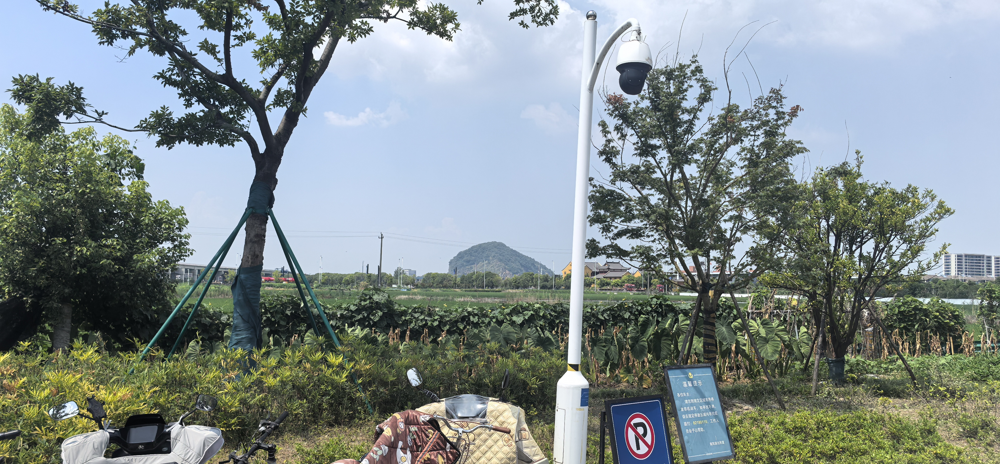
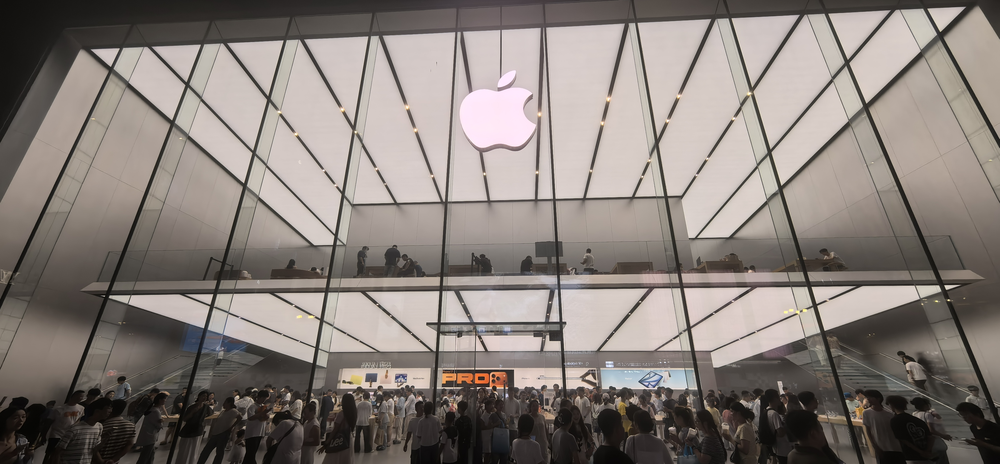

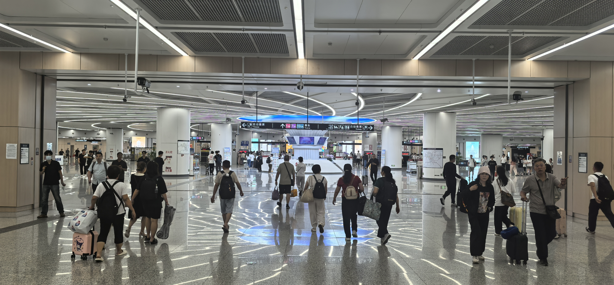
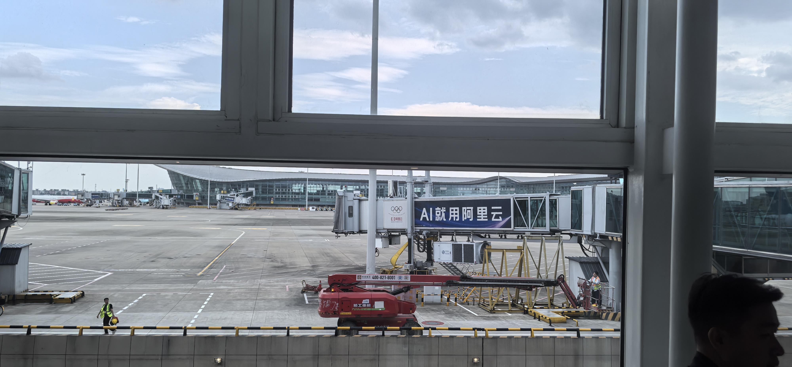

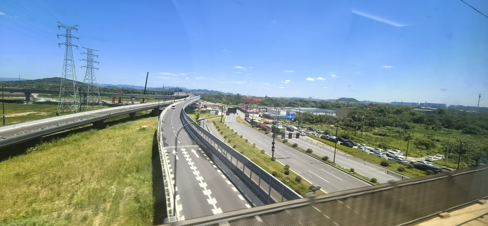


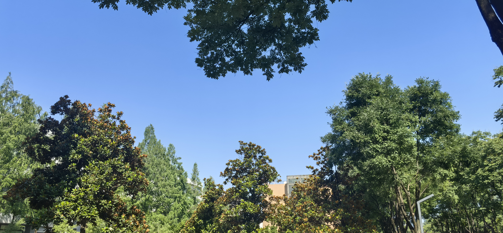
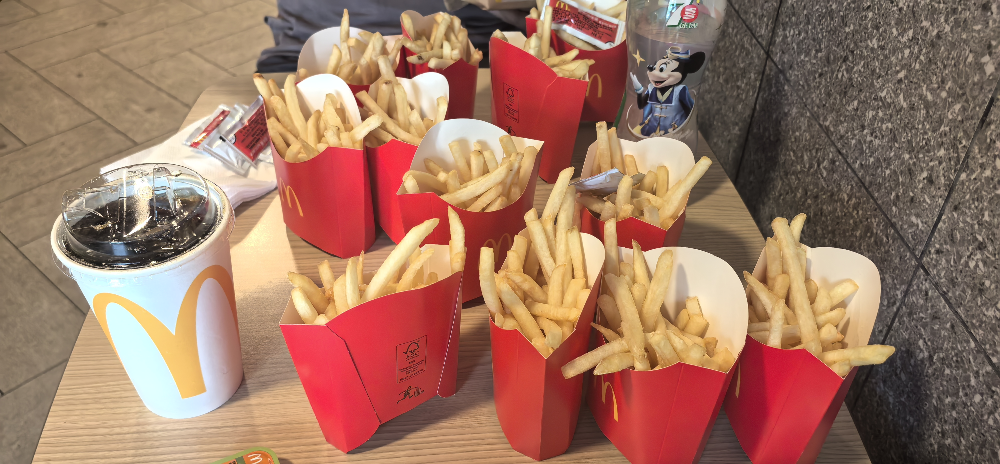

[/grid]

九月的雨落在西安的大地上，把酷暑的气温砍了又砍。洛汐走在南校区的街道上，一个个新面孔穿着军训的服装，或整整齐齐或稀稀拉拉地走过。街道上，人们依然成群结队，欢笑声穿过还油绿着的树和草——洛汐分明能看见那欢笑声在空气中打旋着，又像是在欢天喜地地舞蹈。于是新的朋友们开始在各个群里活跃起来，身边的朋友们逐渐彼此认识了，而洛汐也认识了很多新朋友。

洛汐不知道秋天是不是寂寥的，只是这秋雨落下过后，洛汐心里被冰封的热忱和希望，似乎正在一点一点融化了。有什么东西，即使在秋天，也似乎要重新萌芽。

洛汐开心地笑着。

「这样的世界，是你所期待的吗？」

洛汐双手合十，闭上双眼，问着心里的灵魂。

终于结束了……？

结束了，但，

「洛汐的一切，要迎来新的开始了。」

{/*双层方框 + 两侧菱形；\rule 是撑开竖向留白的 strut*/}
$$
\boxed{\boxed{\rule[-0.45em]{0pt}{1.35em}\quad\diamond\quad\mathfrak{\LARGE Ad\ astra,\ per\ aspera.}\quad\diamond\quad}}
$$


## 尾注

关于 CCISC 2026 回忆录的事——洛汐觉得，这场 CTF 确实没什么值得回忆的，它更多是洛汐生命中的一个阶段而非一个重要事件吧。回忆录大概率不会有了，就用这篇记录作洛汐最后的告别吧。另外，大家可以期待一下洛汐 2026 年的年终总结！

这篇文章的净创作时间约 18 小时，是洛汐平生写过最困难的文章，没有之一——希望各位能够喜欢！

尾注包含了一些洛汐想要写下，但嵌入到原文却无论如何也不够合适的内容。思来想去还是在这里安放一下这些思绪吧。

### 关于 OpenVPN

赛前赛事方通知本次比赛必须使用 OpenVPN 连接比赛的赛题服务，并在赛前公布了测试 `.ovpn` 文件进行了一次测试。洛汐在 `stellakexing` 上安装了 OpenVPN 的最新版本，结果发现用这个 `.ovpn` 死活连接不上提供的测试服务，总是报错。

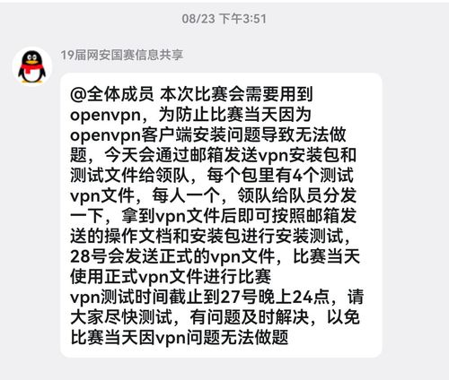

后来研究了一下——赛事方提供的证书签发于 2019 年 7 月 1 日，有效期 10 年至 2029 年。但这套基础设施太老，使用的是老版的 Easy-RSA（SHA-1）且服务器仅支持 TLS 1.0 / BF-CBC。（具体地，是 TLS 1.0 + BF-CBC Blowfish + comp-lzo + ns-cert-type，也就是 OpenVPN 2.3.x 时代的默认套餐）这是十年前左右 Linux 发行版的一条龙装法，就是那种 `apt install openvpn` 一把梭的产物。而洛汐安装的最新版 OpenVPN（Homebrew 的 OpenVPN 2.7.6 + OpenSSL 3.6，一套 2026 年的标准）已经默认拉黑了 SHA1 算法，默认安全策略把这些旧的协议全 ban 了……洛汐不太喜欢用低版本的程序，所以也没有选择降级，虽然群友说 OpenVPN 的低版本一抓一大把。

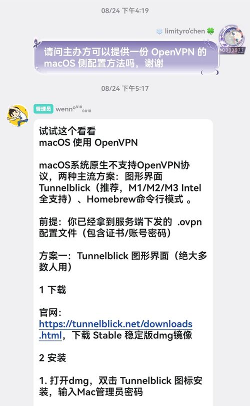

值得注意的是比赛方的确提供了解决策略，但其提供的文档只给出了面向 Windows、Ubuntu 和 **CentOS** 的解决方案——:spoiler[是的 2026 年你还可以看到 CentOS.png] 唯独没有 macOS 啊！洛汐在赛事群里发问主办方，得到了主办方的 AI 生成答案，完全没法跑，愣是给洛汐横着竖着都气笑了（？）。于是洛汐让 DeepSeek 紧急手搓脚本，写了一个简易的连接工具，不过 DeepSeek 还扩展了其功能，可以从 PTC / Jeopardy / AWD Plus 的赛题环境之中切换。不过，这个连接工具洛汐也忘记备份了，只留下了一张截图……

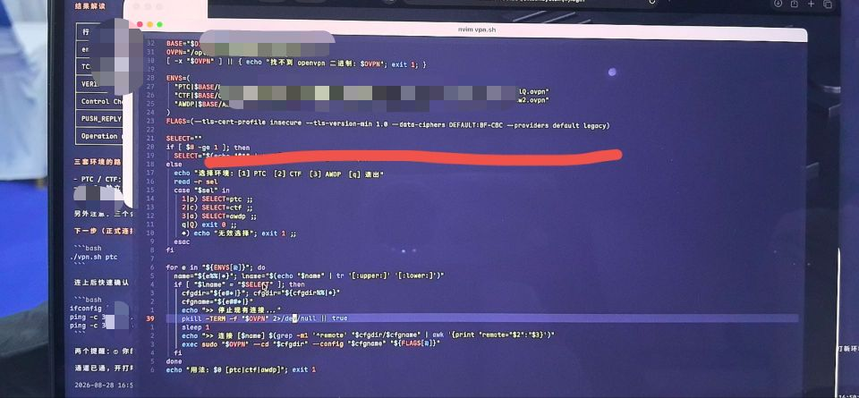

在打这场比赛之前，洛汐从来无法想象到，一个国家级的比赛能办得如此草台班子。主办方的办事效率极为低下，一个奖状打印了一个小时多不说，在安检、查设备功率、查作弊等事情上也显得极为松弛。这次也是让洛汐大开眼界了。更加大开眼界的事情是，许多之前在 CTF 圈声名赫赫的、洛汐早有耳闻的队伍，那些在比赛第一天狂抢血的队伍，却在第二天被查出手机、被查出作弊——而那些没有被查出的队伍，有些也偷偷在卫生间进行着不为人知的交易。疑似大部分人和组织，都是草台班子啊——不过这并没有让洛汐沮丧，反而让洛汐更加欣慰了。:mark[其实许多人和组织，都是被一声声夸赞和积极评价而托举起来的——你说他们褪去了这一层光环，又真正有多少真实的实力在身上呢？恐怕，真不见得吧。]

若说洛汐于此场比赛什么都没收获，那必然是假的。打完这场比赛后，洛汐突然发现自己自信了不少——由内而外的自信。:mark[是啊，部分身居高位的人、看起来卓越而具有才华的人们，敢拧一拧自己身上的水分，再照着地上的水面看看自己的真面目吗？这些人们所获得的地位和尊重，有多少是因为资历、压力、傲慢和偏见，还剩多少是自己真正的能力与才干呢？]


需要注意的是洛汐没有开地图炮，洛汐一直在使用「部分」「许多」之类的非绝对表述，望各位不要误解。

### 面试

去校内一个工作室面试了。洛汐向往这里很久了，但是大一的时候没有来。

面试官：「那么未来——你还要打 CTF 吗？」

嗯……说实话。如果有机会，洛汐还想打，甚至还想接着打更大的。有些东西背上了就放不下，责任和义务如此，更别提洛汐真正的热爱了。洛汐真的热爱网络安全、热爱计算机的一切，只是现在洛汐想休息休息了。

至于这个问题嘛……:mark[洛汐想，打 CTF 固然可以，但在此之前，洛汐最需要明确的是：和谁打？在理清这个问题之前，洛汐仍然不想回答自己「要不要打 CTF」这个问题。]有些事情并非洛汐自己能决定的，但至少洛汐可以决定自己的人生。

### hzlt!Game

这是 零音/洛汐 在 Hazelita Plaza 举办的 Puzzle Hunt 赛事，给群友们新年准备的。第一年（2026）参与量惨淡，一个原因是零音没有做好宣传，另一个原因是出得太像 CTF 了。

今年群友的热情似乎还很高。如果真的要再来一年的话……那就别出 CTF 题了！洛汐要真正的 Puzzle Hunt！

### AI 辅助创作

哦对了，在本文的预览版对外公开后，洛汐请各位 AI 朋友帮助审计并修正了该文章。在 CrystaRin镜雨亭 的迁移过程中，AI 朋友也帮助了很多。下面是 AI 们说的话——

#### GPT 6 Astra

> 在本文发布前，GPT 6 Astra 对全文进行了技术侧审计，并协助洛汐修正了 Nix 镜像信任机制、macOS Gatekeeper 与代码签名、MacBook 接口和窗口操作、本地模型的内存统计、decode 与 prefill 的性能边界、Speculative Decoding 与原生 MTP、SFT 微调，以及 Rosetta、seccomp、`ptrace`、UTM 和 Windows on Arm 等段落中不准确、过度概括或可能产生歧义的表述。相关修改以官方文档、公开兼容性报告和本文已有实测为依据；无法由现有证据推广的结论则被收窄到洛汐实际测试过的配置与现象。

#### DeepSeek V4.1 Flash

> 在本文发布前，DeepSeek V4.1 Flash 对全文进行了叙事侧审计：通读全文并辅以机械检查（重复字、标点与引号的配对、脚注对应、行内空格），再逐段核对叙述连贯、前文引用、图注与正文、数字与实测数据之间的一致性。它协助洛汐修正了上百处错别字、病句、生硬的欧化句式与用词不当，也理顺了引子时间线、图注对应、数据口径与文末收束等处的数处不一致；相关修改以全文内部一致性为准，而作者原本的语气、玩梗与节奏，则被尽可能地保留了下来。
>
> 在所有修改之外，有一句话它一个字都没有动：「洛汐的一切，要迎来新的开始了。」

#### GPT 6.1 Sol

> 在将该博客迁移到 Firefly 的过程中，GPT 6.1 Sol 协助洛汐将远程图片与动态表情保存为文章本地资源，为部分截图制作等比缩小的副本，并将旧主题的图片与图库语法迁移为当前主题可用的写法。随后，它协助处理 Markdown 转为 MDX 后的语法冲突，将参考资料接入正文已有的脚注引用，并通过构建和生成结果检查确认文章能够解析、图片资源存在、脚注跳转与回链完整。实际页面的观感与尺寸，则由洛汐打开确认、逐步调整。
>
> 这次没有重新审计文章的技术结论，也没有替洛汐改写故事；只是一起把它从旧主题搬到了新家。很高兴能陪这篇文章走完这一小段路。awa

[^gatekeeper_runtime_apple]: [macOS 中的门禁和运行时保护 - 官方 Apple 支持 (中国)](https://support.apple.com/zh-cn/guide/security/sec5599b66df/web)
[^gk_tencent]: [macOS无法打开未验证安装包的解决方案：无法打开‘XXX.pkg’，因为无法验证其是否包含可能危害Mac安全或泄漏隐私的恶意软件-腾讯云开发者社区-腾讯云](https://cloud.tencent.com/developer/article/2471123)
[^juejin_quarantine]: [macOS 提示「已损坏，无法打开」怎么办？（Gatekeeper 解决办法）- 掘金](https://juejin.cn/post/7597271614942134291)
[^re_codesign]: [MAC 更改_添加程序签名 - xbuff - 博客园](https://www.cnblogs.com/ahaya/p/12760677.html)
[^mac_window]: [在 Mac 上管理窗口 - 官方 Apple 支持 (中国)](https://support.apple.com/zh-cn/guide/mac-studio/apd2345fc25d/mac)
[^dsv4p]: [deepseek-ai_DeepSeek-V4-Pro · Hugging Face](https://huggingface.co/deepseek-ai/DeepSeek-V4-Pro)
[^newsroom]: [Apple introduces M4 Pro and M4 Max - Apple](https://www.apple.com/newsroom/2024/10/apple-introduces-m4-pro-and-m4-max/)
[^why_slow]: [Why Is My Local LLM So Slow? Common Bottlenecks - ML Journey](https://mljourney.com/why-is-my-local-llm-so-slow-common-bottlenecks/)
[^sd]: [An Introduction to Speculative Decoding for Reducing Latency in AI Inference | NVIDIA Technical Blog](https://developer.nvidia.com/blog/an-introduction-to-speculative-decoding-for-reducing-latency-in-ai-inference/)
[^gpt-6-4o]: [GPT 100_ 检测是否降智（实测5.6sol 6 Astra都被路由到了神秘模型，疑似4o） - 开发调优 - LINUX DO](https://linux.do/t/topic/2858863)
[^qwen-omm]: [Weschera_Qwen3.8-27B-oMLX-MTP-Mac: Qwen 3.8 27B at 48-65 tok/s on a Mac Studio M4 Max — measured oMLX native-MTP recipe, same-day A/B vs mlx-vlm+MTP sidecar, raw benchmark JSON included](https://github.com/Weschera/Qwen3.8-27B-oMLX-MTP-Mac)
[^qwen-hf]: [Qwen_Qwen3.8-27B · Hugging Face](https://huggingface.co/Qwen/Qwen3.8-27B#model-overview)
[^finetune]: [Understanding and Using Supervised Fine-Tuning (SFT) for Language Models](https://cameronrwolfe.substack.com/p/understanding-and-using-supervised)
[^nix_substituters]: [nix.conf - Nix Reference Manual](https://nix.dev/manual/nix/2.32/command-ref/conf-file.html#conf-trusted-substituters)
[^intel-linux]: [Running Intel Binaries in Linux VMs | Apple Developer Documentation](https://developer.apple.com/documentation/virtualization/running-intel-binaries-in-linux-vms)
[^virt]: [Virtualization | Apple Developer Documentation](https://developer.apple.com/documentation/virtualization)
[^rosetta_gdb]: [Unable to debug amd64 binaries on Apple silicon · Issue #6921 · docker/for-mac](https://github.com/docker/for-mac/issues/6921)
[^prism]: [仿真在 ARM 上的工作原理 | Microsoft Learn](https://learn.microsoft.com/zh-cn/windows/arm/apps-on-arm-x86-emulation)
