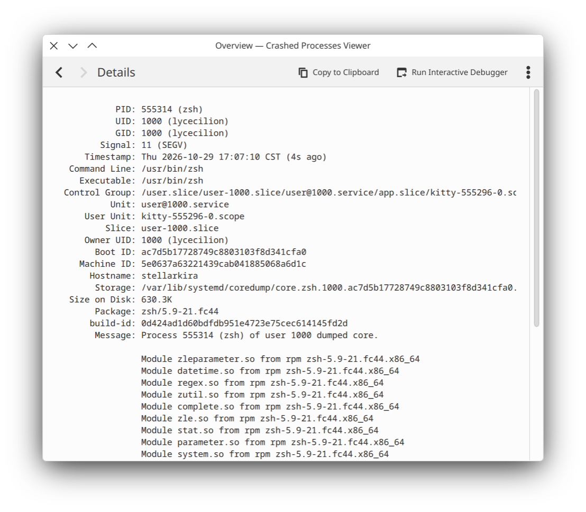
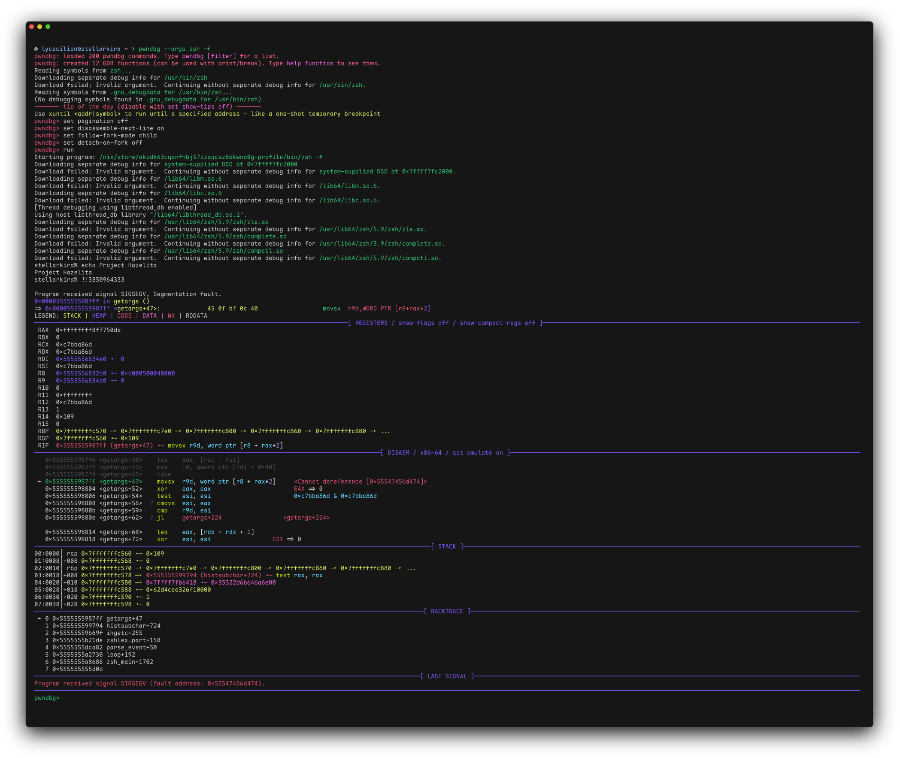
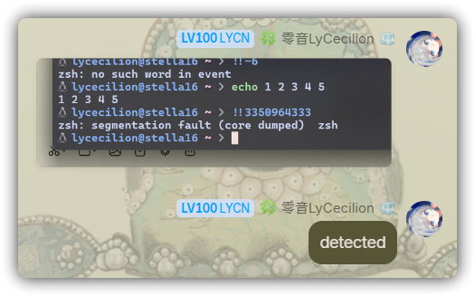
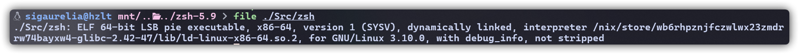
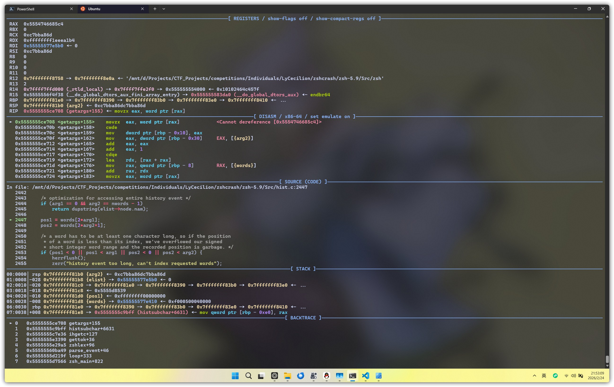
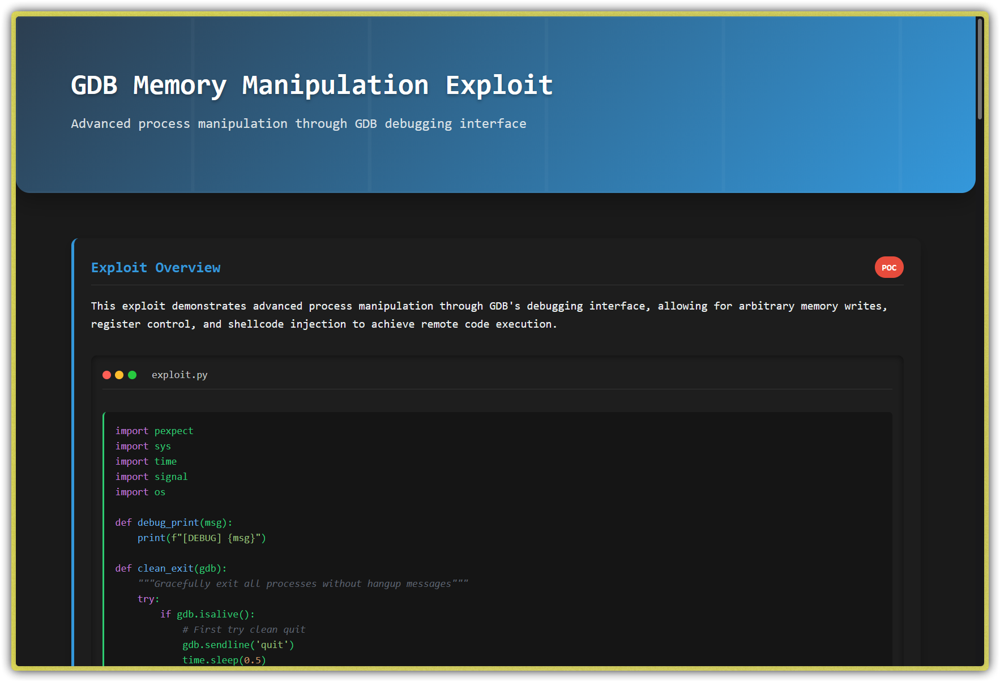

:::tip[前言]
Project Hazelita 社群并非该漏洞的最早发现者，并且在该文章发布之前许久，上游的修复补丁就已经进了 git——不过直到本文更新时，官方发行版里还没有一个带上它。本文仅仅作 Project Hazelita 社群独立分析该漏洞全过程的记录。另外，我觉得大伙都应该教我 /求放过
:::

:::note
本文撰写于 2026 年 2 月 24 日，并于 2026 年 10 月 29 日更新。在撰写成文时，零音仍然在使用 WSL2 上的 Ubuntu；而更新时，零音的设备已经迁移到了 Fedora，因而在本文的更新中，零音追加了部分 Fedora 侧的实测内容，并替换了原文中可能包含不正确或已经过时的信息的一些图片。
:::

## 初探之喜

零音正在西咸新区游玩，突然看到 Project Hazelita 社群（现 Hazelita Plaza）里 [AstralFlare-owo](https://github.com/AstralFlare-owo) 的消息，在 Zsh 中输入 `!!3350964333` 会触发 SIGSEGV。最初的零音并不太确信这类问题的存在，毕竟 Zsh 作为成熟的 shell 已经运行了几十年，而且若问题发生在 `!!` 处，即 history expansion 阶段，这一阶段仍然在以字符串解析指令，根本没有真正执行命令。但后来经过 [Hello8693](https://github.com/Hello8693) 等群友的验证，确认了这一问题可能是普遍存在的。


这时的零音就非常感兴趣了。AstralFlare-owo 使用 `pwndbg` 调试了 `zsh`，截获到了 SIGSEGV 时的信息：

```text
#3  0x000055acbc1375ba in zshlex ()
#4  0x000055acbc15afc7 in parse_event ()
#5  0x000055acbc1269f0 in loop ()
#6  0x000055acbc12aad4 in zsh_main ()
```

初步判定是 `parse_event` 的问题，并锁定了问题应当出现在整数溢出上。 ~~此时的零音更加饥渴难耐了~~ 于是一回到家便开始进行分析。根据 AstralFlare-owo 提供的情报：


> 阿焰: 02-24 16\:44\:38\
> 猜测是这个数值不知怎么的歪打正着绕过了检测
>
> 阿焰: 02-24 16\:44\:55\
> 以及这附近一小块的数值都能触发 bug
>
> 阿焰: 02-24 16\:45\:28\
> 因为包括 4294967295 2147483648 之类的极端数值都没事
>
> 阿焰: 02-24 16\:57\:01\
> 我试了一下 !!<=2147483647 都是正常行为
>
> 阿焰: 02-24 16\:57\:15\
> !!>=2147483648 就开始出现一些异常情况了
>
> 阿焰: 02-24 17\:00\:01\
> 基本上来说 Bug 起始于 !!2147500000 +- 10000 附近 随历史记录数量变化 历史记录越多 故障越靠后
>
> 阿焰: 02-24 17\:05\:33\
> 一直到 !!4294500000 +- 100000 附近

零音开始了第一轮自测，确定了该漏洞的存在。按照 Hello8693 的说法，「输入该指令会导致终端关闭」，结合零音在执行该指令后的情况，怀疑是 Zsh 发生了 SIGSEGV——而事实的确如此。



但为何该漏洞会工作呢？零音打算使用 `pwndbg` 进行调试。使用 `pwndbg --args zsh -f` 以纯净模式打开 `zsh` 并接入调试，同时使用 `set pagination off` 关闭分页、`set disassemble-next-line on` 打开 RIP 附近指令的反汇编自动显示，以及使用 `set follow-fork-mode child` 使得 `pwndbg` 自动跟随 `fork()` 的子进程，使用 `set detach-on-fork off` 关闭自 `detach`，运行并复现了该问题。



> 卧槽，情报好像是真的？

事情从而有趣了起来。我们注意看 `R8`，它指向堆上的 `words[]`：屏幕上那串 `0xc000500040000` 按 little-endian 拆成 `short` 正好是 `0x0000`、`0x0004`、`0x0005`、`0x000c`，也就是上一条 `echo Project Hazelita` 里 `echo` 与 `Project` 的起止位置，确实是一个合法的基地址。

真正诡异的是 `RAX`：`0xffffffff8f7750da`，高位几乎全是 `f`！

只看寄存器还只能猜，好在反汇编直接把过程写在了脸上——`getargs+38` 的 `lea eax, [rsi + rsi]` 在 32 位里算出 `2 * arg1 = -1888005926`，即 `0x8f7750da`，紧接着 `getargs+45` 的 `cdqe` 把它符号扩展进 64 位，于是 `RAX` 的高位被 `f` 填满；下一条 `movsx r9d, word ptr [r8 + rax*2]` 就用这个被「放大」的下标去寻址，一头撞进 `0x55547456d474`——比基址低 $3,776,011,852$ 字节的未映射页面。

顺带一提，`RCX` 里的 `0xc7bba86d` 也并不是另一个神秘值：它恰好是 `3350964333` 的 32 位补码，也就是 `-944002963` 按无符号读出来的样子——寄存器只装了 32 位，再被零扩展成 64 位，所以看着一点不像负数。换一份编译产物，这个中间值也可能落在别的寄存器上，变的只是寄存器分配，`2 * arg1` 的数值恒为 `-1888005926`。

并且在零音的复现中，程序依然在 history expansion 的处理过程中 SIGSEGV——`parse_event` 只是调用链上的祖先，真正出事的是 `getargs`，下文会讲——这证明了崩溃并非随机事件，漏洞是真实存在的。另外，注意到，若在直接启用的 `zsh` 内调用了 `zsh`，则里层 `zsh` 的 segmentation fault 崩溃可被直接显示出来。



## 源码之审

但是…这漏洞，究竟存在在哪呢？零音不免会好奇究竟在 Zsh 的哪一部分出现了这一漏洞。考虑到系统自带的 Zsh 去掉了调试符号，在这里零音选择自己从源码构建一份带调试符号的 Zsh 以进一步分析。

~~此时的零音，仍然抱着对 Project Hazelita 社群挖出史诗级漏洞的期许，，~~


由于零音在 WSL2 Ubuntu 上使用 Nix 管理软件包，零音直接使用 `nix-shell` 获取纯净的编译环境：

```bash
nix-shell -p gcc gnumake ncurses.dev yodl valgrind
```

并下载 Zsh 5.9 源码：

```bash
wget https://sourceforge.net/projects/zsh/files/zsh/5.9/zsh-5.9.tar.xz
tar -xf zsh-5.9.tar.xz
cd zsh-5.9
```

随后编译即可。不过，在编译过程中，零音总共遇到了两个坑点——其中第二个回头看还夹着一处误判——这里先一并说明。

### `boolcodes` 的冲突

在编译过程中遇到的第一个坑点是 `boolcodes` 的冲突。Zsh 为了能够在终端显示颜色和控制光标，需要依赖一个叫 `ncurses` 的底层库。在 Zsh 的源码中，会用到一些关于终端特性的数组，其中一个就是 `boolcodes`。Zsh 为了确保这个数组一定存在，便使用宏逻辑定义备用的 `boolcodes`。但零音使用的 `ncurses 6.6` 开发版把头文件里的这些数组声明成 `const char * const`（指向只读字符的只读指针数组），而 Zsh 5.9 的 configure 探针写的是 `char **test = boolcodes;`——这个探针在 const 限定下必然失败，configure 于是判定「系统没有 `boolcodes`」，Zsh 便回落到自己那份非 const 的备用数组，最终 `gcc` 判定类型冲突，编译中断。

```text
termcap.c:45:14: error: conflicting types for ‘boolcodes’; have ‘char *[]’
   45 | static char *boolcodes[] = {
      |              ^~~~~~~~~
In file included from ../../Src/zshterm.h:1,
                 from ../../Src/zsh_system.h:932:
/nix/store/n7iyqawbhv90ikx7casy5sapwpqj870b-ncurses-6.6-dev/include/term.h:784:56: note: previous declaration of ‘boolcodes’ with type ‘const char * const[]’
  784 | extern NCURSES_EXPORT_VAR(NCURSES_CONST char * const ) boolcodes[];
      |                                                        ^~~~~~~~~
make[3]: *** [Makefile:230: termcap.o] Error 1
make[3]: Leaving directory '/mnt/d/Projects/CTF_Projects/competitions/Individuals/LyCecilion/zshcrash/zsh-5.9/Src/Modules'
make[2]: *** [Makemod:372: modobjs] Error 1
make[2]: Leaving directory '/mnt/d/Projects/CTF_Projects/competitions/Individuals/LyCecilion/zshcrash/zsh-5.9/Src'
make[1]: *** [Makefile:449: modobjs] Error 2
make[1]: Leaving directory '/mnt/d/Projects/CTF_Projects/competitions/Individuals/LyCecilion/zshcrash/zsh-5.9/Src'
make: *** [Makefile:188: all] Error 1
```

为了解决这一点，我们追加这一 `CPPFLAGS`，使用 `-DHAVE...` 强迫不使用 Zsh 源码中宏定义的备用版本。

```text
CPPFLAGS="-g -O0 -DHAVE_BOOLCODES -DHAVE_NUMCODES -DHAVE_STRCODES -DHAVE_BOOLNAMES -DHAVE_NUMNAMES -DHAVE_STRNAMES"
```

### Nix 的 gcc wrapper 与过去的误判

Nix 非常注重包的体积和安全性，从而在 `nix-shell -p gcc` 中调用的 `gcc`，是 Nix 的一个 Shell 包装器！它会往编译命令里追加一堆硬化选项和 Nix 专属参数（`-fstack-protector-strong`、`-D_FORTIFY_SOURCE`、`-fPIC`、`-frandom-seed=…`，还有若干 `-isystem`），所以在 `nix-shell` 里「我传了 `-g -O0` 就一定是 `-g -O0`」并不成立，想干净地掌控编译行为，就得把这些附加项清掉。

> 顺带纠正零音当年的一个误判：这段经历曾被记成「wrapper 把符号表 strip 了」。后来实测，`nix-shell -p gcc` 下用 `-g` 编译出来的程序、以及用本文这套参数编出来的 `Src/zsh`，`file` 都报告 `with debug_info, not stripped`——符号从来没有被剥离过。当年 `pwndbg` 报 `No debugging symbols found`，是因为调试的是 `/nix/store/…-home-manager-path/bin/zsh` 这个 nixpkgs 打包产物：剥离发生在打包阶段的 `fixupPhase`，与 gcc wrapper 无关。~~冤枉好人这么久😇~~

在 `make clean` 后，我们清空这些附加标志，把编译行为交还给编译器本身。

```text
export NIX_CFLAGS_COMPILE="-g -O0"
export NIX_HARDENING_ENABLE=""
```

总而言之，绕过这两个坑点后，我们使用下面的指令编译：

```bash
./configure --enable-zsh-debug CFLAGS="-g -O0" CPPFLAGS="-g -O0 -DHAVE_BOOLCODES -DHAVE_NUMCODES -DHAVE_STRCODES -DHAVE_BOOLNAMES -DHAVE_NUMNAMES -DHAVE_STRNAMES"
make -j$(nproc) CFLAGS="-g -O0" CPPFLAGS="-g -O0 -DHAVE_BOOLCODES -DHAVE_NUMCODES -DHAVE_STRCODES -DHAVE_BOOLNAMES -DHAVE_NUMNAMES -DHAVE_STRNAMES"
```

使用 `file` 可以查看最终的编译产物：

```bash
file ./Src/zsh
```



`with debug_info, not stripped` 指示了符号表的存在。从而，我们使用 `pwndbg --args ./Src/zsh -f` 重新调试 `zsh`，发现该崩溃仍然可以触发。

```text
stella16% echo Project Hazelita
Project Hazelita
stella16% !!3350964333

Program received signal SIGSEGV, Segmentation fault.
```



报错指示了问题出现在 `Src/hist.c` 的 `getargs()` 里：边界检查在 2436 行，而紧接着 2447 行的 `words[2*arg1]` 就是越界读发生的地方。

```c
if (arg2 < arg1 || arg1 >= nwords || arg2 >= nwords) {
    /* remember, argN is indexed from 0, nwords is total no. of words */
    herrflush();
    zerr("no such word in event");
    return NULL;
}
```

[J2rQ(y)](https://github.com/JerryQAQ-233) 给出了分析。 ~~J2rQ(y) 分析啥了？零音也不知道，但给 J2rQ(y) 一点人气吧。~~


这里，`pwndbg` 指示函数调用为

```c
getargs (elist=0x5555557768a0, arg1=-944002963, arg2=-944002963) at hist.c:2447
```

因为整型溢出，我们输入的 `3350964333` 已经变成了 `-944002963`，作为 `arg1` 和 `arg2` 被传入了 `getargs`。但 Zsh 的开发者在这里的边界检查出了问题：他们

1. 校验了 `arg2 < arg1`，以确保提取的结束范围不能小于起始范围。
2. 校验了 `arg1 >= nwords` 和 `arg2 >= nwords`，以确保提取的词的索引不能超过当前历史记录的总词数。

但遗憾地：两个 `arg` 已经变成了负数，从而第 2 点检验完全通过了！于是代码来到第 2447 行的 OOB Read：`2*arg1` 算出来是 `-1888005926`，C 语言便去读 `words[-1888005926]`——以 `short` 为步长，这个下标落在基址**下方约 3.5 GiB**（`2 × 1888005926` 字节，正好等于截图里的 `0x5555556a5510 − 0x55547458f6c4` ≈ $3,776,011,852$ 字节）的未映射页面上，一次 load 就 SIGSEGV 了。

另外，由于这一特性，事实上我们可以做到更多。在执行 `echo LyCecilion loves Limity'roChen forever` 后：

- 使用 `!!2147483648`：`2147483648` 卷成 `INT_MIN`（`-2147483648`），它照样通过了负数检查；可 `2*arg1` 在 32 位里又回绕成了 `0`，于是 `words[0]`、`words[1]` 正好是上一条指令的第一个词——`zsh` 会去「执行 `echo` 自身」。这是两次溢出接力：解析时卷成 `INT_MIN`，计算下标时再卷回 `0`。
- 使用 `!!2147483649`、`!!2147483650`：卷成 `-2147483647`、`-2147483646` 后，`2*arg1` 分别回绕成 `2`、`4`，读到的是上一条指令的第 1、第 2 个词。零音当时在 5 词的历史下看到它执行 `LyCecilion`、`loves`，在 1 词的历史下则得到空展开——因为此时下标已经越过 `words[]` 数组本体，读到的是相邻堆上的垃圾字节。所以这两个值的表现取决于当时的堆布局，并不是稳定行为——零音当年看到的 `out of heap memory`，也是某次垃圾值恰好让 `pos2 - pos1` 变成一个巨大正数、`dupstrpfx` 申请内存失败的结果。

（零音 fuzzing 的时候发现了一个特别神秘的值，可以在崩溃后达成输入一个出现俩，但只能删掉一个字母的特性，但零音忘了，，贵人多忘事这一块……）

## 成神之路？

就在零音为这一发现而得意时，突然发现晴天霹雳：原来这个漏洞已经被人发现了？！

原来，就在几个月前（2025 年 7 月），一位 17 岁的安全研究员 livepwn 发现了该漏洞，并在其 GitHub Pages 上给出了一个 [PoC](https://livepwn.github.io/ZshShock/)（页面标题其实写的是「Advanced GDB Exploit Framework」，`ZshShock` 只是站点路径，不过后来大家都这么叫），并 [通过邮件](https://www.zsh.org/mla/workers/2025/msg00517.html) 告知了 `zsh-workers`。 ~~不得不说这 GitHub Pages 网站一眼就能看出来绝对是 AI 写的~~



然而，仅一个半小时后（按邮件头：livepwn 的邮件发于 2025-07-12 18\:23 UTC，Mikael 的回复发于 19\:52 UTC，相隔 1 小时 29 分），Mikael Magnusson 便通过邮件回复 livepwn：

> This seems to be mostly nonsense, maybe ai generated[1]? But the crash does happen, this patch fixes it but I don't use history substitution much ... Nobody was notified at those dates, and today is not may 19th. Also the rest is mostly nonsensical, why would you locate the pointer to system() in glibc when you're already writing arbitrary commands into a shell session.
>
> **翻译：** 废话怎么这么多，这玩意怎么看着是 AI 写的？不过崩溃是真的，这个补丁修了——虽然这功能我也不爱用。今天不是 5 月 19 日，那些日子（应该指的是 GitHub Pages 上的日期）也没通知我们啊。你写得其他东西也挺神秘的，都能在 shell 会话中写任意指令了，为啥还费那么大劲定位 glibc 的 `system()` 指针？

于是……就用俩补丁修了这个漏洞。不过这边看来 livepwn 应该是备受打击了，在 Medium 上发布文章 [My last Writeup (0day in Zsh (RCE))](https://livepwn.medium.com/my-last-writeup-0day-in-zsh-rce-ce3dcbca0105)

> I am Rana M.Sinan Adil aka (livepwn). I am 17 years old i was working on bug and also created a exploit.I don,t know much about report writing, so i took help of chatgpt to write for me. I reported this in zsh-security but they said a very harsh words “This seems to be mostly nonsense, maybe ai generated[1]”. This broke my heart, my eye,s turned in to a glass of water and i am quiting cyber security,because i waited for their reponse that they will tell some words that will motivate me, but. This is my life last hacking blog about the bug i found and also the exploit that i wrote. Hope you will enjoy :)
>
> **翻译：** 我是 Rana M. Sinan Adil，也就是那个 livepwn，今年 17 岁。我最近一直在看这个漏洞，我还写了个 exploit！但我真不知道怎么写漏洞报告，所以就让 ChatGPT 帮忙了。我把漏洞交给了 `zsh-security`，结果他们还骂我半天，我好难受啊😭！挖出来这漏洞，竟然都不夸我一下？反正，我以后再也不搞网络安全了。这是我最后一篇网络安全博客了，望多多包涵。😢

啧……零音读到这里心头一紧啊。其实零音有点同情 livepwn 来着。但是，哎……看着 livepwn 难受零音也难受啊😭（零音还以为 Project Hazelita 首发这个漏洞了😭😭何意味……


但有一说一，livepwn 这个漏洞确实没法 RCE，尽管 livepwn 本人说可以。原因倒不是 livepwn 的 exploit 非要开 `gdb`（那只是 PoC 的取巧，不属于漏洞本身的性质），而是这个 bug **根本不给写原语**：它读出来的是 `words[]` 数组之外的两个 `short`，这两个值随后只被当作历史字符串的偏移，交给 `dupstrpfx` 切出一段内存当作待执行的命令行。最坏的结果是「把内存里的字节读进一条待执行的命令」——有限的信息泄露，加上越界读本身必然带来的 SIGSEGV，也就是实打实的 DoS。没有任意写，自然谈不上 RCE。🤔所以感觉 livepwn 应该还是有点心急了。不过还是有点同情对方的——看了看 livepwn 的 Medium，livepwn 应该是一个 CTFer，Medium 上发了好多 CTF writeup，好像和零音一样，最近也在学 Heap——虽然零音已经淡坑 CTF 了。

不过真正遗憾的是——从这篇文章之后，livepwn 真的没有再发过 Medium 文章了——到本文初稿时（2026 年 2 月）已经过去半年多了。😢

### 修复

Mikael Magnusson 起初的想法是修改 `getargs` 函数的声明，即

```diff
- getargs(Histent elist, int arg1, int arg2)
+ getargs(Histent elist, unsigned int arg1, unsigned int arg2)
```

但 Bart Schaefer 最终反驳了这一点。Bart 说：

> Changing the integer type of getargs() does fix the specific reported crash but the erroneous code is called from other places as well, so better to detect the bad integer and report error. I'm not even sure the reported example is meant to be valid history syntax? "!!" followed by a word designator isn't documented, and doesn't seem to do anything except verify that the previous event has at least that many words. The entire event is still repeated as far as I can tell.
>
> **翻译：** 改 `getargs()` 的参数类型确实能行，但是问题是这段代码也会在其他地方被调用，所以最好还是在检查到无效整数的时候报错。我最纳闷的是到底是谁在用 `!!` 这种语法，文档里都没提过这个啊？难道只是验证了一下上一条指令真有这么多单词吗…？

并给出了最终 patch。

```c
ret = 0;
while (idigit(c)) {
    ret = ret * 10 + c - '0';
    if (ret < 0) {
        herrflush();
        zerr("no such word in event");
        return -2;
    }
    c = ingetc();
}
inungetc(c);
```

这个修改作用于 `getargspec()`（注意是 `getargs()` 的解析侧同伴，不是 `getargs()` 本身），它负责解析历史扩展里的词索引，把连续的数字字符以累乘的方式转成整数。每当执行一次 `ret = ret * 10 + c - '0';` 后，只要数值越过 `INT_MAX`，`ret` 就会变成负数，而这个负数随后会一路传到 `getargs()` 里，最终引发越界读。新 patch 在循环内部插入 `if (ret < 0)` 的校验，一旦转负立刻报错返回，从解析层面就把非法值挡在了外面。严格说，这里依赖的是有符号溢出后的补码回绕，在 C 里属于实现行为而非标准保证；但「第一次溢出必然转负」这个性质让这道检查在实践中足够可靠。

为何 Bart 不喜欢 `unsigned int` 的改法呢？他自己的理由是「这段代码在别的地方也会被调用」——只改 `getargs()` 的参数类型，等于只堵住了其中一个入口。零音的理解还要再补一层：`getargs()` 的崩溃来自溢出后的负数仍能继续被使用，改成 `unsigned` 只是把负数换了个解释方式，并不能保证别处传进来的值仍然合法。故 Bart 的修改事实上更加稳妥。

### 修复到哪儿了？

需要特别提醒的是：**直到本文更新时，这道补丁仍然只存在于 git 里。** 上游对应的提交是 `9dcd08e58`（"53820: detect integer overflow when parsing history word designators."，2025-07-13）。零音在 2026 年 10 月重新核对过：官方 5.9.2（2026-07-12 发布）里的 `getargspec()` 与 5.9 逐字节相同，`if (ret < 0)` 依然缺席；用这份代码编译出来的 `zsh` 输入 `!!3350964333`，照样以 139 退出。Fedora 44 仓库里的 `zsh-5.9-21.fc44` 亦然。

换句话说，本文讨论的问题在发行版里依然可以稳定复现。如果你只是想确认自己的 shell 有没有中招，请以实际的版本与补丁状态为准，而不是以「上游已经修了」为准。 ~~这也算本文为数不多的现实意义了~~

## 终末之诗

虽然说不是最新最热震撼首发，但毕竟是自己从头到尾挖出来的，应该是开心的吧😋虽然零音也不知道这玩意到底严格意义上算不算一个漏洞（现在回头看：可稳定触发的越界读，DoS 是真的，信息泄露是有限的，RCE 是谈不上的），但总之……哎零音你不是说自己不打 CTF 了，要转前端了吗？怎么一天变三次脸啊😡可恶的水母 ~~😭呜呜呜别骂我了我要抑郁了~~

感谢 Project Hazelita 社群的朋友们在分析过程中提供的帮助，另外感谢 Gemini、GPT 和 DeepSeek 三位 AI 大手子辅助了分析。
